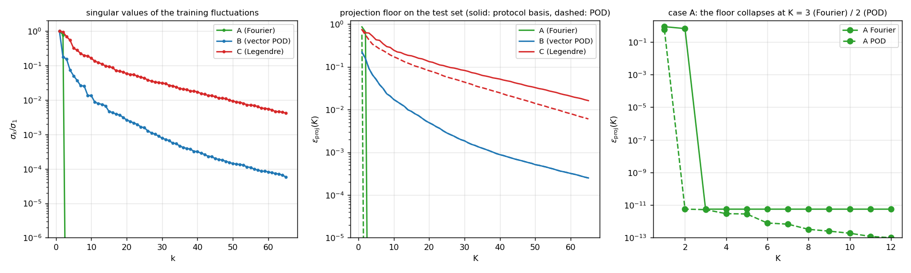
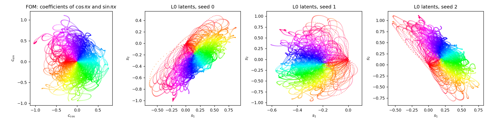
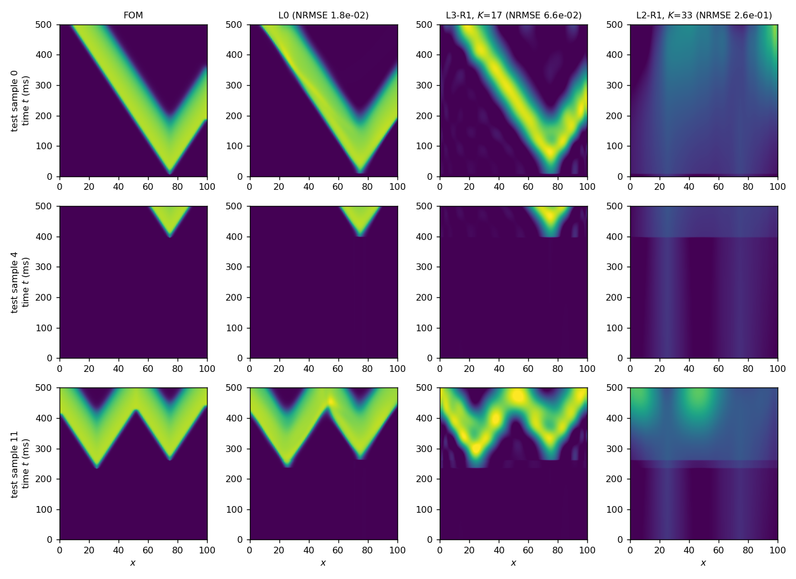
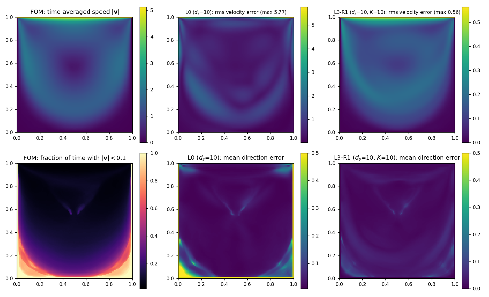
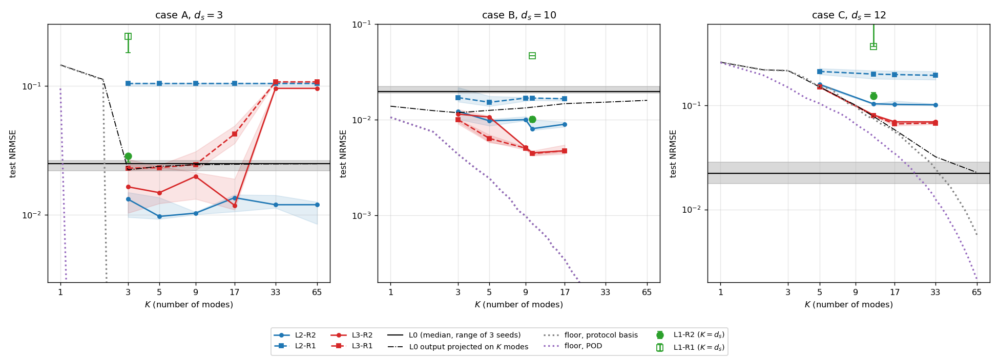
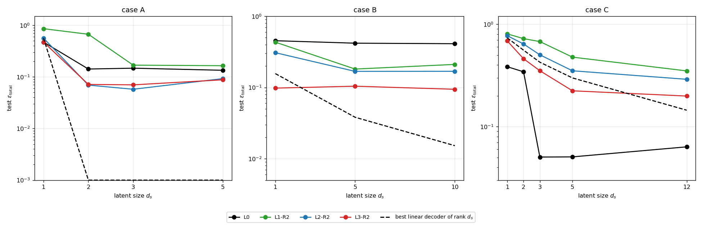
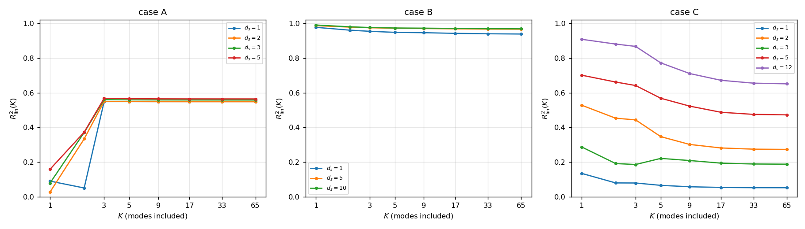
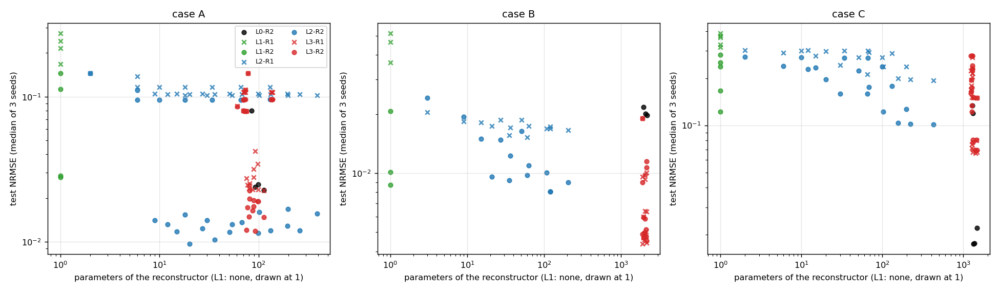

# RQ2 report: how much nonlinearity does the LDNet reconstructor need?

This document is the written report of the experiment defined in [`protocol.md`](protocol.md): an ablation in which only the reconstructor $\mathrm{NN}_{\mathrm{rec}}$ of a Latent Dynamics Network (LDNet) is replaced, step by step, by a linear expansion on a fixed spectral basis. It covers the three completed sweeps (Case A: `Case_A_ADR-1b/`, Case B: `Case_B_2D-Stokes/`, Case C: `Case_C_AP1D/`). It explains the mathematical reasons behind the design, presents the results, interprets them against the goal of the research question, compares what the three cases say about each reconstructor, and lists what the data can and cannot support.

Nothing was re-trained to write it. Every number below was recomputed from the stored results (`*/results/runs.csv`, `predictions.csv`, `modes.csv`, `weights/`, `latents/`) and from the data files. The script [`report_analysis.py`](report_analysis.py) produces all figures in [`figures/`](figures/) and prints all tables; its verbatim output is kept in [`figures/tables.md`](figures/tables.md). The script rebuilds the stored L0 decoders (and the stored decoders of the frozen-latent runs) in numpy from the saved weights and checks that they reproduce the NRMSE stored by the notebooks (to better than $10^{-9}$), so the extra analyses (spectral content, direction error, initial state, and so on) are computed on exactly the models that were trained.

**Contents.** [0 Summary](#0-summary) · [1 Question and framework](#1-question-and-framework) · [2 Mathematical design of the experiment](#2-mathematical-design-of-the-experiment) · [3 The three problems before any training](#3-the-three-problems-before-any-training) · [4 Results per case](#4-results-per-case) · [5 Cross-case synthesis](#5-cross-case-synthesis) · [6 Hypotheses scorecard](#6-hypotheses-scorecard) · [7 Insights for the community](#7-insights-for-the-community) · [8 Limitations and threats to validity](#8-limitations-and-threats-to-validity) · [9 Recommended next steps](#9-recommended-next-steps) · [10 Files and reproducibility](#10-files-and-reproducibility) · [References](#references)

---

## 0. Summary

**What was done.** The reconstructor of an LDNet maps the decoder input $\mathbf z(t)$ (the latent state $\mathbf s(t)$, plus the lid velocity $u(t)$ in Case B) and a query point $\mathbf x$ to the value of the field. We kept the latent dynamics $\mathrm{NN}_{\mathrm{dyn}}$, the data, the splits, the loss and the optimiser fixed, and compared four reconstructors: the original multilayer perceptron (**L0**), the identity on the first $d_s$ modes of a fixed basis (**L1**, no parameters), an affine map from the latent state to $K$ modes (**L2**), and a small neural network from the latent state to $K$ modes (**L3**, same number of parameters as L0). Each linear-basis variant was trained in two ways: with the latent trajectories of the trained L0 frozen (**R1**, only the new reconstructor is fitted) and end to end from scratch (**R2**). The basis is Fourier in Case A (a linear, periodic reaction–diffusion problem), the proper orthogonal decomposition (POD) of the training snapshots in Case B (a lid-driven cavity flow, Navier–Stokes), and Legendre polynomials in Case C (an excitable-tissue model with travelling fronts). The sweeps cover latent sizes $d_s$, numbers of modes $K$ and three seeds, for 348 + 195 + 273 = 816 runs.

**Headline numbers** (test NRMSE, median of three seeds, best configuration of each procedure selected on the validation set; the number of reconstructor parameters is in brackets):

| | Case A (smooth, linear) | Case B (Navier–Stokes cavity) | Case C (fronts) |
|---|---|---|---|
| L0, original decoder | $2.26\cdot10^{-2}$ (113) | $1.97\cdot10^{-2}$ (2186) | $1.76\cdot10^{-2}$ (1361) |
| L2-R2, affine in the modes | $9.7\cdot10^{-3}$ (20) | $8.1\cdot10^{-3}$ (119) | $1.01\cdot10^{-1}$ (429) |
| L3-R2, nonlinear map to the modes | $1.18\cdot10^{-2}$ (92) | $4.5\cdot10^{-3}$ (2134) | $6.9\cdot10^{-2}$ (1417) |
| ratio L2-R2 / L0 | 0.43 | 0.41 | 5.7 |
| ratio L3-R2 / L0 | 0.52 | 0.23 | 3.9 |
| reading | a linear decoder is enough if the dynamics are trained with it | linear is enough for the bulk, a nonlinear map to the coefficients still halves the error; L0 is the weakest at this budget | the nonlinear, non-separable decoder (L0) is needed |

The training budget is small in all three cases (50 Adam + 150 BFGS epochs in A, 200 + 500 in B and C, against 200 + 10000 and 200 + 5000 in the original scripts for B and C), so every statement about L0 in A and B is conditional on that budget; Section 8 explains how far each conclusion survives a longer training.

**Main findings.**

1. **The answer depends on how well a fixed basis fits the solution manifold, not on the type of PDE.** Where the basis is aligned with the physics (Case A, where the solution lies exactly in the span of $\cos\pi x$ and $\sin\pi x$) a linear decoder reaches the accuracy of L0 and, at equal training effort, beats it by a factor 2.3 with 5.6 times fewer parameters. Where the solution manifold is nearly linear and the POD spectrum decays fast (Case B) linear decoders are competitive, but a nonlinear map to the coefficients still gives an additional factor 1.8. Where the solution contains travelling fronts (Case C) no fixed-basis decoder with up to 33 modes gets closer to L0 than a factor 3.8 (R1) or 3.9 (R2).

2. **For a linear decoder the number of modes $K$ is the wrong knob. The latent size is the right one.** An affine map from a latent vector of size $r$ can only reach an affine subspace of dimension at most $r$, whatever $K$ is, so its error cannot fall below the error of the best $r$-dimensional POD subspace (Section 2.5). The data confirm it: in all three cases the error of L2 is flat in $K$ beyond a few modes (Case A, $d_s=3$: between $1.0$ and $1.4\cdot10^{-2}$ from $K=3$ to $K=65$), and in Case C the ratio between the achieved error and the projection floor grows from 1.06 at $K=5$ to 4.1 at $K=33$. A sweep over $K$ with a linear decoder is a sweep over $d_s$ in disguise.

3. **Nonlinear decoders break the linear barrier, but only when the manifold has few intrinsic degrees of freedom.** In Case C, L0 with three latent states has a relative error of 5.0%, which is the floor of a linear expansion with about 28 optimal modes (POD) or 41 Legendre modes. The best linear decoder with three latent states has a floor of 42.6%. Below three latent states L0 fails (relative errors 34–39%), above three it does not improve, and the latent spaces found by different seeds agree up to an affine map only from $d_s=3$ on (test $R^2$ of 0.97–0.99, against 0.02 at $d_s=1$).

4. **The latents learned by L0 contain the information but are not linear coordinates of the physical modes.** Fitting an affine decoder to the frozen L0 latents (R1) is 4.0–4.4 times worse than L0 in Case A and 6–11 times worse than the same decoder trained end to end; a small nonlinear decoder on the same latents recovers the accuracy of L0 (ratio 1.01 between the best configurations). The best affine function of the latents explains only 55% of the variance of L0's Fourier coefficients, a cubic polynomial 98%. The latent coordinates are information-complete but curved, and the nonlinearity of $\mathrm{NN}_{\mathrm{rec}}$ in the smooth case mostly absorbs this freedom of coordinates.

5. **At a small, equal training budget a fixed basis is a strong preconditioner, and it makes inference much cheaper.** In Case B, L3 reaches $4.5\cdot10^{-3}$ and L0 $2.0\cdot10^{-2}$ with the same budget, while the paper reports $1.4$–$4.1\cdot10^{-3}$ for L0 at twenty times more BFGS epochs. Evaluating the reconstructor on the test set takes 8–13 ms for the POD-based decoders and 0.93 s for L0 (Case B), 2–5 ms against 0.37 s in Case C. This says nothing yet about what a fully trained L0 would do in B.

6. **Truncated expansions are smooth and inherit linear invariants of the data; an implicit decoder does not.** In Case B the L0 output needs 41 POD modes to hold 99% of its energy, against 4 for the true flow, and its vorticity has a relative error of 0.89 (0.27 after truncation to three modes). The POD-based decoder has vorticity error 0.11 and a relative divergence of 0.070, identical to the data, while L0 gives 0.21–0.33.

7. **Details of the protocol matter more than expected.** Adding the mean field to L1 while the latent state starts at zero makes L1 predict the mean field, not the rest state, at $t=0$; in Case A, 54% of the squared error of L1 is made in the first 20 of the 201 time steps. The parameter-matching rule collapses the hidden width of L3 to one neuron for $K\ge33$ in Case A. The Fourier ordering with the constant function first makes $d_s=2$ structurally insufficient for L1. Section 8 lists all such effects.

8. **No reconstructor is best everywhere.** Dividing the error of every procedure by the best one of each case, L3-R2 has the smallest worst-case ratio among L0 and the end-to-end procedures (3.9), then L0 (4.5), L2-R2 (5.7) and L1-R2 (6.9); L3-R1, which reuses the L0 latents, is at 3.75. L2 wins where the basis fits, L3 wins in Case B, and L0 is the only one that wins when the physics needs a non-separable decoder.

---

## 1. Question and framework

### 1.1 The reconstructor in an LDNet

An LDNet predicts a field $y(\mathbf x,t)$ from an input signal $\mathbf u(t)$ in two steps. A small network drives a latent state of dimension $d_s$ by an ordinary differential equation, integrated with forward Euler from the rest state,

$$
\dot{\mathbf s}(t)=\mathrm{NN}_{\mathrm{dyn}}\big(\mathbf s(t),\mathbf u(t)\big),\qquad \mathbf s(0)=\mathbf 0 ,
$$

and a second network, the reconstructor, turns the latent state into the field at an arbitrary query point,

$$
\hat y(\mathbf x,t)=\mathrm{NN}_{\mathrm{rec}}\big(\mathbf z(t),\mathbf x\big),\qquad \mathbf z=\mathbf s\ \text{(Cases A and C)},\quad \mathbf z=[\mathbf s;u]\ \text{(Case B)} .
$$

In Case B the lid velocity $u(t)$ is also given to the reconstructor, as in the original script. The point $\mathbf x$ enters the reconstructor as an ordinary input, which is why LDNets work on any set of query points and can be trained on random subsets of the grid (200 random points per sample and time in Case B, 20 in Case C).

### 1.2 Two ways to look at the reconstructor

There are two equivalent views, and the experiment is built on the difference between them. In the first, the reconstructor is a **family of functions of $\mathbf x$** indexed by $\mathbf z$: as $\mathbf z$ runs over $\mathbb R^{d_s}$ the family sweeps a $d_s$-dimensional surface in the space of fields. Nothing forces the surface to be flat or to be aligned with prescribed functions of $\mathbf x$. In the second view, one fixes functions $\varphi_1,\dots,\varphi_K$ of $\mathbf x$ (a basis) and writes the prediction as a series,

$$
\hat y(\mathbf x,t)=\bar y(\mathbf x)+\sum_{k=1}^{K} c_k(\mathbf z(t))\,\varphi_k(\mathbf x),
$$

with a fixed mean field $\bar y$ (the mean of the training fields). All the spatial nonlinearity is then inside the fixed functions $\varphi_k$, and all the nonlinearity in the latent state is inside the coefficient map $\mathbf c(\mathbf z)$. The variants of the protocol differ only in this map:

| Variant | Coefficient map $\mathbf c(\mathbf z)$ | Trainable | Reachable set of fields |
|---|---|---|---|
| L0 | none: the original $\mathrm{NN}_{\mathrm{rec}}(\mathbf z,\mathbf x)$, no fixed basis | MLP | a nonlinear $d_s$-dimensional surface, not tied to any basis |
| L1 | $\mathbf c=\mathbf s$, $K=d_s$ | nothing | the fixed linear space spanned by the first $d_s$ modes |
| L2 | $\mathbf c=W\mathbf z+\mathbf b$ | $W\in\mathbb R^{K\times r}$, $\mathbf b\in\mathbb R^{K}$ | an affine subspace of dimension at most $r$ inside the span of $K$ modes |
| L3 | $\mathbf c=g_\theta(\mathbf z)$ | an MLP with as many parameters as L0 | a nonlinear $d_s$-dimensional surface inside the span of $K$ modes |

Here $r=d_s$ in Cases A and C and $r=d_s+1$ in Case B, where $u$ enters $\mathbf z$. Going from L1 to L2 releases the identification of each latent state with a modal amplitude and the constraint $K=d_s$; going from L2 to L3 releases the linearity in the latent state; going from L3 to L0 releases the fixed basis. Each step changes one thing, so a change in accuracy can be attributed to it.

### 1.3 Notation

$y$ is the true field (the full-order model, FOM) and $\hat y$ a prediction; $\bar y(\mathbf x)$ is the mean of the training fields over samples and times; $\varphi_k$ are basis functions orthonormal for the discrete inner product $\langle f,g\rangle_w=\sum_i w_i\,f(\mathbf x_i)\cdot g(\mathbf x_i)$ defined in Section 2.4; $c_k=\langle y-\bar y,\varphi_k\rangle_w$ are the coefficients of the true field and $\hat c_k$ those of a prediction; $P_K$ is the orthogonal projection on the first $K$ modes. The relative error and the projection floor are

$$
\varepsilon_{\mathrm{total}}=\frac{\lVert \hat y-y\rVert}{\lVert y\rVert},\qquad
\varepsilon_{\mathrm{proj}}(K)=\frac{\lVert (y-\bar y)-P_K(y-\bar y)\rVert}{\lVert y\rVert},
$$

with the norms taken over all test samples, times and points. The normalised root-mean-square error used by the LDNet paper is $\mathrm{NRMSE}=\sqrt{\operatorname{mean}(\hat y-y)^2}\,/\,(\max y-\min y)$. On a fixed test set the two are proportional, $\mathrm{NRMSE}=c\,\varepsilon_{\mathrm{total}}$, with $c=0.1686$ (A), $0.0480$ (B) and $0.3484$ (C); the script checks this proportionality on every run. The Pearson dissimilarity $1-\rho$ is reported as in the notebooks.

---

## 2. Mathematical design of the experiment

This section gives the reason for each choice of the protocol in mathematical terms. How the notebooks implement them is described in the notebooks themselves.

### 2.1 Why a reconstructor ablation: linear against nonlinear approximation

Let $\mathcal S$ be the set of all fields the system can visit. The **Kolmogorov $n$-width** of $\mathcal S$ is the smallest worst-case error that any $n$-dimensional linear space can achieve,

$$
d_n(\mathcal S)=\inf_{\dim V=n}\ \sup_{y\in\mathcal S}\ \mathrm{dist}(y,V).
$$

For a finite set of snapshots there is a sharp and constructive average version. Stack the centred snapshots in a matrix $Z$ and let $\sigma_1\ge\sigma_2\ge\dots$ be its singular values. By the Eckart–Young–Mirsky theorem, the span of the $n$ leading left singular vectors (the proper orthogonal decomposition, POD) is, among all $n$-dimensional linear subspaces, the one with the smallest mean-square distance to the snapshots, and that smallest value is $\sum_{k>n}\sigma_k^2$. If the singular values decay fast, as in smooth or diffusion-dominated problems, a few modes are enough. If they decay slowly, as in transport of sharp fronts (the translates of a front by more than its width are almost orthogonal to each other, so each position needs its own direction), many modes are needed.

Every decoder that is **linear in a fixed set of functions of $\mathbf x$** (L1, L2 and L3 here; DeepONet with a fixed trunk or PCA-Net elsewhere) is subject to this barrier, and for discontinuous solutions the barrier is a proven lower bound on the error [Lanthaler et al., 2022]. Decoders that move the functions with the state (autoencoders, and the L0 reconstructor $\mathrm{NN}_{\mathrm{rec}}(\mathbf z,\mathbf x)$, which is not a sum of products of a function of $\mathbf z$ and a function of $\mathbf x$) are not subject to it [Ohlberger and Rave, 2016; Lee and Carlberg, 2020]. The LDNet paper itself points to the slow decay for the electrophysiology problem. The ablation measures the practical size of this effect: the K-sweeps show how far the linear route goes, and L0 is the nonlinear reference. The four hypotheses of the protocol are the predictions of this picture: in Case A the manifold is exactly two-dimensional and linear (H1), in Case C the width decays slowly (H2), Case B sits in between (H3), and whether the latents are themselves linear coordinates is tested by comparing the two training regimes (H4).

### 2.2 The two training regimes

In **R2** (end to end) $\mathrm{NN}_{\mathrm{dyn}}$ and the reconstructor are trained together from scratch with the original pipeline. This answers the practical question of what a model with a given decoder family can reach when the latent coordinates are free to adapt to it. In **R1** (frozen latents) the latent trajectories $\mathbf s(t)$ of the trained L0 with the same $(d_s,\text{seed})$ are stored and only the new decoder is fitted. This is a different question: whether the latent coordinates that L0 discovered contain what the new decoder needs, in the form it needs. Two cases are informative. If $R1\approx R2$, the latents of L0 are as good for that decoder as latents trained for it, so the information they carry does not depend on the decoder. If $R1\gg R2$, the decoder cannot read the L0 latents in its own terms, for instance because they are not the modal amplitudes an identity or affine map assumes. This is how H4 is stated in the protocol.

A mathematical fact makes R1 clean for the affine decoder. The L2 decoder is linear in its parameters $(W,\mathbf b)$, so with the loss of Cases A and C (squared error plus a Tikhonov term) the fit in R1 is a regularised linear least-squares problem: the loss is a quadratic function of the parameters, convex, with a unique minimiser that the optimiser finds up to its tolerance. Orthonormality of the basis adds that the squared error of the field inside the span is the squared error of the coefficients (Parseval, Section 2.4; for the random points of the training set of Case C it holds in expectation), so the problem is also the least-squares fit of the modal coefficients. For L1 there is nothing to fit, the formula is simply evaluated. In Case B the direction term of the loss makes the problem non-convex also for L2.

### 2.3 The mean field and the initial state

Every variant with a fixed basis adds the mean $\bar y(\mathbf x)$ of the training fields (over samples and times), which is not trained. There are three reasons. The POD optimality statement above is about centred data; without centring, the first singular vector mostly rediscovers the mean and wastes a mode. The affine variants need an offset, and with centred data the offset $\mathbf b$ has a clear meaning. And a fixed mean field does not give L1–L3 an extra trainable function of $\mathbf x$ that L0 would not have.

The price is paid at the initial time. All fields of the three problems start at rest, $y(\cdot,0)=0$, and the latent state starts at $\mathbf s(0)=\mathbf 0$, so the prediction of the variants with a mean field at $t=0$ is $\hat y(\cdot,0)=\bar y+\sum_k c_k(\mathbf 0)\varphi_k$. L2 and L3 can cancel the part of $\bar y$ that lies in their span through the offset $\mathbf b$ or $g_\theta(\mathbf 0)$. L1 cannot: $\mathbf c=\mathbf s=\mathbf 0$ gives $\hat y(\cdot,0)=\bar y$, a mean field instead of the rest state. The root-mean-square of $\bar y$ is 0.52, 0.18 and 0.48 times that of the field in Cases A, B and C, so the effect is not small; its measured size is in Section 5.4.

### 2.4 Orthonormal bases and the discrete inner product

All errors are measured on a grid, so all bases are orthonormalised **on the grid** with the discrete inner product

$$
\langle f,g\rangle_w=\sum_{i} w_i\,f(\mathbf x_i)\cdot g(\mathbf x_i),
$$

where $w_i$ are quadrature weights: the uniform cell size $h=0.02$ in Case A (periodic grid), $h=\mathrm{d}x\,\mathrm{d}y=(1/99)^2$ in Case B (uniform $100\times100$ Cartesian grid, verified from the data), and trapezoidal weights in Case C ($2/100$ in the interior of $[-1,1]$ and $1/100$ at the two end points, since the grid contains both end points and the boundary conditions are of Neumann type). With $\langle\varphi_j,\varphi_k\rangle_w=\delta_{jk}$ the coefficients of a field are obtained by plain projection, $c_k=\langle y-\bar y,\varphi_k\rangle_w$, they coincide with the least-squares coefficients, the error energy splits mode by mode (Parseval), and the first $K$ modes of a nested family do not change when $K$ grows. Orthogonality in the continuous sense would not be enough: for the Legendre polynomials normalised in the continuous $L^2$ product, the Gram matrix of the trapezoidal sum on 101 points has off-diagonal entries up to 0.04 for degrees below 10, 0.2 below 17, 0.5 below 33 and above 1 below 65 (it is numerically singular for 65 functions), so Case C uses a weighted QR factorisation of the Legendre Vandermonde matrix, which keeps the span of the first $K$ columns equal to that of the Legendre polynomials of degree below $K$ and makes the discrete orthonormality exact. In Case A the Fourier functions are exactly orthonormal for the sum over the periodic grid (up to 99 functions); the notebook asserts it.

### 2.5 The projection floor, the efficiency ratio and the rank bound

For any prediction $\hat y-\bar y$ in the span of the first $K$ modes, Pythagoras in the discrete inner product gives

$$
\lVert y-\hat y\rVert^2=\underbrace{\sum_{k>K}c_k^2}_{\text{outside the span}}+\underbrace{\sum_{k\le K}(c_k-\hat c_k)^2}_{\text{wrong coefficients}},
\qquad\text{i.e.}\qquad
\varepsilon_{\mathrm{total}}^2=\varepsilon_{\mathrm{proj}}^2+\varepsilon_{\mathrm{coef}}^2 .
$$

The **projection floor** $\varepsilon_{\mathrm{proj}}(K)$ is therefore the smallest error any model whose output lies in the span can reach, whatever its training. It is computed before and independently of any training. The **efficiency ratio** $\varepsilon_{\mathrm{total}}/\varepsilon_{\mathrm{proj}}=\sqrt{1+\varepsilon_{\mathrm{coef}}^2/\varepsilon_{\mathrm{proj}}^2}\ge1$ tells whether the basis or the learned coefficients limit the model: a value near 1 means that the dynamics and the coefficient map are as good as the basis allows and the basis is the bottleneck; a large value means the opposite.

The floor does not tell the whole story for the affine decoder, because it only accounts for the span of the modes and not for the dimension of the set of fields that the decoder actually reaches. This is the content of the following statement, which is what makes the K-sweep of L2 close to uninformative.

> **Proposition (rank bound).** Let the decoder input be $\mathbf z\in\mathbb R^r$ and the decoder be affine in $\mathbf z$ with values in the span of $K$ modes, $\hat y-\bar y=\Phi_K(W\mathbf z+\mathbf b)$ (L2). Then, whatever $K$, every field it can produce lies in the affine subspace $\Phi_K\mathbf b+\mathrm{range}(\Phi_KW)$ of dimension at most $\min(r,K)$, and on any set of centred training snapshots with singular values $\sigma_1\ge\sigma_2\ge\cdots$ its summed squared error is at least $\sum_{k>r}\sigma_k^2$.

The proof is the Eckart–Young–Mirsky theorem: among all affine subspaces of dimension at most $r$, the one through the mean of centred data spanned by the $r$ leading singular vectors has the smallest summed squared distance to the data. Here $r=d_s$ in Cases A and C and $r=d_s+1$ in Case B, because the lid velocity enters the decoder. For the other variants the bounds are: L1 is confined to the fixed span of $d_s$ modes, so its error is at least $\varepsilon_{\mathrm{proj}}(d_s)$; L3 reaches a curved $d_s$-dimensional surface inside the span of $K$ modes, which can come arbitrarily close to data lying on a $d_s$-dimensional manifold, so the only unconditional bound is $\varepsilon_{\mathrm{proj}}(K)$; L0 has no bound of this kind. Two consequences matter for the interpretation. First, L2 can improve with $K$ only while $K$ is of the order of $r$, and for larger $K$ its error is capped by $r$, so a K-sweep with a linear decoder is a sweep over the latent size in disguise. Second, the statement holds for any amount of training, so it is not affected by the reduced budgets of Cases B and C. On the test set the bound is used as a proxy: the **rank floor** is the error of the first $r$ POD modes, computed on the training data, evaluated on the test snapshots. It overestimates the best possible floor on the test set (the SVD of the test fluctuations themselves) by 0.1–1.7% in Case C, 1–13% in Case B and 5% at $r=1$ in Case A, and no conclusion of this report changes if the test-optimal floors are used instead (the ratios to the floor quoted below grow by these percentages). It is plotted in Figure 3 and tabulated in Section 5.1.

### 2.6 The basis chosen in each case

**Case A, Fourier.** The equation is linear with periodic boundary conditions and a forcing of fixed spatial frequency. Fourier modes diagonalise the operator $-\mu_1\partial_{xx}+\mu_3$, and the solution is exactly $z(x,t)=a(t)\cos\pi x+b(t)\sin\pi x$: after removing the mean field the manifold has linear dimension 2. This is the best possible case for a linear decoder, so a failure of the linear variants in Case A cannot be blamed on the representation, only on the dynamics, the latent coordinates or the optimisation. The basis is ordered as $\{1/\sqrt2,\cos\pi x,\sin\pi x,\cos2\pi x,\dots\}$. Because the constant function comes first and carries no energy once the mean field is subtracted, the floor drops to round-off only at $K=3$, and L1 with $d_s=2$ spans $\{1/\sqrt2,\cos\pi x\}$ and cannot represent $\sin\pi x$ (floor 0.658).

**Case B, vector POD.** The cavity flow has corner singularities and no analytic basis. The POD of the training snapshots is, by the theorem above, the most favourable linear basis that can be built from the data: no linear decoder with $K$ modes can have a smaller average error on the training data. The velocity $(v_x,v_y)$ is treated as one vector field with the joint inner product $\int \mathbf v\cdot\mathbf w\,\mathrm d\mathbf x$, so the modes are vector fields. A linear combination of divergence-free snapshots is divergence free, so the POD decoders inherit the incompressibility of the data up to the discretisation error, a property the original reconstructor does not have (Section 5.4). The basis is computed from the training set only (no leakage) with the snapshot method: eigenvectors of the $1680\times1680$ Gram matrix of the mean-subtracted snapshots (every 5th time step of the 80 training samples; consecutive snapshots at $\Delta t=0.2$ are so correlated that the stride does not change the subspace), rescaled to be orthonormal for the discrete product.

**Case C, Legendre.** The domain is not periodic and the boundary conditions are of Neumann type, so a Fourier basis would suffer from the periodic extension, which is discontinuous in the derivative. Polynomial bases need no periodicity. We chose Legendre rather than Chebyshev because Legendre polynomials are orthogonal for the uniform weight, which is exactly the $L^2$ product in which the error is measured: the truncated series is the best $L^2$ approximation by polynomials. Chebyshev polynomials are orthogonal for the weight $(1-x^2)^{-1/2}$, which over-weights the boundary, and give instead a near-minimax approximation; their fast transforms are of no use on 101 points. For functions analytic in a neighbourhood of the interval the Legendre coefficients decay geometrically, but the rate is governed by how close the singularities of the analytic continuation are to the interval: a smooth front of width $\delta$ has them at a distance proportional to $\delta$, so the decay is geometric but very slow at the values of $K$ that matter here. Figure 1 shows exactly this.

### 2.7 Levels of the sweep, matched parameters and the selection rule

The numbers of modes $K\in\{3,5,9,17,33,65\}=2^m+1$ are nested dyadic levels, equally spaced in $\log K$, so that geometric and algebraic decay appear as a straight line on a semi-logarithmic or logarithmic plot and each level doubles the resolution; every $d_s$ also adds $K=d_s$ (the L1 value). Cases B and C used truncated lists for cost: $K\le17$ in B and $K\le33$ in C. The latent sizes are chosen around the intrinsic dimension: $\{1,2,3,5\}$ in Case A (below, at and above the exact dimension 2), $\{1,5,10\}$ in Case B as in the LDNet paper, and $\{1,2,3,5\}$ plus the original value 12 in Case C.

The network of L3 has two hidden layers of width $w$, and $w$ is the largest value for which $g_\theta$ has no more parameters than the L0 reconstructor. The reason is that a nonlinear decoder with more parameters would confound the effect of the structure (fixed basis) with that of the capacity. A consequence is that the output layer, $(w+1)K$ parameters, dominates for large $K$ and $w$ shrinks: in Case A it is 6 at $K=3$, 3 at $K=17$ and 1 for $K\ge33$. In Cases B and C the L0 decoder is larger (about 2000 and 1400 parameters) and $w$ stays between 33 and 41 (B) and between 21 and 34 (C). The notebooks flag that large-$K$ points of L3 in Case A measure this bottleneck and not the basis.

The best configuration of each procedure (a variant with a regime) is the pair $(d_s,K)$ with the lowest **validation** NRMSE, median over the seeds; the test set is never used for selection, since selecting among tens of configurations on the test set biases the reported error downward. Three seeds are used; their spread is reported as minimum and maximum, because with three values an interquartile range is only an interpolation.

### 2.8 Metrics

The primary metrics are the NRMSE and $1-\rho$ of the notebooks, computed on denormalised fields; the relative error $\varepsilon_{\mathrm{total}}$, which divides by the energy of the field instead of by its range and is the natural unit for the floors; the efficiency ratio; and the per-mode error $\lVert\hat c_k-c_k\rVert$ over all test samples and times. Case B adds the **direction error** $\operatorname{mean}\lVert\mathbf d(\hat{\mathbf v})-\mathbf d(\mathbf v)\rVert^2$ with $\mathbf d(\mathbf v)=\mathbf v/(10^{-4}+\lVert\mathbf v\rVert)$ (the loss term of the original script), the **vorticity error** (relative $L^2$ error of $\partial_xv_y-\partial_yv_x$ by central differences), and the **extrapolation ratio** $\varepsilon_{[20,40]}/\varepsilon_{[0,20]}$. Case C adds the **activation-time error**, the mean absolute difference in milliseconds of the first time at which the potential reaches 0.5, over the grid points where the true front arrives. Cost is the number of reconstructor parameters, the training time, and the time to evaluate the reconstructor on the test latents.

The analyses of the trained L0 decoder in Sections 5.2–5.4 are additions to the protocol (its Section 9 describes them): the **linearizability index**

$$
R^2_{\mathrm{lin}}(K)=1-\frac{\sum_t\lVert\hat{\mathbf c}_{1:K}(t)-W\mathbf z(t)-\mathbf b\rVert^2}{\sum_t\lVert\hat{\mathbf c}_{1:K}(t)-\overline{\hat{\mathbf c}}_{1:K}\rVert^2},
$$

the fraction of the variance of L0's first $K$ spectral coefficients explained by the best affine function of the decoder input (an index near 1 means that $\mathrm{NN}_{\mathrm{rec}}$ behaves as an L2 decoder on the states it sees); the **spectral width** $K_{99}$, the smallest $K$ for which the first $K$ modes hold 99% of the energy of $\hat y(\cdot,t)-\bar y$ among the first 65 modes; the error of L0's output projected on its first $K$ modes; and the agreement of the latent spaces of different seeds by the test $R^2$ of the best affine map between them.

### 2.9 Training budget and the status of L0 as a baseline

The loss, the optimiser (Adam with learning rate $10^{-2}$, then BFGS) and the absence of early stopping (the weights of the last epoch are used) are the same for every variant. The budgets are 50 Adam + 150 BFGS epochs in Case A (the budget of the original notebook, which the refactored L0 reproduces exactly: seed 0, $d_s=2$, test NRMSE $2.44\cdot10^{-2}$), and 200 + 500 in Cases B and C, instead of the 200 + 10000 and 200 + 5000 of the original scripts, because the 195 and 273 runs of the sweeps would not have been affordable otherwise. Two facts show that these budgets are far from convergence for L0. The pilot recorded in the protocol (Section 7) gave a test NRMSE of $1.4$–$1.6\cdot10^{-2}$ for L0 in Case B with 1000 BFGS epochs, against $\approx4\cdot10^{-3}$ at the full budget, while 500 epochs give $2.2\cdot10^{-2}$ ($d_s=1$). And in the supplementary information of the LDNet paper (Test Case 1a, a smooth case similar to our Case A) the test NRMSE of an L0-type decoder falls from $1.2\cdot10^{-3}$ to $7.2\cdot10^{-5}$ to $1.9\cdot10^{-5}$ when the BFGS epochs go from 500 to 5000 to 50000. L0 is the variant whose spatial structure and coefficient map are learned together, and its error is dominated by optimisation, so a small fixed budget penalises it more than the variants whose spatial structure is given. Every comparison with L0 below is therefore a comparison **at equal and small training effort**, which is a legitimate and useful question but not the asymptotic one. Where an argument does not depend on the budget (the floors, the rank bound) it is marked as such.

### 2.10 What three seeds can support

Three seeds do not allow conventional significance tests. The exact two-sided Wilcoxon signed-rank test on three pairs has a smallest attainable $p$-value of $2/2^3=0.25$, and a permutation test between two groups of three seeds has a smallest two-sided $p$-value of $2/\binom{6}{3}=0.10$ (one-sided 0.05), reached only when the groups are completely separated. The protocol states that effect sizes and consistency across seeds weigh more than $p$-values; we therefore report medians, ranges, ratios of medians, and a flag "separated" when the three seeds of a procedure all lie on one side of the three seeds of L0.

---

## 3. The three problems before any training

Before any network is trained, the data say what a linear decoder can and cannot do. Table 1 summarises the three problems and the experiment; Figure 1 and Table 2 give the singular values of the centred training snapshots and the projection floors on the test set.

**Table 1. The three test cases and the settings of the sweeps.**

| | Case A: `Case_A_ADR-1b` | Case B: `Case_B_2D-Stokes` | Case C: `Case_C_AP1D` |
|---|---|---|---|
| Physics | linear advection–diffusion–reaction, periodic, forcing $A(t)\cos(\pi x-P(t))$; solution exactly in $\mathrm{span}\{\cos\pi x,\sin\pi x\}$ | incompressible Navier–Stokes in the lid-driven cavity $[0,1]^2$, lid velocity $u(t)$, Reynolds number up to about 1500 (the folder is named `Case_B_2D-Stokes`, the equations are the full Navier–Stokes ones) | monodomain + Aliev–Panfilov in 1D, $L=100$, Neumann: travelling fronts, collisions, fast–slow dynamics |
| Output | scalar $z(x,t)$ | vector $(v_x,v_y)$ | scalar potential in $[0,1.2]$ |
| Grid | 100 points, $h=0.02$, periodic | $100\times100$ uniform Cartesian, $h=1/99$ | 101 points on $[0,100]$, $h=1$ (every 8th node), both end points |
| Time | stored every 0.1, resampled linearly to $\Delta t=0.05$: 201 instants | $\Delta t=0.2$: 101 instants (train, valid), 201 (test, $T=40$) | $\Delta t=1$ ms: 501 instants |
| Samples train / valid / test | 100 / 100 / 100 | 80 / 20 / 10 | 100 / 100 / 200 |
| Input | $(A(t),P(t))$ | lid velocity $u(t)$ | two pulse trains $(I_{\mathrm{app},1},I_{\mathrm{app},2})$ |
| Points used in training | all | 200 random per (sample, time) | 20 random per (sample, time) |
| $\mathrm{NN}_{\mathrm{dyn}}$ | 10–10–$d_s$ | 7–7–$d_s$ on $(\mathbf s,u)$ | 8–$d_s$, with an offset so that $\mathbf s=\mathbf 0$ is at rest |
| L0 decoder | 7–7–1 (92 parameters at $d_s=2$) | $24^4\to2$ with tail compression (1970 at $d_s=1$) | $17^5\to1$ (1480 at $d_s=12$) |
| Loss | MSE + $10^{-5}$ Tikhonov | MSE + 0.1 direction MSE | MSE + $4.7\cdot10^{-3}$ Tikhonov |
| Budget (Adam + BFGS epochs) | 50 + 150 | 200 + 500 | 200 + 500 |
| Basis | Fourier | vector POD | Legendre |
| $d_s$ levels | 1, 2, 3, 5 | 1, 5, 10 | 1, 2, 3, 5, 12 |
| $K$ levels | $d_s$, 3, 5, 9, 17, 33, 65 | $d_s$, 3, 5, 9, 17 | $d_s$, 5, 17, 33 |
| Runs (all with 3 seeds) | 348 | 195 | 273 |
| rms of $\bar y$ divided by rms of $y$ | 0.52 | 0.18 | 0.48 |



*Figure 1. Left: singular values of the centred training snapshots, normalised by the first one (an empirical proxy of the Kolmogorov $n$-width). Centre: projection floor $\varepsilon_{\mathrm{proj}}(K)$ on the test set for the basis of the protocol (solid) and for the optimal linear basis, the POD (dashed). Right: zoom on Case A, where the floor collapses to round-off at $K=2$ (POD) and $K=3$ (Fourier).*

**Table 2. Projection floor $\varepsilon_{\mathrm{proj}}(K)$ on the test set (relative to $\lVert y\rVert$; multiply by $c$ of Section 1.3 to obtain NRMSE).**

| $K$ | A, Fourier | A, POD | B, vector POD | C, Legendre | C, POD |
|---|---|---|---|---|---|
| 1 | 0.860 | 0.565 | 0.2215 | 0.743 | 0.737 |
| 2 | 0.658 | $6\cdot10^{-12}$ | 0.1563 | 0.628 | 0.559 |
| 3 | $6\cdot10^{-12}$ | $5\cdot10^{-12}$ | 0.0910 | 0.617 | 0.426 |
| 5 | $6\cdot10^{-12}$ | $3\cdot10^{-12}$ | 0.0509 | 0.429 | 0.299 |
| 10 | $6\cdot10^{-12}$ | $2\cdot10^{-13}$ | 0.0172 | 0.245 | 0.172 |
| 17 | $6\cdot10^{-12}$ | $3\cdot10^{-14}$ | 0.00721 | 0.159 | 0.0989 |
| 33 | $6\cdot10^{-12}$ | $2\cdot10^{-15}$ | 0.00144 | 0.0706 | 0.0359 |
| 65 | $6\cdot10^{-12}$ | $1\cdot10^{-15}$ | $2.5\cdot10^{-4}$ | 0.0162 | 0.0060 |
| smallest $K$ with floor $\le$ 10% / 5% / 1% | 3 / 3 / 3 | 2 / 2 / 2 | 3 / 6 / 14 | 26 / 41 / >65 | 17 / 28 / 57 |

The floors reproduce the values stored by the notebooks for every $K$ of the sweeps (checked by the script), and are extended here to all $K\le65$.

**Case A is exactly linear.** After the mean field is removed the training snapshots have two non-zero singular values, $\sigma_2/\sigma_1=0.78$ and $\sigma_3/\sigma_1\approx10^{-11}$, so the solution manifold lies in a two-dimensional linear space and any basis containing $\cos\pi x$ and $\sin\pi x$ has a floor at round-off level ($6\cdot10^{-12}$, the error of the analytic basis on the grid). The mean field is not small: its rms is 0.52 times the rms of the solution. From $K=3$ on the efficiency ratio is of order $10^{10}$ and carries no information: all the error of any linear variant with $K\ge3$ comes from the dynamics or the coefficient map. With the protocol ordering, the first two functions $\{1/\sqrt2,\cos\pi x\}$ leave a floor of 0.658.

**Case B decays geometrically.** The singular values fall like $e^{-0.1k}$: $\sigma_2/\sigma_1=0.175$, $\sigma_5/\sigma_1=0.050$, $\sigma_{10}/\sigma_1=0.013$, $\sigma_{17}/\sigma_1=0.0039$, $\sigma_{65}/\sigma_1=5.8\cdot10^{-5}$. One POD mode already reduces the error to 22% of the field norm, three modes to 9.1%, six modes to 3.8% and 14 modes to 1%. The protocol basis is the POD itself, so the two floors coincide. Linear decoders have no representational problem here, provided the latent dynamics deliver good coefficients.

**Case C decays slowly.** The first singular values stay close to each other ($\sigma_2/\sigma_1=0.94$, $\sigma_3/\sigma_1=0.69$, $\sigma_5/\sigma_1=0.32$) and from $k=10$ to $k=65$ they fall by a factor 39 only, against 230 in Case B. At $k=10$, $\sigma_{10}/\sigma_1$ is 0.16 in C and 0.013 in B. A floor of 10% needs 26 Legendre modes (17 POD modes), 5% needs 41 (28) and 1% needs more than 65 (57). This is the signature of travelling fronts. The gap between the Legendre and the POD floor, a factor between 1.6 and 2.7 for $K\ge17$, is the price of a generic basis that does not know the data; the $K$ of the sweep ($\le33$) stops where the floor is still 7.1% (Legendre) and 3.6% (POD).

The floors are **necessary** conditions. They can prove that a linear decoder cannot work (Case C) but they cannot show that it can (Case B has tiny floors and large errors, Section 4.3). The efficiency ratio and the rank bound of Section 2.5 are the tools that connect them to the results.

---

## 4. Results per case

In all tables the test NRMSE is the median over the three seeds, with the minimum and maximum in brackets; "ratio to L0" divides the median of a procedure by the median of the best L0 configuration; "separated" means that the three seeds of the procedure all lie on one side of the three seeds of L0. The best configuration of each procedure is chosen on the validation NRMSE. $d_s$ is the latent size and $K$ the number of modes. The quantities used below are in [`figures/tables.md`](figures/tables.md).

### 4.1 Case A: smooth and linear (`Case_A_ADR-1b`)

**Setting.** The solution is exactly in the span of $\cos\pi x$ and $\sin\pi x$ (Section 3), the basis is Fourier, and the budget is the 50 + 150 epochs of the original notebook. The question of Case A is whether a decoder that is linear in the right modes matches L0. Hypothesis H1 states that it does for $K\le5$ (falsified if $\mathrm{NRMSE}_{\mathrm{L2}}>1.5\,\mathrm{NRMSE}_{\mathrm{L0}}$).

**Table A1. Best configuration of each procedure.**

| Procedure | $d_s$ | $K$ | params | test NRMSE | ratio to L0 | separated |
|---|---|---|---|---|---|---|
| L0 | 5 | – | 113 | $2.26\cdot10^{-2}$ [$1.96$, $2.65$]$\cdot10^{-2}$ | 1.00 | – |
| L1-R1 | 1 | 1 | 0 | $1.68\cdot10^{-1}$ [$1.64$, $1.80$]$\cdot10^{-1}$ | 7.41 | yes |
| L1-R2 | 3 | 3 | 0 | $2.85\cdot10^{-2}$ [$2.57$, $2.88$]$\cdot10^{-2}$ | 1.26 | no |
| L2-R1 | 5 | 3 | 18 | $1.02\cdot10^{-1}$ [$1.01$, $1.02$]$\cdot10^{-1}$ | 4.52 | yes |
| L2-R2 | 3 | 5 | 20 | $9.7\cdot10^{-3}$ [$9.3\cdot10^{-3}$, $1.36\cdot10^{-2}$] | 0.43 | yes |
| L3-R1 | 3 | 3 | 87 | $2.30\cdot10^{-2}$ [$2.23$, $2.42$]$\cdot10^{-2}$ | 1.01 | no |
| L3-R2 | 3 | 17 | 92 | $1.18\cdot10^{-2}$ [$1.09$, $1.90$]$\cdot10^{-2}$ | 0.52 | yes |

**Table A2. L0 and L1 against the latent size.**

| $d_s$ | L0 | L1-R2 | L1-R1 |
|---|---|---|---|
| 1 | $7.98\cdot10^{-2}$ | $1.45\cdot10^{-1}$ | $1.68\cdot10^{-1}$ |
| 2 | $2.40\cdot10^{-2}$ | $1.13\cdot10^{-1}$ | $2.15\cdot10^{-1}$ |
| 3 | $2.49\cdot10^{-2}$ | $2.85\cdot10^{-2}$ | $2.42\cdot10^{-1}$ |
| 5 | $2.26\cdot10^{-2}$ | $2.78\cdot10^{-2}$ | $2.72\cdot10^{-1}$ |

**Table A3. Sweep over $K$ at $d_s=3$ (test NRMSE, median of 3 seeds).**

| | $K=3$ | $K=5$ | $K=9$ | $K=17$ | $K=33$ | $K=65$ |
|---|---|---|---|---|---|---|
| L2-R2 | $1.32\cdot10^{-2}$ | $9.7\cdot10^{-3}$ | $1.03\cdot10^{-2}$ | $1.36\cdot10^{-2}$ | $1.20\cdot10^{-2}$ | $1.20\cdot10^{-2}$ |
| L2-R1 | $1.04\cdot10^{-1}$ | $1.04\cdot10^{-1}$ | $1.04\cdot10^{-1}$ | $1.04\cdot10^{-1}$ | $1.04\cdot10^{-1}$ | $1.04\cdot10^{-1}$ |
| L3-R2 | $1.65\cdot10^{-2}$ | $1.48\cdot10^{-2}$ | $1.98\cdot10^{-2}$ | $1.18\cdot10^{-2}$ | $9.55\cdot10^{-2}$ | $9.55\cdot10^{-2}$ |
| L3-R1 | $2.30\cdot10^{-2}$ | $2.32\cdot10^{-2}$ | $2.45\cdot10^{-2}$ | $4.23\cdot10^{-2}$ | $1.07\cdot10^{-1}$ | $1.07\cdot10^{-1}$ |
| width of $g_\theta$ | 6 | 5 | 4 | 3 | 1 | 1 |

**L0.** The error is $8.0\cdot10^{-2}$ at $d_s=1$ and about $2.3$–$2.5\cdot10^{-2}$ for $d_s=2,3,5$: a plateau from the exact dimension two on, as the structure of the problem and the LDNet paper suggest. The refactored L0 reproduces the original notebook at its budget ($2.44\cdot10^{-2}$ for seed 0, $d_s=2$). The seeds range from $1.96$ to $2.65\cdot10^{-2}$.

**L1.** At $d_s=1$ and $2$ the error equals the floor (efficiency ratio 1.00 and 1.02: $\varepsilon_{\mathrm{total}}=0.860$ and $0.670$ against floors $0.860$ and $0.658$), as it must: the identity map cannot do better than the span it is confined to, and the constant function wastes the first slot. From $d_s=3$ on the floor is at round-off and L1 trained end to end reaches $2.8\cdot10^{-2}$, close to L0 but not separated from it. This number is partly an artifact of the protocol: the mean field makes $\hat y(\cdot,0)=\bar y$, and 54% of the squared error of L1-R2 is made in the first 20 of the 201 time steps (Section 5.4). With the latents of L0 frozen (R1), the identity map is useless (error 0.17–0.27): the latents of L0 are not the Fourier amplitudes.

**L2.** Trained end to end, the affine decoder with $d_s=3$ and $K=5$ has $9.7\cdot10^{-3}$, **0.43 times the error of L0 with 20 parameters instead of 113**, and its three seeds are all below the three seeds of L0. The error is flat in $K$ from $K=3$ to $K=65$ (between $1.0$ and $1.4\cdot10^{-2}$): this is the rank bound at work, the extra modes cannot be used by an affine map of three latent states, and the floor (at round-off) is not what limits the model. With the latents of L0 frozen (R1) the same decoder reaches only $1.02$–$1.04\cdot10^{-1}$ for every $K\ge3$ and every $d_s\ge3$. The reason is that the latent states of L0 are not affine functions of the Fourier coefficients (Section 5.2).

**L3.** Trained end to end, the nonlinear decoder is not better than the affine one ($1.2$–$2.0\cdot10^{-2}$ for $K\le17$): once the dynamics adapt to the modal basis, the map from latents to coefficients is close to affine and a nonlinear map has nothing to add. For $K\ge33$ its error jumps to $9.6\cdot10^{-2}$ because the parameter-matching rule has reduced the hidden width to one neuron: this measures the bottleneck of the network, not the basis. On the frozen latents of L0 (R1) the nonlinear decoder recovers the accuracy of L0 ($2.30\cdot10^{-2}$ at $K=3$, ratio 1.01), which shows that the latents of L0 do contain the information, in a form that needs a nonlinear read-out; its error also grows with $K$ because the width shrinks.

**Hypothesis H1.** The paired ratios of the L2 error to the L0 error at the same $d_s$ and seed are the following.

| $d_s$ | $K$ | L2-R2 / L0 | L2-R1 / L0 |
|---|---|---|---|
| 2 | 3 | 0.63 [0.52, 0.64] | 4.33 [4.31, 4.38] |
| 2 | 5 | 0.48 [0.48, 0.59] | 4.33 [4.31, 4.38] |
| 3 | 3 | 0.53 [0.44, 0.57] | 4.00 [3.96, 4.78] |
| 3 | 5 | 0.44 [0.37, 0.52] | 4.00 [3.96, 4.78] |
| 5 | 3 | 0.71 [0.58, 0.73] | 4.44 [3.87, 5.22] |
| 5 | 5 | 0.62 [0.61, 0.68] | 4.44 [3.87, 5.22] |

With the end-to-end regime a linear decoder with $K\le5$ is better than L0 in every pair, far from the 1.5 threshold of falsification; with frozen latents it is four times worse. H1 is therefore supported in R2 and falsified in R1 by the literal criterion. Section 5.2 discusses what the two regimes mean.

**Spectral content and latent geometry.** The spectral width of the L0 output is $K_{99}=3$, the same as the true solution, so L0 puts its energy in the right three modes; it leaves a spurious energy of between $10^{-4}$ and $2\cdot10^{-3}$ of the field energy in each of the modes 4–8, where the true field has none and the fixed-basis decoders that include these modes have at most $4\cdot10^{-5}$ (Figure 6). The linearizability index of the L0 decoder is 0.55–0.57 for every $d_s$ once the first three modes are included, and polynomial fits of its $(\cos,\sin)$ coefficients on the latents reach $R^2=0.56$ (degree 1), 0.89 (degree 2) and 0.98 (degree 3) at $d_s=3$; for the true coefficients the values are 0.53, 0.85 and 0.96. Figure 9 shows the L0 latents of three seeds against the Fourier coefficient plane. The latent clouds are sheared and stretched versions of the circular cloud of the true coefficients; the order of the phases is preserved, the radial scale is not. The latent spaces of different seeds are related to each other by near-affine maps (test $R^2$ between 0.95 and 0.99 for every $d_s$), so each seed finds the same curved coordinate system up to an affine change, a regularity we observed but did not explain.



*Figure 9. Case A. Left: coefficients of $\cos\pi x$ and $\sin\pi x$ of the test fields (after removing the mean field), coloured by the phase of the pair. Right: latent states of L0 ($d_s=2$) for three seeds on the same states, with the same colours.*

**Reading.** The representation is not the issue in Case A (floor $6\cdot10^{-12}$ for $K\ge3$), and every difference comes from how well and how fast the coordinates and the coefficient map are found. A linear decoder trained together with the dynamics makes the latent states modal and reaches 0.43 times the error of L0 with 5.6 times fewer parameters. L0 has to learn the sinusoidal shape and a suitable coordinate system together, and with 150 BFGS epochs it does not do it as well. For RQ2 this says that in the smooth case the nonlinearity of $\mathrm{NN}_{\mathrm{rec}}$ is not needed and mostly absorbs the freedom in the choice of the latent coordinates. What this does not say is how L0 compares after a long training: for the similar Test Case 1a the paper shows an error that decreases by more than an order of magnitude every time the BFGS epochs are multiplied by ten (Section 2.9).

### 4.2 Case C: travelling fronts (`Case_C_AP1D`)

**Setting.** The potential of an excitable tissue is a pair of travelling fronts that collide and are followed by slow repolarisation; the basis is Legendre, the budget is 200 + 500 epochs (the original script uses 5000 BFGS epochs), the Tikhonov weight is $4.7\cdot10^{-3}$, and the sweep uses $d_s\in\{1,2,3,5,12\}$ and $K\in\{d_s,5,17,33\}$. Hypothesis H2 states that L1 and L2 follow the projection floor, which decays slowly, that L3 does not close the gap, and that only L0 does; it is falsified if $\mathrm{NRMSE}_{\mathrm{L3}}(K{=}65)\le2\,\mathrm{NRMSE}_{\mathrm{L0}}$. The sweep stops at $K=33$, so this exact test could not be performed (see below).

**Table C1. Best configuration of each procedure.**

| Procedure | $d_s$ | $K$ | params | test NRMSE | ratio to L0 | separated |
|---|---|---|---|---|---|---|
| L0 | 5 | – | 1361 | $1.76\cdot10^{-2}$ [$1.58$, $3.27$]$\cdot10^{-2}$ | 1.00 | – |
| L1-R1 | 1 | 1 | 0 | $3.15\cdot10^{-1}$ [$3.02$, $3.20$]$\cdot10^{-1}$ | 17.9 | yes |
| L1-R2 | 12 | 12 | 0 | $1.22\cdot10^{-1}$ [$1.20$, $1.32$]$\cdot10^{-1}$ | 6.92 | yes |
| L2-R1 | 12 | 33 | 429 | $1.94\cdot10^{-1}$ [$1.76$, $2.12$]$\cdot10^{-1}$ | 11.0 | yes |
| L2-R2 | 12 | 33 | 429 | $1.01\cdot10^{-1}$ [$1.00$, $1.03$]$\cdot10^{-1}$ | 5.73 | yes |
| L3-R1 | 12 | 17 | 1417 | $6.62\cdot10^{-2}$ [$6.36$, $6.86$]$\cdot10^{-2}$ | 3.75 | yes |
| L3-R2 | 12 | 17 | 1417 | $6.93\cdot10^{-2}$ [$6.69$, $7.02$]$\cdot10^{-2}$ | 3.93 | yes |

**Table C2. L0 and L1 against the latent size.**

| $d_s$ | L0 | L1-R2 | L1-R1 |
|---|---|---|---|
| 1 | $1.34\cdot10^{-1}$ | $2.81\cdot10^{-1}$ | $3.15\cdot10^{-1}$ |
| 2 | $1.20\cdot10^{-1}$ | $2.52\cdot10^{-1}$ | $3.27\cdot10^{-1}$ |
| 3 | $1.76\cdot10^{-2}$ | $2.36\cdot10^{-1}$ | $3.85\cdot10^{-1}$ |
| 5 | $1.76\cdot10^{-2}$ | $1.66\cdot10^{-1}$ | $3.73\cdot10^{-1}$ |
| 12 | $2.21\cdot10^{-2}$ | $1.22\cdot10^{-1}$ | $3.65\cdot10^{-1}$ |

**Table C3. Sweep over $K$ at $d_s=12$ (test NRMSE, median of 3 seeds; efficiency ratio $\varepsilon_{\mathrm{total}}/\varepsilon_{\mathrm{proj}}$ of the end-to-end runs; width of $g_\theta$).**

| | $K=5$ | $K=12$ | $K=17$ | $K=33$ |
|---|---|---|---|---|
| L2-R2 | $1.59\cdot10^{-1}$ | $1.03\cdot10^{-1}$ | $1.02\cdot10^{-1}$ | $1.01\cdot10^{-1}$ |
| efficiency ratio of L2-R2 | 1.06 | 1.38 | 1.85 | 4.11 |
| L2-R1 | $2.11\cdot10^{-1}$ | $1.99\cdot10^{-1}$ | $1.97\cdot10^{-1}$ | $1.94\cdot10^{-1}$ |
| L3-R2 | $1.50\cdot10^{-1}$ | $8.09\cdot10^{-2}$ | $6.93\cdot10^{-2}$ | $6.93\cdot10^{-2}$ |
| efficiency ratio of L3-R2 | 1.00 | 1.08 | 1.26 | 2.82 |
| L3-R1 | $1.50\cdot10^{-1}$ | $7.99\cdot10^{-2}$ | $6.62\cdot10^{-2}$ | $6.74\cdot10^{-2}$ |
| width of $g_\theta$ | 30 | 27 | 25 | 21 |

**Table C4. Error of L1, L2, L3 divided by that of L0 at the same $d_s$ (end to end; median [min, max] over the three seeds).**

| $d_s$ | L1 ($K=d_s$) | L2 ($K=33$) | L3 ($K=17$) | L3 ($K=33$) |
|---|---|---|---|---|
| 3 | 13.5 [11.3, 16.3] | 10.1 [8.5, 14.0] | 7.5 [5.7, 8.6] | 6.4 [6.1, 10.2] |
| 5 | 9.2 [5.1, 10.5] | 7.2 [3.9, 7.6] | 4.3 [2.4, 5.2] | 4.7 [2.5, 5.0] |
| 12 | 6.0 [4.2, 6.9] | 4.6 [3.5, 5.8] | 3.0 [2.4, 4.0] | 3.2 [2.4, 3.9] |

**L0.** With one or two latent states L0 fails (0.134 and 0.120); with three it reaches $1.76\cdot10^{-2}$, and five or twelve states do not improve it ($1.76$ and $2.21\cdot10^{-2}$). The relative error at $d_s=3$ and $5$ is $\varepsilon_{\mathrm{total}}=0.050$, which a linear expansion reaches only with about 28 optimal (POD) modes or 41 Legendre modes (Section 3). Compared with the best possible linear decoder with the same number of latent states (the rank floor, Table 5.1), L0 is 8.5 times lower at $d_s=3$ (0.050 against 0.426) and 5.9 times lower at $d_s=5$ (0.051 against 0.299); at $d_s=12$ it is 2.3 times lower (0.063 against 0.145). The seeds are less consistent than for the other variants (at $d_s=5$ they range from $1.58$ to $3.27\cdot10^{-2}$). The original configuration $d_s=12$ gives $2.21\cdot10^{-2}$ against the $7.4\cdot10^{-3}$ of the paper, a factor 3.0 at one tenth of the BFGS epochs; the loose provisional gate of the notebook (five times the value of the paper) is met, but the value is not at the precision of the paper. What the three latent states encode was not tested here (that is a question for the interpretability study, RQ3).

**L1 and L2.** The identity map reaches at best 0.122 (with 12 latent states, 6.9 times L0). The affine decoder reaches 0.101 with $d_s=12$ and $K=33$ (5.7 times L0). Its error is flat in $K$ beyond $K\approx d_s$, while the floor keeps falling; the efficiency ratio grows from 1.06 at $K=5$ to 4.1 at $K=33$. This is the rank bound again: a decoder that is affine in 12 latent states can reach an affine subspace of dimension 12, and the best 12-dimensional linear subspace has a floor of 0.145 (NRMSE 0.050), already 2.3 times the error L0 has with the same number of states. The ratio to L0 grows when $d_s$ shrinks (4.6 at $d_s=12$, 7.2 at 5, 10.1 at 3), because L0 gets its accuracy from three states while a linear decoder with three states has a floor of 0.426. With the latents of L0 frozen (R1) the affine decoder gives 0.19–0.21, about twice the end-to-end error (ratio 1.9 at the best configuration).

**L3.** With the same number of parameters as L0, the nonlinear decoder on a fixed Legendre basis reaches $6.9\cdot10^{-2}$ at $d_s=12$, $K=17$, 3.0 times L0 (range 2.4–4.0). Its efficiency ratio is between 1.00 and 1.26 up to $K=17$: the basis is the bottleneck, as the Legendre floor at $K=17$ (relative error 0.1585) corresponds to an NRMSE of $5.5\cdot10^{-2}$ out of the $6.9\cdot10^{-2}$ observed. Going to $K=33$ (floor NRMSE $2.5\cdot10^{-2}$) does not help: the matched width falls from 25 to 21 and the output layer, $22\times33=726$ weights, takes about half of the 1461 parameters of that configuration. At $K=65$ the matched width would be 15. On the frozen latents of L0 (R1) the nonlinear decoder is as good as when trained end to end (ratio 0.96), so the latents of L0 are as useful to a different nonlinear decoder as latents trained for it; at $d_s=3$ the frozen latents are even better (ratio 0.58). The nonlinear decoder on the fixed basis is the best fixed-basis variant in Case C, and still 3 to 7.5 times worse than L0 whenever $d_s\ge3$.

**Activation time.** The mean absolute error of the arrival time of the fronts is 1.0 ms for L0 (range 0.9–1.5; the time step is 1 ms), 2.8 ms for L3, 5.1 ms for L2-R2, 8.3 ms for L1-R2 and 26.6 ms for L2-R1. Fixed-basis decoders locate the fronts in time correctly when the latents trigger them, but smear their shape (Figure 7).



*Figure 7. Case C. Three test samples (rows; horizontal axis $x$, vertical axis time) predicted from the same frozen latent states of an L0 run with $d_s=5$ by four decoders: the true potential, L0, L3 ($K=17$) and L2 ($K=33$). The fixed-basis decoders switch on at the right time, but only L0 draws the fronts.*

**Spectral content of L0.** The L0 output has a spectral width $K_{99}$ of 24–25 Legendre modes, equal to that of the true field (25), with an interquartile range of 3–30 against 3–31: L0 reproduces the width of the fronts without a fixed basis. The linearizability index is low and grows with $d_s$ ($R^2_{\mathrm{lin}}(K{=}33)=0.19$, 0.48 and 0.66 for $d_s=3,5,12$) and falls as more modes are included (0.87 for $K=3$ and 0.66 for $K=33$ at $d_s=12$): the low-order coefficients are almost affine in 12 latent states, the high-order ones, which describe the shape of the fronts, are not. Projecting the L0 output on $K$ Legendre modes gives an NRMSE of $5.8\cdot10^{-2}$ at $K=17$, $3.2\cdot10^{-2}$ at $K=33$ and $2.3\cdot10^{-2}$ at $K=65$ (the unprojected value is $2.2\cdot10^{-2}$): even a linear decoder able to extract the exact coefficients of the L0 output would lose a factor 1.45 with 33 modes. The latent spaces of different seeds agree up to an affine map only when the model works: the test $R^2$ is 0.02 for $d_s=1$, 0.64 for $d_s=2$ and 0.97, 0.985 and 0.99 for $d_s=3,5,12$, so the alignment of the latents across seeds is itself a diagnostic of an adequate latent size, and it changes where the error does.

**Hypothesis H2.** At $K=33$ the nonlinear decoder is 3.2 times worse than L0 at $d_s=12$ (range 2.4–3.9), 4.7 times at $d_s=5$ and 6.4 times at $d_s=3$, always above the factor 2 of the criterion, in every seed (Table C4). The literal criterion at $K=65$ was not tested; the floor at $K=65$ (NRMSE $5.6\cdot10^{-3}$ for Legendre) does not exclude a better result, but the matched width would be 15, which makes it unlikely that a 15-neuron network realises the 65 coefficients accurately. The first part of the hypothesis needs a correction: L1 and L2 do not follow $\varepsilon_{\mathrm{proj}}(K)$. They follow it only up to $K\approx d_s$ (efficiency ratio 1.06 at $K=5$) and then saturate at a level set by the rank, not by $K$.

**Reading.** Case C is where the answer to RQ2 is clearest. The fixed basis is the limiting factor for L3, the rank is the limiting factor for L2, and a decoder that places the fronts through the state itself, without a fixed set of functions, is the only one that works with a few latent states. We did not test whether that is because of the non-separable form (a front at a position that is a function of the state, such as a steep function of $x-a(\mathbf s)$, takes one hidden unit in $\mathrm{NN}_{\mathrm{rec}}$ and many terms in a sum of fixed functions) but it is the expected explanation, and the data (the cliff at $d_s=3$, the structure of Figure 7, the relative error of 5% with three states against the 28–41 modes of the floor) agree with it.

### 4.3 Case B: lid-driven cavity (`Case_B_2D-Stokes`)

**Setting.** The flow is driven by the lid velocity $u(t)$, which is also an input of the decoder ($\mathbf z=[\mathbf s;u]$); the test horizon $T=40$ is twice the training horizon, so the second half of every test trajectory is time extrapolation; the basis is the vector POD; the loss is the squared error plus 0.1 times the squared error of the flow direction; the budget is 200 + 500 epochs (the original script uses 10000 BFGS epochs); $\mathrm{NN}_{\mathrm{dyn}}$ is the 7–7 network of the original script for every $d_s$, and $K\le17$. Two differences with the paper must be kept in mind. Only the configuration $d_s=1$ coincides with the architecture that the paper tuned for it; for $d_s=5$ and $10$ the paper tuned larger networks ($\mathrm{NN}_{\mathrm{dyn}}$ with 1085 and 1188 parameters and $\mathrm{NN}_{\mathrm{rec}}$ with 3731 and 3698), while here the dynamics network has 145 and 220 parameters and the decoder 2066 and 2186. And the reference of the paper (test NRMSE $4.1$, $1.9$, $1.4\cdot10^{-3}$ for $d_s=1,5,10$) is obtained with twenty times more BFGS epochs.

**Table B1. Best configuration of each procedure.**

| Procedure | $d_s$ | $K$ | params | test NRMSE | ratio to L0 | separated |
|---|---|---|---|---|---|---|
| L0 | 10 | – | 2186 | $1.97\cdot10^{-2}$ [$1.89$, $2.25$]$\cdot10^{-2}$ | 1.00 | – |
| L1-R1 | 1 | 1 | 0 | $3.66\cdot10^{-2}$ [$2.93$, $6.02$]$\cdot10^{-2}$ | 1.86 | yes |
| L1-R2 | 5 | 5 | 0 | $8.69\cdot10^{-3}$ [$7.92$, $9.16$]$\cdot10^{-3}$ | 0.44 | yes |
| L2-R1 | 10 | 5 | 60 | $1.53\cdot10^{-2}$ [$1.39$, $1.77$]$\cdot10^{-2}$ | 0.77 | yes |
| L2-R2 | 5 | 17 | 119 | $8.06\cdot10^{-3}$ [$7.98$, $8.91$]$\cdot10^{-3}$ | 0.41 | yes |
| L3-R1 | 10 | 10 | 2134 | $4.43\cdot10^{-3}$ [$4.21$, $4.51$]$\cdot10^{-3}$ | 0.22 | yes |
| L3-R2 | 10 | 10 | 2134 | $4.52\cdot10^{-3}$ [$4.27$, $4.72$]$\cdot10^{-3}$ | 0.23 | yes |

**Table B2. L0 and L1 against the latent size.**

| $d_s$ | L0 | L1-R2 | L1-R1 |
|---|---|---|---|
| 1 | $2.17\cdot10^{-2}$ | $2.07\cdot10^{-2}$ | $3.66\cdot10^{-2}$ |
| 5 | $2.01\cdot10^{-2}$ | $8.69\cdot10^{-3}$ | $5.14\cdot10^{-2}$ |
| 10 | $1.97\cdot10^{-2}$ | $1.01\cdot10^{-2}$ | $4.66\cdot10^{-2}$ |

**Table B3. Sweep over $K$ at $d_s=10$ (test NRMSE, median of 3 seeds; efficiency ratio of the end-to-end runs; width of $g_\theta$).**

| | $K=3$ | $K=5$ | $K=9$ | $K=10$ | $K=17$ |
|---|---|---|---|---|---|
| L2-R2 | $1.23\cdot10^{-2}$ | $9.75\cdot10^{-3}$ | $1.00\cdot10^{-2}$ | $8.07\cdot10^{-3}$ | $8.99\cdot10^{-3}$ |
| efficiency ratio of L2-R2 | 2.8 | 4.0 | 10.2 | 9.8 | 26.0 |
| L2-R1 | $1.71\cdot10^{-2}$ | $1.53\cdot10^{-2}$ | $1.69\cdot10^{-2}$ | $1.69\cdot10^{-2}$ | $1.66\cdot10^{-2}$ |
| L3-R2 | $1.15\cdot10^{-2}$ | $1.07\cdot10^{-2}$ | $5.16\cdot10^{-3}$ | $4.52\cdot10^{-3}$ | $4.74\cdot10^{-3}$ |
| efficiency ratio of L3-R2 | 2.6 | 4.4 | 5.2 | 5.5 | 13.7 |
| L3-R1 | $1.00\cdot10^{-2}$ | $6.38\cdot10^{-3}$ | $5.05\cdot10^{-3}$ | $4.43\cdot10^{-3}$ | $4.75\cdot10^{-3}$ |
| width of $g_\theta$ | 39 | 38 | 36 | 36 | 33 |

**Table B4. Goal-oriented metrics of the best configurations (median of 3 seeds).**

| Procedure | direction error | vorticity error | extrapolation ratio $\varepsilon_{[20,40]}/\varepsilon_{[0,20]}$ |
|---|---|---|---|
| L0 | 0.051 | 0.887 | 0.974 |
| L1-R1 | 0.323 | 0.765 | 0.980 |
| L1-R2 | 0.048 | 0.241 | 0.968 |
| L2-R1 | 0.098 | 0.411 | 1.007 |
| L2-R2 | 0.028 | 0.232 | 1.065 |
| L3-R1 | 0.026 | 0.110 | 0.774 |
| L3-R2 | 0.025 | 0.123 | 0.747 |

**L0.** The error is $2.17$, $2.01$ and $1.97\cdot10^{-2}$ for $d_s=1,5,10$: practically flat in $d_s$, and 5.3, 10 and 14 times the paper's values. The dependence on $d_s$ that the paper reports is absent; with a small training budget and a dynamics network of fixed size (7–7 for every $d_s$) the extra latent states are not exploited. This L0 is not the converged baseline of the paper, and the gate of the notebook against the paper (seed 0, $d_s=1$: $2.26\cdot10^{-2}$ against $4.1\cdot10^{-3}$) remains provisional, as the notebook states.

**L1.** Trained end to end, the identity on the first POD modes reaches $8.7\cdot10^{-3}$ at $d_s=5$ (0.44 times L0, with no parameters in the decoder), $1.0\cdot10^{-2}$ at $d_s=10$, and $2.1\cdot10^{-2}$ at $d_s=1$, where the efficiency ratio is 1.95 above the one-mode floor of 0.2215. With the frozen latents of L0 the identity map is poor ($3.7$ to $5.1\cdot10^{-2}$): the latents of L0 are not the POD amplitudes. The initial-state mismatch of L1 is here a small part of its error (3% of the squared error in the first 20 steps, Section 5.4), because the mean field is only 18% of the field.

**L2.** The affine decoder reaches $8.1\cdot10^{-3}$ for $(d_s,K)=(5,17)$ and $8.07\cdot10^{-3}$ for $(10,10)$, 0.41 times L0 with 119 and 120 parameters, separated from L0 in all seeds. The error is flat in $K$ above $K=5$ and the efficiency ratio grows from 2.8 to 26 (Table B3). Unlike Case C, L2 is not at its rank floor in Case B: with $r=d_s+1=11$ the floor is 0.015 and the achieved relative error is 0.168, eleven times larger. The limit is therefore the quality of the coefficients that an affine map of the latent state and of the lid velocity can produce, not the number of modes and not the rank. With the frozen latents of L0 the affine decoder gives $1.5$–$1.7\cdot10^{-2}$, 0.77 times L0, which says that the L0 latents are read by an affine map about as well as by L0's own decoder (this is consistent with the linearizability index of L0 of 0.94–0.99).

**L3.** The nonlinear decoder on the POD basis reaches $4.5\cdot10^{-3}$ at $(d_s,K)=(10,10)$, 0.23 times L0 and 0.56 times the best affine decoder, with all seeds separated. Its error falls from $1.15\cdot10^{-2}$ at $K=3$ to $5.2\cdot10^{-3}$ at $K=9$ and then stays at $4.5$–$4.7\cdot10^{-3}$. Its efficiency ratio is 2.6–5.5 up to $K=10$: the coefficients, not the basis, are the bottleneck (the floor at $K=10$ is an NRMSE of $8\cdot10^{-4}$, about five times lower than the error). On the frozen latents of L0 the same decoder reaches $4.43\cdot10^{-3}$, so the latents are as good as co-trained ones (R1/R2 ratio 1.00). At $d_s=1$ the nonlinear decoder reaches a relative error of 0.098, below the rank floor of 0.156 of the best linear decoder with the same two inputs ($s$ and $u$): a nonlinear map beats every linear decoder with the same number of inputs. For $d_s=5$ and $10$ its error (0.104 and 0.094) is above the rank floors (0.038 and 0.015); with the dynamics network of 7–7 neurons the latent states carry less than the basis could use.

**Goal-oriented metrics.** The decoder on the POD basis with the nonlinear map (L3) gives the best direction error (0.025), the best vorticity error (0.11–0.12) and an extrapolation ratio of 0.75, against a direction error of 0.051 and a vorticity error of 0.89 for L0 (Table B4). No procedure is worse in the second half of the test than in the first: the ratio is 0.97 for L0 and 0.97–1.07 for L1 and L2, and lower for L3. The lid velocities of the test set lie within the training range (about $\pm15$ against $\pm20$), so this is an extrapolation in the horizon, not in the amplitude. The paper finds the same flat behaviour at $d_s=1$ (4.10 and $4.07\cdot10^{-3}$ in the two halves).

**Hypothesis H3 and where the direction error lives.** Figure 8 shows the time-averaged speed, the root-mean-square velocity error and the mean direction error of L0 and of L3 (frozen latents of the same seed, $d_s=10$). The direction of a vector is ill-conditioned where the vector is small: the error is of order one whenever the prediction has a residual larger than the true vector, whatever its size. In agreement with this, 22% of the space-time samples have a speed below 0.1 (a lid speed of order 10), and they carry 77% (L0) and 90% (L3) of the direction error; samples with speed below 0.01 carry 54% and 47%. The direction error is concentrated at the walls, in the lower corners (where the fraction of time with speed below 0.1 is close to one), at the core of the main vortex and along the lines that separate the recirculation regions. The two singular upper corners at the lid contribute only 1.4% (L3) and 6.9% (L0) of the direction error, against 17% and 31% for the lowest tenth of the cavity. So the statement of H3 is supported, with one precision: the corners that matter for the direction error are the lower, quiescent ones, not the singular corners at the lid. In terms of the loss this means that the direction term (weight 0.1) acts as a penalty on the relative accuracy of the weak flow, where a fifth of the points carries three quarters or more of it.



*Figure 8. Case B, test set, $d_s=10$ (the seed of the best L3-R1 run). Top row: time-averaged speed of the true flow, and root-mean-square velocity error of L0 and of L3-R1 (note the different colour scales, the maxima are in the titles). Bottom row: fraction of time at which the true speed is below 0.1, and mean direction error of L0 and of L3-R1.*

**Reading.** In Case B the spatial structure is close to linear: a handful of POD modes carry the flow, the first POD mode alone brings the error to 22%, and the L0 decoder is almost affine in its inputs on the states it sees ($R^2_{\mathrm{lin}}\ge0.94$). Linear decoders therefore compete with L0 (0.41 times its error at this budget) but a nonlinear map from the latent state and the lid velocity to the coefficients gains another factor 1.8. The nonlinearity needed in Case B is in the coefficients, not in the spatial structure. Two cautions apply. At this budget L0 is 5–14 times worse than in the paper, so the ranking between L0 and L3 at convergence is open: L3 reaches with 500 BFGS epochs the order of magnitude that the paper obtains for L0 with 10000 at $d_s=1$, and falls short of its best value ($1.4\cdot10^{-3}$) by a factor 3. And the efficiency ratios of 2.6 to 26 show that the dynamics network, identical for all variants and small, is the bottleneck of every variant: the POD floor at $K=10$ is 1.7%, the observed error 9.4%.

---

## 5. Cross-case synthesis

### 5.1 The answer to RQ2: error against $K$ and against $d_s$

Figure 2 is the main figure required by the protocol. For each case it shows, at one latent size, the test NRMSE of L2 and L3 against $K$ in both regimes (median and range of the three seeds), the projection floors converted to NRMSE, the band covered by the seeds of L0, and, dash-dotted, the NRMSE of the L0 output projected on its first $K$ modes, which is what a $K$-mode linear decoder would have to extract to match L0.



*Figure 2. Test NRMSE against the number of modes $K$ at $d_s=3$ (A), $10$ (B) and $12$ (C): L2 (blue) and L3 (red), end to end (solid) and on the frozen L0 latents (dashed); L1 (green, at $K=d_s$); band and median of the three seeds of L0 (grey); NRMSE of the L0 output projected on $K$ modes (dash-dotted); projection floors of the protocol basis (grey dotted) and of the POD (purple dotted). The floors of Case A fall below the axis from $K=3$.*

In **Case A** the end-to-end curves of L2 and L3 are below the band of L0 and flat for $K\ge3$; the floors have disappeared (round-off), so the dependence on $K$ is entirely due to the networks, including the sudden rise of L3 at $K\ge33$ where the width is one neuron. The frozen-latent curve of L2 is flat at $0.104$, above L0, and the frozen-latent curve of L3 sits on the band of L0 until the width collapses. In **Case B** the curves of L2 and L3 lie between $4\cdot10^{-3}$ and $1.8\cdot10^{-2}$, while the floors fall from $10^{-2}$ at $K=1$ to $3.5\cdot10^{-4}$ at $K=17$: for $K\ge3$ the curves are between 3 and 26 times above their floors, so the bottleneck is not the basis, and the end-to-end curves lie below the L0 band. In **Case C** the curves of L2 and L3 sit on the floors up to $K\approx5$–12, then separate: L2 saturates at 0.10 and L3 at 0.069, both far above the band of L0 ($1.8$–$2.9\cdot10^{-2}$ at $d_s=12$), which the floors reach only at $K\approx24$ (POD) and $K\approx35$ (Legendre) for $d_s=12$ and at $K\approx28$ and $41$ for $d_s=5$. The dash-dotted curve shows that even a linear decoder fed with the exact coefficients of the L0 output would need 65 modes to match it.

Figure 3 shows the same results against the latent size, with the error of the best possible linear decoder of that rank, which is the right comparison for a linear decoder (Section 2.5).



*Figure 3. Relative test error $\varepsilon_{\mathrm{total}}$ against the latent size $d_s$ for L0, L1, and L2 and L3 with $K$ chosen on the validation set (end-to-end runs), and the rank floor (dashed black): the error of the first $d_s$ POD modes ($d_s+1$ in Case B, where the lid velocity is an additional input of the decoder). The floor of Case A is at round-off from $d_s=2$ and is drawn at $10^{-3}$.*

**Table 5.1. Relative test error $\varepsilon_{\mathrm{total}}$ of the end-to-end procedures and rank floor ($K$ of L2 and L3 chosen on validation; $\mathrm{NRMSE}=c\,\varepsilon_{\mathrm{total}}$).**

| Case | $d_s$ | L0 | L1-R2 | L2-R2 | L3-R2 | rank floor |
|---|---|---|---|---|---|---|
| A | 1 | 0.474 | 0.860 | 0.566 | 0.474 | 0.565 |
| A | 2 | 0.142 | 0.670 | 0.069 | 0.072 | $\approx0$ |
| A | 3 | 0.148 | 0.169 | 0.058 | 0.070 | $\approx0$ |
| A | 5 | 0.134 | 0.165 | 0.093 | 0.088 | $\approx0$ |
| B | 1 | 0.453 | 0.432 | 0.307 | 0.098 | 0.156 |
| B | 5 | 0.418 | 0.181 | 0.168 | 0.104 | 0.038 |
| B | 10 | 0.411 | 0.211 | 0.168 | 0.094 | 0.015 |
| C | 1 | 0.385 | 0.806 | 0.774 | 0.688 | 0.737 |
| C | 2 | 0.344 | 0.724 | 0.642 | 0.461 | 0.559 |
| C | 3 | 0.050 | 0.678 | 0.503 | 0.352 | 0.426 |
| C | 5 | 0.051 | 0.478 | 0.351 | 0.224 | 0.299 |
| C | 12 | 0.063 | 0.350 | 0.290 | 0.199 | 0.145 |

Three observations follow from Table 5.1 and organise everything else. First, **an affine decoder never goes below its rank floor** (in Case A at $d_s=1$ it sits on it, 0.566 against 0.565; in Cases B and C it is always above), as Section 2.5 requires. Second, **a nonlinear decoder can go below it when the number of latent states is small**: L3 does in Case C at every $d_s\le5$ (0.352 against 0.426 at $d_s=3$, 0.224 against 0.299 at $d_s=5$), in Case B at $d_s=1$ (0.098 against 0.156) and in Case A at $d_s=1$ (0.474 against 0.565), and L0 does by a large margin in Case C (0.050 against 0.426 at $d_s=3$). Third, **in Case B, for $d_s\ge5$, no variant is near its rank floor** (L2 is 4.4 and 11 times above it, L3 is 2.7 and 6.2 times above it), so the limiting element of B is the dynamics and the coefficient map and not the representation. In Case A the floors are not informative from $d_s=2$ on, because they are zero.

### 5.2 What the two training regimes say about the latent coordinates

**Table 5.2. Ratio R1/R2 of the test NRMSE, same $d_s$, $K$ and seed (variants L2 and L3: configurations with $K\ge3$).**

| Case | Variant | best R2 configuration | R1/R2 at that configuration | median over all configurations | share of configurations with ratio above 2 |
|---|---|---|---|---|---|
| A | L1 | $d_s=3$, $K=3$ | 8.98 [6.28, 9.44] | 5.45 | 0.50 |
| A | L2 | $d_s=3$, $K=5$ | 10.75 [7.65, 10.80] | 7.35 | 0.75 |
| A | L3 | $d_s=3$, $K=17$ | 3.58 [1.89, 4.48] | 1.12 | 0.08 |
| B | L1 | $d_s=5$, $K=5$ | 5.92 [4.95, 7.53] | 4.61 | 0.67 |
| B | L2 | $d_s=5$, $K=17$ | 2.08 [2.03, 2.15] | 1.63 | 0.15 |
| B | L3 | $d_s=10$, $K=10$ | 1.00 [0.89, 1.04] | 0.99 | 0.00 |
| C | L1 | $d_s=12$, $K=12$ | 2.99 [2.75, 7.65] | 1.66 | 0.40 |
| C | L2 | $d_s=12$, $K=33$ | 1.94 [1.74, 2.05] | 1.49 | 0.00 |
| C | L3 | $d_s=12$, $K=17$ | 0.96 [0.95, 0.98] | 0.94 | 0.00 |

The comparison separates three kinds of decoders. The nonlinear decoder L3 reads the latents of L0 as well as latents trained for it (median ratios 0.94–1.12; the large value at the best configuration in Case A comes from the width collapse of its frozen-latent version at $K=17$, and it falls to 1.12 over all configurations). This says that the information in the latents of L0 does not depend on the decoder that reads it. The identity map L1 reads them poorly in A (9 times worse than end to end) and B (6 times), and moderately in C. And the affine decoder L2 depends on the case: 7 to 11 times worse in A, 2.1 at the best configuration in B (1.6 over all configurations), 1.9 in C.

A mathematical reading is that the latent state of an LDNet is defined only up to an invertible change of coordinates, because the reconstructor can absorb any smooth reparametrisation. A decoder that is not tied to a coordinate system (L0, and L3 with enough capacity) can read any of them. An affine decoder can read only coordinates that are an affine image of modal amplitudes, and an identity decoder only the amplitudes themselves. In Case A the L0 latents are a smooth but curved function of the two Fourier coefficients (Section 4.1), which is why L3 reads them and L2 and L1 do not; and the end-to-end results show that the dynamics can equally be learned in modal, affine coordinates, where the affine decoder works well. The failure of R1 for L2 therefore says that the L0 coordinates are curved, not that the physics is nonlinear. In Case C the criterion R1 $>2\times$ R2 of hypothesis H4 is not met by L2 (1.94 at the best configuration, 1.5 over all) for a different reason: both regimes are limited by the same rank bound, so their difference is a second-order effect, and the ratio R1/R2 is informative about the coordinates only when the end-to-end decoder is not itself at its structural limit.

The agreement of the latents of different seeds is a necessary condition before interpreting them (protocol Section 9). It is satisfied in Case A (test $R^2$ of the best affine map from the latents of one seed to those of another: 0.95–0.99 for all $d_s$) and in Case C when the model works (0.97, 0.985 and 0.99 at $d_s=3,5,12$, but 0.02 at $d_s=1$ and 0.64 at $d_s=2$). It is only partly satisfied in Case B: 0.98 at $d_s=1$, but at $d_s=5$ the median is 0.84 and the worst pair 0.63, and at $d_s=10$ the median is 0.99 and the worst pair 0.70, so some seeds of Case B use latent coordinates that are not affinely related to the others and the interpretation of single-seed latents in that case needs care.

### 5.3 How linear is the trained L0 decoder, and how wide is its spectrum?

**Table 5.3. Linearizability index $R^2_{\mathrm{lin}}(K)$ of the trained L0 decoder (median over seeds) and spectral width $K_{99}$ of its output and of the true field (median of the medians over test states, with the quartiles in brackets).**

| Case | $d_s$ | $R^2_{\mathrm{lin}}(1)$ | $R^2_{\mathrm{lin}}(3)$ | $R^2_{\mathrm{lin}}(9)$ | $R^2_{\mathrm{lin}}(33)$ | $K_{99}$ of L0 | $K_{99}$ of the true field |
|---|---|---|---|---|---|---|---|
| A | 2 | 0.03 | 0.55 | 0.55 | 0.55 | 3 [3, 3] | 3 [3, 3] |
| A | 3 | 0.08 | 0.56 | 0.56 | 0.56 | 3 [3, 3] | 3 [3, 3] |
| A | 5 | 0.16 | 0.57 | 0.57 | 0.56 | 3 [3, 4] | 3 [3, 3] |
| B | 1 | 0.98 | 0.95 | 0.95 | 0.94 | 41 [23, 43] | 4 [2, 6] |
| B | 5 | 0.99 | 0.97 | 0.97 | 0.97 | 42 [19, 42] | 4 [2, 6] |
| B | 10 | 0.99 | 0.98 | 0.97 | 0.97 | 42 [22, 42] | 4 [2, 6] |
| C | 3 | 0.29 | 0.19 | 0.21 | 0.19 | 25 [3, 30] | 25 [3, 31] |
| C | 5 | 0.70 | 0.64 | 0.52 | 0.48 | 24 [3, 30] | 25 [3, 31] |
| C | 12 | 0.91 | 0.87 | 0.71 | 0.66 | 25 [3, 30] | 25 [3, 31] |



*Figure 4. Linearizability index of the trained L0 decoder against the number of modes included, for each $d_s$ (median of three seeds).*

The three cases have three different signatures. **Case B** has a narrow true spectrum ($K_{99}=4$) and a decoder that is almost affine in its inputs ($R^2_{\mathrm{lin}}=0.94$–$0.99$, 0.99 for the dominant first mode): the picture of a problem for which a linear decoder is natural. Yet the L0 output has $K_{99}\approx41$ against 4 for the true field, which means that L0 carries a long spectral tail that the true flow does not have (Figure 6). **Case A** also has a narrow spectrum ($K_{99}=3$ for both) but a low index (0.55). **Case C** has a wide spectrum ($K_{99}=25$ for both) and an index that is low at small $d_s$ and decreases as modes are added: the low-order coefficients are close to affine in 12 latent states and the high-order ones are not.

The comparison between A and C contains a caution. The index is about equally low in both (0.55 and 0.19–0.66), but in Case A an affine decoder trained end to end beats L0, and in Case C it fails by a factor close to six. The index measures how curved the latent coordinates that the decoder uses are, so it bounds how linear the decoder is in those coordinates, not how linear the problem is. Used alone it would have misclassified Case A; it must be read together with the R2 results and the floors.

The truncation experiment points the same way. Projecting the L0 output onto its first $K$ modes (Figure 2, dash-dotted) *lowers* its error in Case A, by 10% at $K=3$ ($2.49\to2.23\cdot10^{-2}$ at $d_s=3$), and in Case B, by 40% at $K=3$ ($1.97\to1.19\cdot10^{-2}$ at $d_s=10$, $1.33\cdot10^{-2}$ at $K=9$, $1.60\cdot10^{-2}$ at $K=65$): in these two cases the fixed basis acts as a denoiser that removes spurious content from L0's output. In Case C it destroys information: $5.8\cdot10^{-2}$ at $K=17$, $3.2\cdot10^{-2}$ at $K=33$ and $2.3\cdot10^{-2}$ at $K=65$ against $2.2\cdot10^{-2}$.

### 5.4 Smoothness, linear invariants and the initial state

**Smoothness and derived quantities (Case B).** Differentiation amplifies high-frequency error roughly in proportion to the wavenumber, so a decoder with spurious high modes is penalised in the vorticity. The vorticity of L0 has a relative error of 0.89. After projecting the L0 output on its first 3, 9, 17 and 65 POD modes the error is 0.27, 0.48, 0.52 and 0.61, so most of it is in the high-order content; the true flow itself projected on 3, 10 and 17 modes has vorticity errors of 0.134, 0.029 and 0.013. The POD decoder L3 gives 0.11–0.12 without any projection, because its output has no content beyond $K=10$ modes. A truncated expansion is a built-in smoothness prior, which is an advantage that an implicit decoder must learn from data.

**Linear invariants (Case B).** The velocity is divergence free. Measuring $\lVert\nabla\!\cdot\mathbf v\rVert/\lVert\nabla\mathbf v\rVert$ with central differences on the $100\times100$ grid gives 0.0696 for the true flow (a discretisation level: the data come from a finite element solver and were interpolated to the grid), 0.0693–0.0699 for L3 on the POD basis, and 0.21–0.33 for L0. A linear combination of snapshots satisfies every linear constraint of the snapshots, so the POD decoders reproduce the divergence level of the data to three digits; the implicit decoder does not learn the constraint to that accuracy at this budget. Any linear invariant of the problem (boundary conditions, conservation laws, incompressibility) is inherited in the same way.

**The initial state.** Every field of the three problems starts at rest, the latent state starts at zero, and the variants with a basis add the mean field (Section 2.3). Table 5.4 shows the consequence for the frozen-latent runs at the reference $d_s$ (relative rms error, divided by the rms of the true field, at $t=0$, averaged over the first five steps, and over the whole horizon), together with the end-to-end runs of Cases A and B.

**Table 5.4. Relative rms error at the initial time (Cases A, B, C at $d_s=3,10,12$ for R1; A at $d_s=3$ and B at $d_s=5$ for R2).**

| Case | model | rms$(\bar y)$/rms$(y)$ | error at $t=0$ | first 5 steps | whole horizon | share of squared error in the first 20 steps |
|---|---|---|---|---|---|---|
| A | L0 | 0.520 | 0.124 | 0.117 | 0.156 | |
| A | L1-R1 | 0.520 | 0.520 | 0.467 | 1.518 | |
| A | L2-R1 | 0.520 | 0.268 | 0.241 | 0.618 | |
| A | L3-R1 | 0.520 | 0.204 | 0.182 | 0.213 | |
| A | L1-R2 | 0.520 | 0.520 | 0.450 | 0.152 | 0.54 |
| A | L2-R2 | 0.520 | 0.011 | 0.024 | 0.058 | 0.08 |
| A | L3-R2 | 0.520 | 0.010 | 0.027 | 0.070 | 0.08 |
| B | L0 | 0.175 | 0.000 | 0.052 | 0.468 | |
| B | L1-R1 | 0.175 | 0.175 | 0.186 | 0.978 | |
| B | L2-R1 | 0.175 | 0.012 | 0.027 | 0.290 | |
| B | L3-R1 | 0.175 | 0.006 | 0.036 | 0.088 | |
| B | L1-R2 | 0.175 | 0.175 | 0.043 | 0.165 | 0.03 |
| B | L2-R2 | 0.175 | 0.004 | 0.012 | 0.166 | 0.01 |
| B | L3-R2 | 0.175 | 0.010 | 0.063 | 0.100 | 0.07 |
| C | L0 | 0.481 | 0.004 | 0.009 | 0.063 | |
| C | L1-R1 | 0.481 | 0.481 | 0.481 | 1.047 | |
| C | L2-R1 | 0.481 | 0.047 | 0.053 | 0.505 | |
| C | L3-R1 | 0.481 | 0.014 | 0.016 | 0.182 | |

For L1 the error at $t=0$ equals exactly rms$(\bar y)$/rms$(y)$ (0.52, 0.175, 0.48): the prediction at the initial time is the mean field instead of the rest state. L2 and L3 cancel it with their offset ($\mathbf b$ or $g_\theta(\mathbf 0)$) and start at 0.4–5% of the field (up to 27% for the frozen-latent runs of Case A, whose latents were not trained for these decoders). In Case A the mean field has an rms of half the rms of the field and the error does not relax quickly: 54% of the squared error of L1-R2 is made in the first 20 of the 201 steps. A model whose dynamics follow the linear physics can relax such an offset only at the physical damping rate, which is consistent with the slow decay seen in the first 20 steps. This is a limitation of the way L1 is defined in the protocol (mean field plus zero initial state), not of linear decoders in general, and it makes the L1 numbers of Case A pessimistic. In Case B, which also starts from rest, the effect is smaller in the end-to-end runs (3% of the squared error in the first 20 steps); for Case C only the frozen-latent runs were analysed, in which L1 starts at 0.48 and stays there for the first five steps.

### 5.5 Cost and parameter efficiency

**Table 5.5. Cost of the best end-to-end configurations (median of 3 seeds). Training time is that of the whole model (dynamics and decoder); evaluation time is that of the reconstructor alone on the test latents. TensorFlow, double precision, CPU.**

| Case | Variant | $d_s$ | $K$ | reconstructor parameters | training time (s) | evaluation on the test set (ms) |
|---|---|---|---|---|---|---|
| A | L0 | 5 | – | 113 | 14.3 | 14.7 |
| A | L1 | 3 | 3 | 0 | 3.8 | 1.7 |
| A | L2 | 3 | 5 | 20 | 4.1 | 1.8 |
| A | L3 | 3 | 17 | 92 | 5.5 | 3.6 |
| B | L0 | 10 | – | 2186 | 240.0 | 931.9 |
| B | L1 | 5 | 5 | 0 | 38.4 | 8.0 |
| B | L2 | 5 | 17 | 119 | 46.0 | 10.2 |
| B | L3 | 10 | 10 | 2134 | 110.2 | 10.4 |
| C | L0 | 5 | – | 1361 | 133.7 | 366.8 |
| C | L1 | 12 | 12 | 0 | 22.5 | 1.9 |
| C | L2 | 12 | 33 | 429 | 27.5 | 3.0 |
| C | L3 | 12 | 17 | 1417 | 51.7 | 5.0 |



*Figure 5. Test NRMSE (median of 3 seeds) against the number of parameters of the reconstructor, for every configuration of the sweeps (dots: end to end, crosses: frozen latents; the decoder of L1 has no parameters and is drawn at 1).*

The decoder on a fixed basis is cheaper in two different ways. Training the whole model takes 2.2 to 6.3 times less time than L0, because the loss of L0 evaluates a network at every sample, time and point, whereas the other decoders evaluate a matrix product with the fixed basis. Evaluating the reconstructor on the test latents is 4–9 times faster in Case A, 90–120 times in Case B and 70–190 times in Case C, a gap that is explained by the cost per query point: of the order of (width)$^2\times$depth operations for the network against $K$ for an expansion. These timings belong to this implementation and are indicative of trends, not constants, and they do not include the time integration of the dynamics, which is common to all variants. In terms of parameters (Figure 5), the cheapest decoders dominate in Cases A and B: in A the affine decoder with 20 to 40 parameters has the lowest errors of the whole sweep; in B the affine decoder with about 100 parameters is a factor 2.4 better than L0 with 2186, and the nonlinear decoder with about 2000 is better by 4.4. In Case C no decoder with a fixed basis reaches the error of L0 at any parameter count up to 430 (L2) or 1500 (L3), whereas the sweep contains configurations of L0 at 1300–1500 parameters with the lowest errors.

### 5.6 Generalisation

The word is used for several things, and the data bear on each.

**New input signals of the same kind.** All the procedures select their configuration on the validation set, and for every procedure the test error is between 0.95 and 1.07 times the validation error in Case A, between 1.00 and 1.24 times in Case B and between 0.87 and 1.00 times in Case C (all the procedures of the best-configuration tables, of which Table 5.6 shows a part), so the selection transfers to the test set and there is no sign of overfitting to the validation signals. The ratio of the test to the training error is 1.1–1.7 in Case A and 1.4–1.6 in Case B for every variant, a gap that does not distinguish between decoders; in Case C it is 0.85–1.1, but the training metric of Cases B and C is computed on the random points used for training (200 and 20 per sample and time) and the test metric on the full grid, so this ratio is not a clean measure of the gap. The mismatch between what the models fit and what they predict is therefore small compared with the differences between the variants of Section 4: the errors are dominated by approximation (the rank and the floors) and by optimisation, not by estimation. **Within the same problem, the spread of the errors between seeds and between test signals is larger for L0 than for the fixed-basis decoders in Case C**: the three seeds of L0 differ by a factor 2.1 (1.03 and 1.05 for L2-R2 and L3-R2), and among the test signals of the three seeds the worst one has an error 20 times the median for L0 against 2.7 for L2 and L3. The fixed-basis decoders degrade smoothly and uniformly, since their error is limited by the basis for all inputs; the implicit decoder is more accurate for typical inputs but has a few inputs on which it fails, and it has no a-priori control of this.

**Table 5.6. Generalisation indicators of the best configurations (medians over seeds; the last two columns pool the three seeds and the test samples).**

| Case | Procedure | train | valid | test | test / valid | seed range (max / min) | per-sample error, 90th percentile / median | per-sample error, max / median |
|---|---|---|---|---|---|---|---|---|
| A | L0 | 0.0169 | 0.0230 | 0.0226 | 0.99 | 1.35 | 1.8 | 5.0 |
| A | L1-R2 | 0.0245 | 0.0300 | 0.0285 | 0.95 | 1.12 | 1.2 | 2.5 |
| A | L2-R2 | 0.0068 | 0.0101 | 0.0097 | 0.96 | 1.47 | 2.4 | 11.1 |
| A | L3-R2 | 0.0070 | 0.0110 | 0.0118 | 1.07 | 1.73 | 2.4 | 7.6 |
| B | L0 | 0.0127 | 0.0171 | 0.0197 | 1.15 | 1.19 | 1.5 | 1.7 |
| B | L1-R2 | 0.0061 | 0.0084 | 0.0087 | 1.04 | 1.16 | 1.9 | 2.6 |
| B | L2-R2 | 0.0056 | 0.0081 | 0.0081 | 1.00 | 1.12 | 1.6 | 2.2 |
| B | L3-R2 | 0.0031 | 0.0038 | 0.0045 | 1.20 | 1.11 | 1.4 | 1.7 |
| C | L0 | 0.0161 | 0.0176 | 0.0176 | 1.00 | 2.06 | 2.4 | 20.2 |
| C | L1-R2 | 0.134 | 0.136 | 0.122 | 0.90 | 1.11 | 1.4 | 6.4 |
| C | L2-R2 | 0.110 | 0.113 | 0.101 | 0.89 | 1.03 | 1.5 | 2.7 |
| C | L3-R2 | 0.0784 | 0.0780 | 0.0693 | 0.89 | 1.05 | 1.3 | 2.7 |

**Time extrapolation (Case B).** No procedure is worse in the extrapolation half of the test horizon than in the interpolation half (ratio 0.97 for L0, 0.97–1.07 for L1 and L2, 0.75 for L3), as for the paper's L0. This agrees with the way the LDNet is built, which integrates a latent dynamics that depends only on the present state and input, so extrapolation in time is the same recursion; the lid velocities and the fields of the test set remain within the training range, and the system state is bounded. All the variants share the dynamics network and inherit this property, so the decoder is not what decides it, within what was tested.

**Different problems.** No procedure is best everywhere. Dividing the test NRMSE of every procedure by the best one of each case gives Table 5.7. L2-R2 is the best procedure in Case A and 5.7 times worse than the best in Case C; L3-R1 and L3-R2 are the best in Case B and 3.8–3.9 times worse than L0 in Case C; L0 is the best in Case C but 2.3 times worse than the best in A and 4.5 times in B at this budget. Among L0 and the end-to-end procedures, **L3-R2 has the smallest worst-case ratio (3.9)**, then L0 (4.5), L2-R2 (5.7) and L1-R2 (6.9). This is the sense in which a nonlinear map on a fixed basis is the most robust choice when the nature of the problem is not known in advance, and L0 and L2 are the choices that win when it is known to need a non-separable or an exactly linear decoder.

**Table 5.7. Test NRMSE divided by that of the best procedure of each case (best configurations).**

| Procedure | A | B | C | worst case |
|---|---|---|---|---|
| L0 | 2.33 | 4.45 | 1.00 | 4.45 |
| L1-R1 | 17.3 | 8.27 | 17.9 | 17.9 |
| L1-R2 | 2.93 | 1.96 | 6.92 | 6.92 |
| L2-R1 | 10.5 | 3.44 | 11.0 | 11.0 |
| L2-R2 | 1.00 | 1.82 | 5.73 | 5.73 |
| L3-R1 | 2.36 | 1.00 | 3.75 | 3.75 |
| L3-R2 | 1.22 | 1.02 | 3.93 | 3.93 |

**Different query points, meshes and geometries.** These were not tested, and what follows is a mathematical argument, not a measurement. L0 takes $\mathbf x$ as an input, so it can be evaluated at any point and was trained on random subsets of the grid. A decoder on an analytic basis (Fourier in A, Legendre in C) can also be evaluated at any $\mathbf x$, since the basis functions are known functions of $\mathbf x$. A decoder on a POD basis (B) is defined only at the points of the snapshots, and needs an interpolation or extension to other points; and for all fixed-basis decoders a new domain or geometry requires a new basis, whereas the network of L0 has no built-in notion of a domain. So the ranking of the decoders could change in a transfer test of this kind, in the direction that favours L0.

**Hyperparameters and seeds.** The affine decoder is insensitive to $K$ (flat curves) and sensitive to $d_s$; the nonlinear decoder is sensitive to its width, which the parameter matching ties to $K$ (collapse in A for $K\ge33$); L0 is sensitive to the latent size in a threshold-like way (Case C: nothing below $d_s=3$) and to the budget. The spread across seeds is 1.0–1.7 for the fixed-basis decoders and 1.2–2.1 for L0 (Table 5.6).

### 5.7 Advantages and drawbacks of each reconstructor from the mathematical point of view

**Table 5.8. Summary.** Quantities are from this study unless said otherwise.

| | L0: implicit MLP $\mathrm{NN}_{\mathrm{rec}}(\mathbf z,\mathbf x)$ | L1: identity on $d_s$ modes | L2: affine map to $K$ modes | L3: MLP to $K$ modes |
|---|---|---|---|---|
| Fields it can reach | a nonlinear $d_s$-dimensional surface, not tied to a basis | the fixed linear span of $d_s$ modes | an affine subspace of dimension at most $r$ in the span of $K$ modes | a nonlinear $d_s$-dimensional surface inside the span of $K$ modes |
| Unconditional lower bound on the error | none of the linear $n$-width type; limited by capacity and optimisation | $\varepsilon_{\mathrm{proj}}(d_s)$, plus the initial-state handicap | $\max\{\varepsilon_{\mathrm{proj}}(K),\ \text{rank floor of } r\}$ | $\varepsilon_{\mathrm{proj}}(K)$ |
| Parameters here | 85–2186 | 0 | $K(r+1)$: 20–429 | matched to L0: 87–2134 |
| Fit of the decoder on given latents | non-convex | nothing to fit | convex (closed-form least squares) with the squared losses of A and C | non-convex |
| Error control | none a priori; heavy-tailed errors over test inputs in Case C (max/median 20) | exact: Pythagoras and the floor | exact, plus the rank floor | exact: Pythagoras and the floor |
| Smoothness and linear invariants of the output | not guaranteed: $K_{99}=41$ against 4, vorticity error 0.89, relative divergence 0.27 in B | smooth; inherits linear constraints of the data (divergence 0.070 in B) | same as L1 | same as L1 |
| Query points | any point (meshless) | any point for analytic bases, grid points for POD | same as L1 | same as L1 |
| Evaluation cost | network per point: 90–120 times slower in B, 70–190 in C | $O(K)$ per point | $O(K)$ per point | $O(K)$ per point plus a small network in the state only |
| Interpretability of latents | low: curved coordinates, unique only up to a reparametrisation | highest: $s_k$ is the amplitude of mode $k$ | high: $W$ is an explicit modal map | medium: the coefficients are modal, the map is a black box |
| Worked | the only decoder that works in C ($d_s\ge3$); stable across $d_s\ge3$ | B (0.44 of L0 at $d_s=5$), A for $d_s\ge3$ | A (0.43 of L0), B (0.41 of L0) | B (0.23 of L0), A (0.52); smallest worst-case ratio |
| Failed or limited | under-trained at a small budget (A, B) | C; always poor with L0 latents | C (5.7 times L0); R1 poor in A | C (3.9 times L0); width collapse at large $K$ in A |
| Main risk | needs a long training; spurious high modes; no error certificate | mean field with zero initial state; mode ordering | the $K$ sweep hides the rank limit | parameter matching spends the budget on the output layer |

The structure behind the table is a trade between expressive freedom and structure. A fixed basis gives exact error bookkeeping (the floor and the Pythagorean split), smooth outputs, inheritance of linear invariants, convex fits (for the affine map) and cheap evaluation, and its price is that the reachable set is linear in the functions of $\mathbf x$, which is a hard limit when the manifold is far from a low-dimensional linear space. The implicit decoder removes that limit by letting the functions of $\mathbf x$ depend on the state, but it gives up the bookkeeping: its output has no spectral cut-off, it satisfies no invariant unless it learns it, its fit is non-convex, and it depends on a long training. The nonlinear map on a fixed basis keeps the bookkeeping and loosens the rank limit, but remains subject to the floor of its basis, and it is parameter-hungry when $K$ is large because its output layer has $(w+1)K$ weights. Within the families of operator-learning methods, the closest relatives are the following. L2 resembles a linear read-out on a fixed basis (PCA-Net, or a spectral neural operator with a linear map to the coefficients), L3 resembles a DeepONet whose trunk is fixed, and L0 is a decoder in which the trunk depends on the state, which is the feature that allows it to represent moving fronts.

---

## 6. Hypotheses scorecard

| Hypothesis | Criterion in the protocol | Evidence | Verdict |
|---|---|---|---|
| H1 (case A) | a linear reconstructor with $K\le5$ matches L0; falsified if $\mathrm{NRMSE}_{\mathrm{L2}}>1.5\,\mathrm{NRMSE}_{\mathrm{L0}}$ | end to end (R2): L2/L0 between 0.44 and 0.71 in every pair with $d_s\in\{2,3,5\}$ and $K\in\{3,5\}$; frozen latents (R1): between 3.9 and 4.4 | supported in R2, falsified in R1 by the literal criterion; "matches" means "is at least as good at the same small training effort" |
| H2 (case C) | linear variants follow $\varepsilon_{\mathrm{proj}}(K)$; L3 does not close the gap; only L0 does; falsified if $\mathrm{NRMSE}_{\mathrm{L3}}(K{=}65)\le2\,\mathrm{NRMSE}_{\mathrm{L0}}$ | $K=65$ not run. At $K=33$: L3/L0 $=3.2$ [2.4, 3.9] at $d_s=12$, 4.7 at $d_s=5$, 6.4 at $d_s=3$; L2/L0 $\ge4.6$; L1/L0 $\ge6.0$; L2 follows the floor only for $K\lesssim d_s$ | not falsified at $K=33$; the literal test at $K=65$ is open; the first clause is corrected: linear variants are limited by the rank, not by the floor |
| H3 (case B) | POD variants capture the bulk, the direction error near corners and in small vortices dominates; effect on extrapolation open in sign | POD decoders reach $4.5$–$8.7\cdot10^{-3}$ end to end; 77–90% of the direction error comes from the 22% of samples with speed below 0.1; the lower, quiescent corners, the walls and the vortex core carry it, the lid corners only 1–7%; extrapolation ratio 0.75 (L3) and 0.97–1.07 (L0, L1, L2) | supported, with the precision on which corners; extrapolation: no degradation for any variant, and the nonlinear POD decoder improves |
| H4 | if R1 is much worse than R2 for the same linear decoder, the latents of L0 are not modal by themselves; criterion $\mathrm{NRMSE}_{\mathrm{R1}}>2\,\mathrm{NRMSE}_{\mathrm{R2}}$ at equal $K$ | L2: 10.8 at the best configuration in A (median over configurations 7.4; above 2 in every seed for $d_s\ge2$ and $K\ge3$), 2.1 in B (1.6), 1.9 in C (1.5); L1: 9.0, 5.9, 3.0; L3: about 1 in all cases | supported in A; borderline in B; not met by L2 in C because both regimes are at the same rank limit (met by L1 at $d_s=12$) |

**Open items of the protocol (Section 12) that this work settles or leaves open.** Case A is `TestCase_1b` and case C is `TestCase_3.py`; in Case C the reconstructor takes only $(\mathbf s,x)$ and has no output transform; its configuration is in Table 1. The data of Case B are on a uniform $100\times100$ Cartesian grid with spacing $1/99$ in both directions (checked on the data files); the "triangular FEM mesh" of `SELECTED_TESTCASES.md` is the mesh of the full-order solver, not of the stored data. The numeric thresholds of H1, H2 and H4 have not been frozen; the evidence suggests that H4 needs a rule that accounts for the rank limit (Section 5.2), and that H2 needs the run at $K=65$ or a threshold stated at the largest $K$ actually run.

---

## 7. Insights for the community

1. **Compare linear decoders at equal latent rank, not at equal number of modes.** For a decoder that is affine in a latent vector of size $r$, the error is bounded below by that of the best $r$-dimensional linear subspace, whatever the number of modes (Section 2.5). Plotting the error against the latent size with this floor (Figure 3) shows what a plot against $K$ hides: in all three cases the affine decoder is flat in $K$ beyond a few modes, and in Case C its efficiency ratio grows from 1.06 to 4.1 as $K$ goes from 5 to 33.

2. **The projection floor proves "cannot", never "can".** In Case C the floors alone show that no basis with 33 modes reaches the accuracy of L0; in Case B the floors are tiny (1.7% with 10 modes) and the errors are 3 to 26 times larger because the dynamics and the coefficient map limit the models. The efficiency ratio $\varepsilon_{\mathrm{total}}/\varepsilon_{\mathrm{proj}}$ should be reported together with the floor.

3. **Nonlinear decoders beat the linear barrier only when the intrinsic dimension is small, and then abruptly.** In Case C, L0 with three latent states has the error of about 28 optimal or 41 Legendre modes, is 8.5 times better than the best linear decoder with three states, and does not work with two. The agreement of the latent spaces across seeds changes at the same place (test $R^2$ of 0.02, 0.64, 0.97 for $d_s=1,2,3$). The alignment across seeds is a cheap diagnostic of whether a latent size is adequate.

4. **Latent coordinates found by end-to-end training are curved, and this is easily misread as nonlinearity of the physics.** In Case A, whose solution is exactly linear, an affine read-out of the L0 latents loses a factor 4 against L0 and 6 to 11 against the same decoder trained end to end, and the best affine function of the latents explains 55% of the variance of the Fourier coefficients (cubic polynomial: 98%), while an affine decoder trained end to end beats L0. The linearizability index of a trained decoder bounds how linear it is in its own coordinates, not how linear the problem is, and it must be read together with the end-to-end result and the floors. Frozen-latent experiments measure the coordinates, end-to-end experiments measure the family.

5. **A fixed basis acts as a preconditioner when the training budget is small.** In Case B at 500 BFGS epochs, a nonlinear map on the POD basis is 4.4 times more accurate than the original decoder and the same decoder on L0's frozen latents is as good as when trained end to end, which locates the difficulty of L0 in learning the spatial structure and the coefficient map together. What a long training does to this ranking is the main open question (Sections 8 and 9).

6. **Metrics other than NRMSE reveal differences that it hides.** In Case B the NRMSE of L3 is 4.4 times lower than that of L0, but its vorticity error is 7 to 8 times lower (0.11–0.12 against 0.89), its relative divergence is 4 times lower (0.070 against 0.27), and the spectral width of the L0 output is 41 modes against 4 for the true flow. Truncated expansions are smooth by construction and inherit every linear invariant of the data, which matters for derived quantities such as vorticity and for conservation properties. Projecting the L0 output on 3 modes cuts its error by 40% in Case B and 10% in Case A, and ruins it in Case C.

7. **Direction-based metrics and losses weight the weak flow.** In Case B, 22% of the space-time samples carry 77–90% of the direction error, because the direction of a small vector is ill-conditioned. The metric is a faithful measure of the accuracy of the flow topology in the weak regions, and a poor measure of the bulk; reporting it without the share of points with small speed invites misreading.

8. **Ablations of this type have design pitfalls that change the numbers.** Adding a fixed mean field to a decoder whose latent state starts at zero makes the identity variant predict the mean field at $t=0$ (error 0.52, 0.175 and 0.48 times the field rms in A, B and C); a Fourier basis with the constant first needs one more mode than the dimension of the manifold; parameter matching shrinks the width of the nonlinear decoder to one neuron when $K$ is large; a small dynamics network shared by all variants makes the dynamics the bottleneck in Case B. Each of these is a protocol choice that a reader should know before comparing the numbers.

9. **With three seeds, tests have no power, and complete separation is the strongest statement available.** The exact Wilcoxon signed-rank test with three pairs cannot go below $p=0.25$, and a permutation test of two groups of three below 0.10 (two-sided). We therefore report effect sizes and complete separation. In Cases B and C every procedure is completely separated from L0; in Case A the exceptions are L1-R2 and L3-R1, which cannot be distinguished from L0.

---

## 8. Limitations and threats to validity

1. **Training budget (the main limitation).** The budgets are 50 + 150 epochs in Case A and 200 + 500 in Cases B and C, against 200 + 10000 and 200 + 5000 in the original scripts for B and C. The evidence that L0 is far from convergence is the following: L0 at $d_s=1$ in Case B is 5.3 times above the paper (and the two pilot runs at 1000 BFGS epochs of the protocol gave $1.4$–$1.6\cdot10^{-2}$, between the 500-epoch value $2.2\cdot10^{-2}$ and the full-budget $4\cdot10^{-3}$), L0 at $d_s=12$ in Case C is 3.0 times above, and in the supplementary information of the paper an L0-type decoder in a smooth problem improves by more than an order of magnitude when the BFGS epochs are multiplied by ten. All the comparisons with L0 are therefore comparisons at equal and small effort, and the ranking after a long training is unknown in A and B. The conclusions that do not depend on the budget are the floors and the rank bound, and with them the conclusion on Case C: the linear variants cannot do better than their rank floors whatever the training, and those floors (0.426 at $d_s=3$, 0.145 at $d_s=12$) are far above the error L0 has already reached. In Cases A and B the floors allow errors far below the observed ones, so there the budget decides.

2. **No early stopping.** The weights of the last epoch are used and the validation loss is only logged, for every variant. This can bias the comparison towards the variants that converge fast and does not penalise overfitting; the test/validation ratios close to one suggest it is not a problem here.

3. **Truncated sweeps and missing items.** Case B stops at $K=17$ and Case C at $K=33$ (the protocol asks for 65), so the literal test of H2 is missing; the variant L2 with the output transform (L2+link) was not run in Case B; the "best size" of $g_\theta$ was not swept (its width follows from the parameter matching); the Wilcoxon and Holm statistics of the protocol were not computed (with three seeds they could not reach significance); and the analysis of the latent mode shapes against POD by principal angles (protocol Section 9, item 4) was not done.

4. **The dynamics network is fixed and small by design.** It is the same for all the variants, which is what an ablation of the reconstructor needs, but its size decides which decoder looks better. In Case B the 7–7 network is the one tuned for $d_s=1$ and is used for $d_s=5$ and 10, where the paper tuned networks with 1085 and 1188 parameters; the efficiency ratios of 2.6 to 26 suggest that the dynamics are the bottleneck there. Results of Case B with $d_s\ge5$ should not be compared with the paper's.

5. **Case C: the equilibrium offset is frozen at initialisation.** In the original script the dynamics are $\mathrm{NN}_{\mathrm{base}}(\mathbf s,\mathbf u)-\mathrm{NN}_{\mathrm{base}}(\mathbf 0,\mathbf 0)$ with the second term recomputed at every call, so that $\mathbf s=\mathbf 0$ is an exact equilibrium at zero input throughout training. In the notebook of Case C the offset is computed once when the network is built (`b0 = base(zeros)`) and kept as a constant, so that the equilibrium holds only at initialisation. This was checked by rebuilding the 15 L0 runs from their seeds (TensorFlow, initial weights only, no training): the stored test latents are reproduced to $10^{-14}$ with the frozen offset, and after training $\lVert\mathrm{NN}_{\mathrm{dyn}}(\mathbf 0,\mathbf 0)\rVert$ ranges from $6\cdot10^{-9}$ to 0.57 (median $1.6\cdot10^{-4}$). Starting from rest without stimulus, the potential predicted by L0 stays below 0.024 (2% of the range 1.2) in all 15 runs, with or without the exact offset, so the effect on the numbers is small. The model class is nevertheless larger than the original (no hard equilibrium), and it is common to all the variants, so the comparisons between variants are not affected but the L0 of Case C is not strictly the original one. This is a check done once; it is not in `report_analysis.py` because it needs TensorFlow.

6. **Protocol effects on L1 and L3.** The mean field with a zero initial latent state penalises L1 (Section 5.4: 54% of its squared error in Case A comes from the first 20 steps); the Fourier ordering makes $d_s=2$ insufficient for L1; and the parameter matching collapses the width of L3 for $K\ge33$ in Case A. The numbers of L1 and of L3 at large $K$ in A should be read with this in mind.

7. **The gate against the original.** Case A reproduces the original notebook exactly (seed 0, $d_s=2$, test NRMSE $2.44\cdot10^{-2}$). The gates of B and C are provisional: Case B ($d_s=1$, seed 0) $2.26\cdot10^{-2}$ against $4.1\cdot10^{-3}$ of the paper, Case C ($d_s=12$, seed 0) $1.76\cdot10^{-2}$ against $7.4\cdot10^{-3}$. The notebooks assert only factors of 10 and 5, respectively.

8. **Three seeds, fixed splits and fixed point subsampling.** The seeds change the initial weights, not the splits and not the random points of the training set (fixed by a single call of the generator, as in the original scripts), so the variance due to the data is not included. Medians over three seeds, ranges and complete separation are the only summaries that three values support.

9. **Metrics.** Training and validation metrics of Cases B and C are computed on the random points used for training and the test metrics on the full grid. The NRMSE normalises by the range of the field, which depends on extremes. The direction error is ill-conditioned where the velocity is small (Section 4.3). The activation-time error ignores the grid points at which the predicted potential never reaches 0.5, so it is optimistic for the weakest decoders (20 runs, all with $d_s\le2$, have no point with a predicted activation). The vorticity and the divergence are computed by central differences on the grid, whose discretisation level (0.070 for the divergence of the true flow) is the reference.

10. **Scope.** Three problems, one per kind of physics, and one set of architectures per problem: the conclusions are about these problems and these decoder families. The data cannot say how the ranking would change for other bases (for instance a basis adapted to fronts), for different Reynolds ranges, or for three-dimensional or irregular geometries.

---

## 9. Recommended next steps

1. **Settle the ranking at convergence.** Train the best L0, L2-R2 and L3-R2 configuration of each case with three seeds at the budget of the original scripts (200 + 10000 for B, 200 + 5000 for C, and 500 to 5000 BFGS epochs for A, as in the supplementary table of the paper for Test Case 1a). This is 27 runs instead of the 816 of the sweeps, and it answers the main open question of Sections 2.9 and 8.
2. **Complete the sweeps where the hypotheses need it.** $K=65$ in Case C (the literal test of H2), $K=33$ and 65 in Case B, and a sweep of the width of $g_\theta$ independent of the parameter budget of L0, to separate the capacity of the network from the limit of the basis.
3. **Remove the initial-state handicap of L1.** Either drop the mean field for L1 so that $\mathbf s=\mathbf 0$ is the rest state, or let the initial latent state or an offset be trainable or given by the coefficients of $\bar y$, and rerun L1 (it has no decoder parameters, so a run takes about 4 s in Case A).
4. **Run L2+link in Case B,** to isolate the effect of the tail-compression transform of the original decoder, which L1–L3 do not have.
5. **Give the dynamics network of Case B the size the paper tuned for $d_s=5$ and 10** (or tune it per $d_s$) and rerun L0 and L3: this tests the explanation that the dynamics are the bottleneck.
6. **Add the remaining analyses of the protocol:** the principal angles between the tangent space of the trained decoder, $\partial\mathrm{NN}_{\mathrm{rec}}/\partial z_k$, and the POD or Fourier modes; the spectral width along trajectories as a function of time; and, for Case C, probing of the latents against front positions and the activated fraction, which would test whether the three latent states encode what the non-separable explanation of Section 4.2 predicts.
7. **Increase the number of seeds** to 5–10 for the configurations that decide the conclusions, and report bootstrap intervals of the ratios between procedures.
8. **Test transfer:** evaluation on finer grids and different meshes with the analytic bases and with an interpolated POD, and a change of the range of the lid velocity or of the Reynolds number in Case B.
9. **For Case C, a control with a basis adapted to transport** (for instance a basis that moves with the fronts), to see how much of the gap between L3 and L0 is due to the separability of the expansion and how much to the use of generic Legendre functions.

---

## 10. Files and reproducibility

| File | Content |
|---|---|
| `README.md` | this report |
| `protocol.md` | the protocol (draft v0.1) |
| `report_analysis.py` | computes every figure and table of this report from the stored results; no training |
| `figures/fig1_spectra_floors.png` … `fig9_A_latents.png` | the nine figures |
| `figures/tables.md` | verbatim output of `report_analysis.py` (all the numbers quoted above) |
| `Case_A_ADR-1b/`, `Case_B_2D-Stokes/`, `Case_C_AP1D/` | notebooks, `utils.py`, `optimization.py` and `results/` of the three cases (not modified) |

The script is run from the repository root with the Python of the repository environment (Python 3.9 with numpy 1.22, pandas 1.4, scipy 1.7 and matplotlib 3.5; TensorFlow is not needed):

```
.venv/bin/python Study_I/report_analysis.py > Study_I/figures/tables.md
```

It takes about four minutes on the machine used (mostly loading the data and decoding the L0 runs on the test sets), reads the results and the data files and writes only into `Study_I/figures/`. Before computing anything it rebuilds the stored L0 runs and one frozen-latent run per case in numpy from the saved weights and latents, and asserts that they reproduce the stored test NRMSE (to $10^{-9}$), and that its projection floors reproduce the `eps_proj_test` of every run (to $10^{-3}$ relative); the proportionality $\mathrm{NRMSE}=c\,\varepsilon_{\mathrm{total}}$ is also asserted on every run. The end-to-end runs used in Section 5.4 are rebuilt by integrating the stored dynamics network by forward Euler, with an assertion on the stored NRMSE.

---

## References

- F. Regazzoni, S. Pagani, M. Salvador, L. Dedè, A. Quarteroni. *Learning the intrinsic dynamics of spatio-temporal processes through Latent Dynamics Networks.* Nature Communications 15, 1834 (2024), doi:10.1038/s41467-024-45323-x (the paper and its supplementary information are in `materials/`).
- S. Lanthaler, R. Molinaro, P. Hadorn, S. Mishra. *Nonlinear reconstruction for operator learning of PDEs with discontinuities.* arXiv:2210.01074 (2022).
- K. Lee, K. Carlberg. *Model reduction of dynamical systems on nonlinear manifolds using deep convolutional autoencoders.* Journal of Computational Physics (2020); arXiv:1812.08373.
- M. Ohlberger, S. Rave. *Reduced basis methods: success, limitations and future challenges.* Proceedings of ALGORITMY 2016, 1–12; arXiv:1511.02021.
- C. Eckart, G. Young. *The approximation of one matrix by another of lower rank.* Psychometrika 1 (1936) 211–218; L. Mirsky. *Symmetric gauge functions and unitarily invariant norms.* Quarterly Journal of Mathematics 11 (1960) 50–59.
- A. Pinkus. *$n$-Widths in Approximation Theory.* Springer, 1985.

