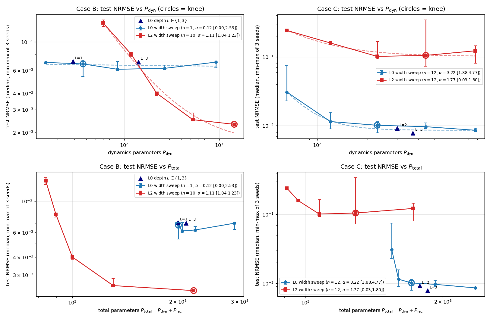
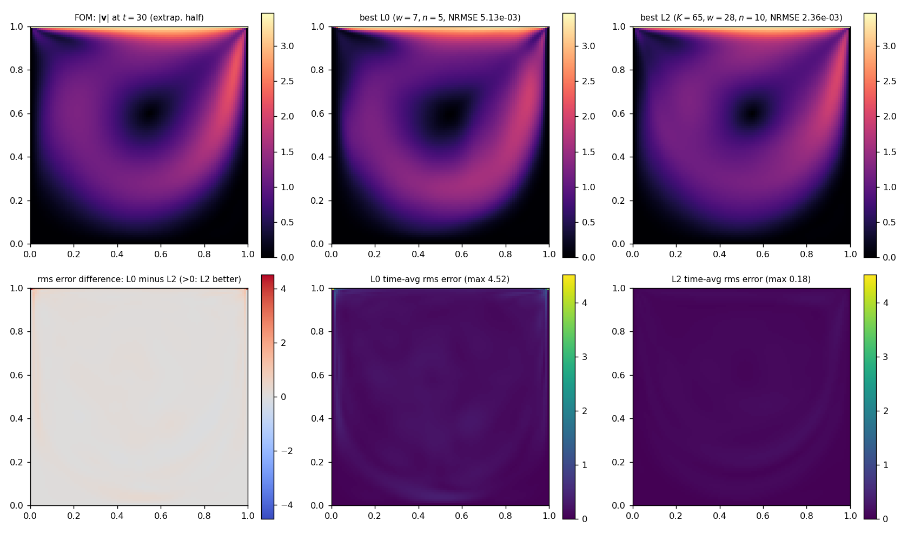
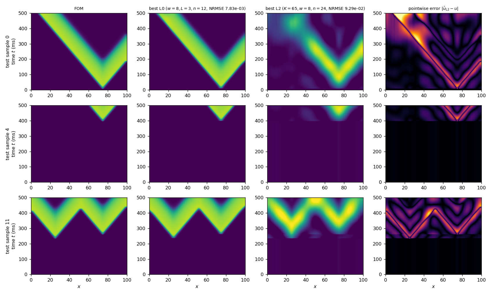
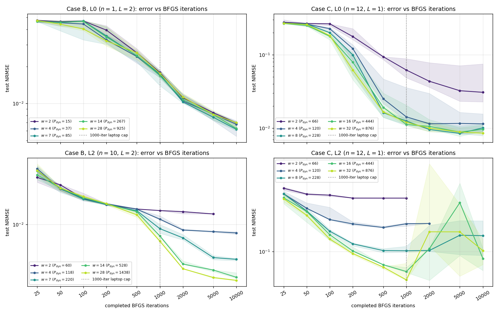
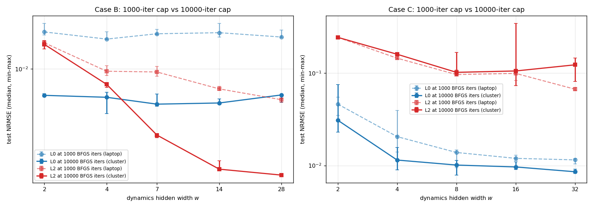
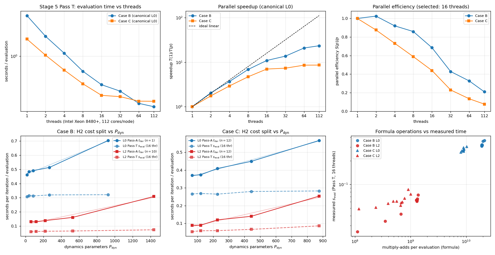
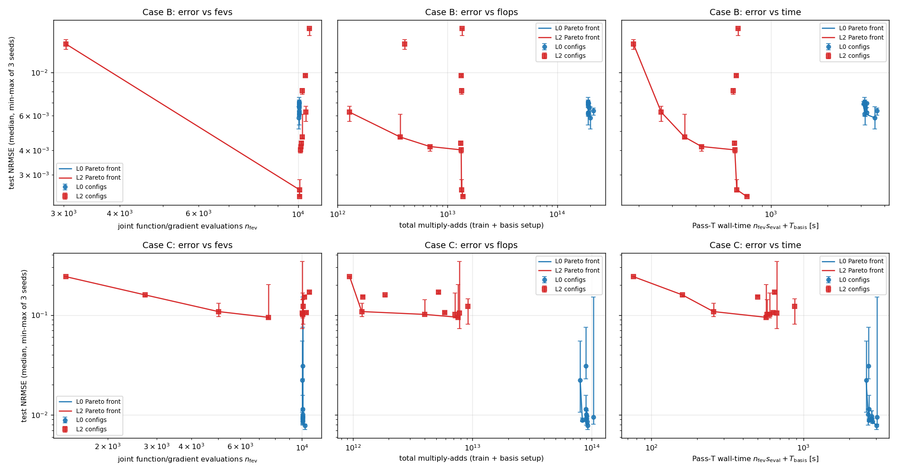
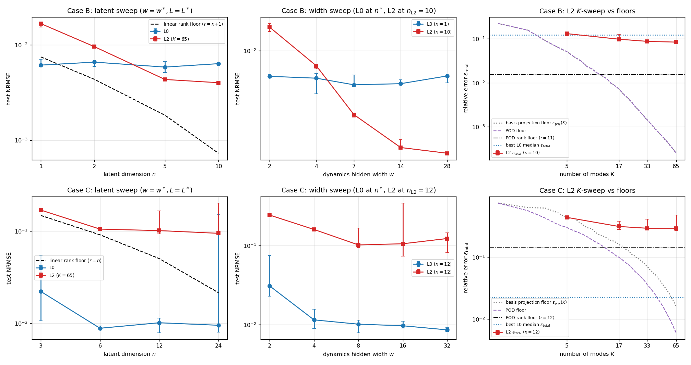
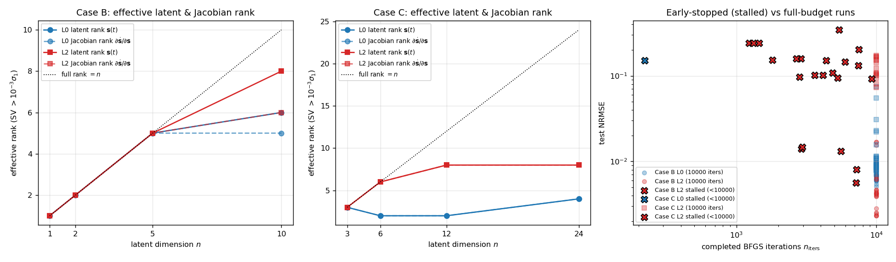

# RQ2-bis report: computational scalability of LDNets (error vs parameters vs cost at a fixed BFGS budget)

This document is the written report of the experiment defined in [`protocol.md`](protocol.md): a computational scalability study of Latent Dynamics Networks (LDNets) trained with **BFGS only** (0 Adam + up to 10000 BFGS iterations) on **Test Case B** (`Case_B_2D-Stokes/`, unsteady Navier–Stokes lid-driven cavity) and **Test Case C** (`Case_C_AP1D/`, 1D Aliev–Panfilov electrophysiology). Whereas [`Study_I/README.md`](../Study_I/README.md) asked *which reconstructor architecture is needed* at fixed dynamics capacity and a reduced Adam+BFGS budget, RQ2-bis asks the complementary computational question:

> *How does the test error of an LDNet decrease as the dynamics network $\mathrm{NN}_{\mathrm{dyn}}$ (width, depth), the latent dimension $n$ and the iteration budget grow under a fixed BFGS budget? Where is the knee, what limits accuracy beyond it, and when does a linear reconstructor ($\mathrm{L2}$) pay off once compared on compute as well as on error?*

Nothing was re-trained to write this report. Every number below was recomputed from the stored 10000-iteration Leonardo cluster sweeps (`*/results/runs.csv`, `predictions.csv`, `curves.csv`, `timing.csv`, `weights/`, `hardware.json`, `meta.json`), the 1000-iteration laptop pilot sweeps (`*/results_1000iters/`), the four per-node shards (`*/results_shard0..3/`), and the data files. The script [`report_analysis.py`](report_analysis.py) produces all nine figures in [`figures/`](figures/) and prints all tables; its verbatim output is kept in [`figures/tables.md`](figures/tables.md). The script rebuilds the stored L0 and L2 models in pure NumPy from the saved weights and checks that they reproduce the NRMSE stored by the notebooks, so all additional diagnostics (latent trajectory SVD, analytic Jacobian ranks, physical divergence, field error maps) are computed on the exact models that were trained.

**Contents.** [0 Summary](#0-summary) · [1 Question and framework](#1-question-and-framework) · [2 Mathematical and computational design](#2-mathematical-and-computational-design) · [3 The two problems and the cost model before training](#3-the-two-problems-and-the-cost-model-before-training) · [4 Results per case](#4-results-per-case) · [5 Cross-case synthesis and compute scaling](#5-cross-case-synthesis-and-compute-scaling) · [6 Hypotheses scorecard](#6-hypotheses-scorecard) · [7 Insights for the community](#7-insights-for-the-community) · [8 Limitations, deviations and threats to validity](#8-limitations-deviations-and-threats-to-validity) · [9 Recommended next steps](#9-recommended-next-steps) · [10 Files and reproducibility](#10-files-and-reproducibility) · [References](#references)

---

## 0. Summary

**What was done.** We kept the data, splits, normalisation and loss functions identical to the original scripts (`src/TestCase_2.py` and `src/TestCase_3.py`) and to RQ2, removed the 200-epoch Adam warm-up so that a single quasi-Newton trajectory with checkpoints at $\{25,50,100,200,500,1000,2000,5000,10000\}$ completed BFGS iterations traces out the full surface $\mathrm{error}(P,\text{iterations})$, and ran two end-to-end (R2) reconstructor arms across both cases:
- **Main arm (L0):** the original point-evaluation MLP reconstructor ($24^4\to 2$ with tail compression in Case B, $1970$ parameters at $n^*=1$; $17^5\to 1$ in Case C, $1480$ parameters at $n^*=12$), sweeping dynamics hidden width $w\in\{w^*/4,w^*/2,w^*,2w^*,4w^*\}$ ($\{2,4,7,14,28\}$ in B, $\{2,4,8,16,32\}$ in C), dynamics hidden depth $L\in\{1,2,3\}$, and latent size $n$ ($\{1,2,5,10\}$ in B, $\{3,6,12,24\}$ in C), for 10 configurations $\times$ 3 seeds = 30 runs per case.
- **Linear arm (Stage 7, L2):** RQ2's affine modal synthesis $\bar y(\mathbf x)+\sum_{k=1}^K(W\mathbf z+\mathbf b)_k\varphi_k(\mathbf x)$ on the $h$-orthonormal vector POD basis (Case B) or trapezoidal-orthonormal Legendre basis (Case C), sweeping $n$ at $K=65$, dynamics width $w$ at $n_{\mathrm{L2}}$ ($10$ in B, $12$ in C) and $K=65$, and $K\in\{5,17,33,65\}$ at $(w^*,L^*,n_{\mathrm{L2}})$, for 11 configurations $\times$ 3 seeds = 33 runs per case.

An initial 1000-iteration sweep on the Apple M5 Pro laptop (63 + 63 = 126 runs) revealed that at 1000 BFGS iterations the error was still dropping by 25–49% between iterations 500 and 1000 across almost all L0 configurations, masking the capacity trend. We therefore raised the hard cap to **10000 BFGS iterations** (matching the original Case B budget and doubling Case C's) and executed the full 63 + 63 = 126-run campaign across four dual-socket Intel Xeon Platinum 8480+ nodes (112 cores/node, DCGP partition) on the CINECA Leonardo supercomputer, followed by dedicated exclusive-node Stage 5 timing jobs (Pass T) measuring thread scaling from 1 to 112 threads and clean per-evaluation wall-times for all 42 configurations.

**Headline numbers** (10000-iteration cluster sweep, median of 3 seeds; $P_{\mathrm{dyn}}/P_{\mathrm{rec}}$ in brackets; Pass-T training time $n_{\mathrm{fev}}\times s_{\mathrm{eval}}$ at 16 threads):

| Arm / configuration | Case B (2D Navier–Stokes cavity) | Case C (1D AP electrophysiology) |
|---|---|---|
| L0 canonical ($w^*,L^*,n^*$) | $6.15\cdot10^{-3}$ ($85/1970$, $3141\text{ s}$) | $1.01\cdot10^{-2}$ ($228/1480$, $2667\text{ s}$) |
| L0 best configuration (valid-selected) | $5.86\cdot10^{-3}$ at $w{=}7,L{=}2,n{=}5$ ($145/2066$, $3556\text{ s}$) | $7.83\cdot10^{-3}$ at $w{=}8,L{=}3,n{=}12$ ($372/1480$, $3024\text{ s}$) |
| L2 canonical-width ($K{=}65,w^*,L^*,n_{\mathrm{L2}}$) | $4.02\cdot10^{-3}$ ($220/780$, $642\text{ s}$) | $1.02\cdot10^{-1}$ ($228/845$, $599\text{ s}$) |
| L2 best configuration (valid-selected) | $2.32\cdot10^{-3}$ at $K{=}65,w{=}28,L{=}2,n{=}10$ ($1438/780$, $744\text{ s}$) | $1.05\cdot10^{-1}$ test ($7.68\cdot10^{-2}$ valid) at $w{=}16,n{=}12$ ($444/845$, $667\text{ s}$) |
| Best L2 / best L0 test NRMSE | **0.40** (L2 is $2.5\times$ more accurate) | **13.4** (L2 is $13\times$ less accurate; $12.1\times$ vs best-on-test L2) |
| Pass-T evaluation time L0 / L2 (median) | **5.0$\times$** ($0.315\text{ s}$ vs $0.063\text{ s}$ per eval) | **4.6$\times$** ($0.274\text{ s}$ vs $0.060\text{ s}$ per eval) |
| Test-set inference time L0 / L2 | **67$\times$** ($1230\text{ ms}$ vs $18.4\text{ ms}$) | **111$\times$** ($732\text{ ms}$ vs $6.6\text{ ms}$) |
| Compute to match best L0 ($1.0\times$ target) | L2 uses **56$\times$ fewer ops**, **10.3$\times$ less Pass-T time** ($347\text{ s}$ vs $3556\text{ s}$) | L2 **never reaches** even $3\times$ the best L0 error at any cost |

**Main findings.**

1. **Capacity scaling ($\mathrm{H1}$) appears if and only if neither the reconstructor nor the latent dimension is the bottleneck.** In Case B with L0 at $n^*=1$, widening $\mathrm{NN}_{\mathrm{dyn}}$ by $62\times$ in parameters ($P_{\mathrm{dyn}}$ from 15 to 925) leaves the test NRMSE flat between $6.15\cdot10^{-3}$ and $6.98\cdot10^{-3}$ ($\alpha=0.12$, 95% CI $[0.00,2.53]$; knee already at $w=4$). The bottleneck is the 1D latent state plus the non-convex optimization of the 4-layer point-MLP decoder. Once the decoder is replaced by the linear POD synthesis L2 at $n=10, K=65$, widening $\mathrm{NN}_{\mathrm{dyn}}$ from $w=2$ ($P_{\mathrm{dyn}}=60$) to $w=28$ ($P_{\mathrm{dyn}}=1438$) drives the test NRMSE down from $1.40\cdot10^{-2}$ to $2.32\cdot10^{-3}$ following a clean power law with $\alpha=1.11$ (95% CI $[1.04,1.23]$, knee at $w=28$). In Case C the roles reverse: L0 at $n^*=12$ shows a steep capacity drop from $w=2$ ($3.08\cdot10^{-2}$) to $w=8$ ($1.01\cdot10^{-2}$) and $w=32$ ($8.57\cdot10^{-3}$; $\alpha=3.22$, CI $[1.88,4.77]$, knee at canonical $w=8$), whereas L2 is trapped at the Kolmogorov $n$-width barrier around $0.10$ regardless of dynamics width.

2. **For Case C L0, dynamics depth beats dynamics width at lower parameter cost.** Adding two hidden layers of width 8 ($L=3$, $P_{\mathrm{dyn}}=372$, $P_{\mathrm{total}}=1852$) reaches a median test NRMSE of $7.83\cdot10^{-3}$ (approaching the paper's Adam+BFGS reference of $7.37\cdot10^{-3}$), beating the widest single-layer dynamics network $w=32, L=1$ ($8.57\cdot10^{-3}$ at $P_{\mathrm{dyn}}=876$, $P_{\mathrm{total}}=2356$) with $2.4\times$ fewer dynamics parameters.

3. **Widening $\mathrm{NN}_{\mathrm{dyn}}$ is virtually free in L0 and still cheap in L2 ($\mathrm{H2}$), but the sequential Euler loop sets a hard floor on per-evaluation time and parallel scaling.** Because $\mathrm{NN}_{\mathrm{rec}}$ in L0 is evaluated at $N_x$ query points per step while $\mathrm{NN}_{\mathrm{dyn}}$ is evaluated once per step, increasing $P_{\mathrm{dyn}}$ by $62\times$ in Case B L0 increases the isolated Pass-T evaluation time at 16 threads by only **4.4%** ($0.308\text{ s}\to 0.321\text{ s}$, dynamics share **3.2%** at $4w^*$). In Pass-A sweep wall-time (56-core shared node), the dynamics share at $4w^*$ is 33.8% (B L0) and 38.1% (C L0), confirming $\mathrm{H2}$ ($<50\%$), while for L2 the reconstructor is so light that $\mathrm{NN}_{\mathrm{dyn}}$ accounts for 63.1% (B) and 72.2% (C) of the Pass-A per-iteration slope. For the same reason, one L2 multiply-add takes $3.0\times$ (B) to $3.1\times$ (C) more wall-time than one L0 multiply-add: L0 is dominated by large batched matrix multiplications over $S\times T\times N_x$, whereas L2 is dominated by $T$ sequential Python/TF steps of tiny $(S,d_s)$ matrices.

4. **Raising the BFGS budget from 1000 to 10000 was essential: the 1000-iteration cap cut every convergent curve mid-descent.** Between iterations 1000 and 10000, Case B L0 drops by a further **60–65%** across all widths (from $\sim1.7\cdot10^{-2}$ to $6.1$–$7.0\cdot10^{-3}$) and Case B L2 ($w\ge7, n\ge5$) drops by **52–67%** (reaching $2.32\cdot10^{-3}$, nearly half the paper's best L0 error at $d_s=1$). In Case C, L0 drops by another **14–54%** (reaching $7.83\cdot10^{-3}$), while L2 moves by less than 5% (and degrades at wide $w$ due to overfitting on the 20 subsampled points) because its line searches stall on the ill-conditioned polynomial basis.

5. **Explainability add-on ($\mathrm{H4}$): we uncover a structural rank bound $\operatorname{rank}(\mathbf s(t)),\,\operatorname{rank}(\partial\dot{\mathbf s}/\partial\mathbf s)\le\min(n,w_{\mathrm{dyn}})$ when the dynamics network is narrower than the latent space.** At the canonical dynamics width ($w^*=7$ in B, $w^*=8$ in C), the output layer of $\mathrm{NN}_{\mathrm{dyn}}$ maps $\mathbb R^{w^*}\to\mathbb R^n$. Because $\mathbf s(0)=\mathbf 0$ and every Forward Euler increment lies in the range of that output layer (plus a constant bias vector in B, and strictly inside the $w^*$-dimensional column space in C because the equilibrium subtraction $\mathrm{NN}_{\mathrm{base}}(\mathbf s,\mathbf u)-\mathrm{NN}_{\mathrm{base}}(\mathbf 0,\mathbf 0)$ cancels the bias), **no trajectory $\mathbf s(t)$ and no Jacobian $\partial\dot{\mathbf s}/\partial\mathbf s$ can ever have rank exceeding $w^*+1=8$ in B or $w^*=8$ in C**, regardless of how large $n$ is chosen! The empirical SVD ranks hit this exact ceiling: in Case C L2 at $w^*=8$, both the trajectory rank and the Jacobian rank are $[3,3,3]$ at $n=3$, $[6,6,6]$ at $n=6$, and saturate at exactly $[8,8,8]$ for both $n=12$ and $n=24$ ($\sigma_{\min}/\sigma_1\approx 10^{-16}$). Widening $\mathrm{NN}_{\mathrm{dyn}}$ to $w=32$ at $n=12$ immediately restores full rank $[12,12,12]$. Conversely, Case C L0 at $w^*=8, n=12$ uses only rank $[2,3,2]$ (and $[4,3,5]$ even at $w=32$), proving that L0's nonlinear decoder needs only a 2–5 dimensional curved latent manifold to parameterise the travelling fronts, whereas L2 is forced to use every linear dimension the dynamics hidden layer can supply.

6. **When to use the linear reconstructor ($\mathrm{H6}$): a 10$\times$ compute-and-accuracy win on smooth spectra, a complete failure on sharp fronts.** In Case B, L2 ($K=17, w=7, n=10$) matches the best L0 accuracy ($5.86\cdot10^{-3}$) using **$56\times$ fewer operations** and **$10.3\times$ less Pass-T wall-time** ($347\text{ s}$ vs $3556\text{ s}$), and at $K=65, w=28, n=10$ reaches $2.32\cdot10^{-3}$ ($2.5\times$ lower error than the best L0) in $744\text{ s}$ ($4.8\times$ faster than L0), while automatically preserving the discrete incompressibility of the FOM ($\lVert\nabla\cdot\mathbf v\rVert/\lVert\nabla\mathbf v\rVert=0.0688$ vs $0.0696$ for FOM and $0.126$–$0.133$ for L0) and cutting vorticity error by $5.2\times$ ($0.067$ vs $0.348$). In Case C, no L2 configuration reaches even $3\times$ the best L0 error ($2.35\cdot10^{-2}$).

---

## 1. Question and framework

### 1.1 From RQ2 to RQ2-bis

In [`Study_I/README.md`](../Study_I/README.md) the dynamics network $\mathrm{NN}_{\mathrm{dyn}}$ was held fixed at its canonical size ($7\text{–}7\text{–}d_s$ in Case B, $8\text{–}d_s$ in Case C) and all runs used a short two-stage schedule (200 Adam + 500 BFGS epochs). That design isolated the reconstructor family (L0–L3) under frozen-latent (R1) and end-to-end (R2) regimes, but left three computational questions open:
1. **Was the dynamics network the bottleneck?** In RQ2 Case B, even with a 17-mode POD basis whose projection floor is $\varepsilon_{\mathrm{proj}}=7.2\cdot10^{-3}$ ($\mathrm{NRMSE}\approx 3.5\cdot10^{-4}$), the best end-to-end models stalled at $\mathrm{NRMSE}\approx 4.5$–$8.1\cdot10^{-3}$ (efficiency ratios 5.5 to 26), because the 7–7 dynamics network had only 85–220 parameters.
2. **How much of the error was an artifact of the 500-epoch BFGS cap?** In RQ2, L0 in Case B was $5$–$14\times$ worse than in the paper.
3. **What is the true error-vs-compute Pareto front of L0 and L2 when trained end to end with a single quasi-Newton optimizer?**

RQ2-bis answers all three questions by fixing the optimizer to **pure BFGS** (0 Adam epochs, up to $I_{\max}=10000$ BFGS iterations) and sweeping the capacity of $\mathrm{NN}_{\mathrm{dyn}}$ (width $w$ and depth $L$), the latent dimension $n$, and the iteration budget (via in-flight checkpoints), for both the original nonlinear reconstructor **L0** and the linear modal reconstructor **L2** in the end-to-end regime **R2**.

### 1.2 The two reconstructor arms and the swept factors

For a latent state trajectory $\mathbf s(t)\in\mathbb R^n$ evolved from rest by Forward Euler with step $\Delta t$ and time normalisation constant $\Delta t_{\mathrm{ref}}$,

$$
\mathbf s(0)=\mathbf 0,\qquad
\mathbf s(t_{i+1})=\mathbf s(t_i)+\frac{\Delta t}{\Delta t_{\mathrm{ref}}}\,\mathrm{NN}_{\mathrm{dyn}}\big(\mathbf s(t_i),\mathbf u(t_i)\big),
$$

let the decoder input be $\mathbf z(t)=[\mathbf s(t);u(t)]\in\mathbb R^{n+1}$ in Case B and $\mathbf z(t)=\mathbf s(t)\in\mathbb R^n$ in Case C. The dynamics network $\mathrm{NN}_{\mathrm{dyn}}$ has $L$ hidden layers of width $w$ with $\tanh$ activation and a linear output layer of size $n$. In Case C, as in `src/TestCase_3.py`, the exact rest-state equilibrium is enforced at every evaluation by subtracting the value at zero:

$$
\mathrm{NN}_{\mathrm{dyn}}(\mathbf s,\mathbf u)=\mathrm{NN}_{\mathrm{base}}(\mathbf s,\mathbf u)-\mathrm{NN}_{\mathrm{base}}(\mathbf 0,\mathbf 0).
$$

(Unlike the RQ2 Case C notebook, which evaluated $\mathrm{NN}_{\mathrm{base}}(\mathbf 0,\mathbf 0)$ once at initialisation, the RQ2-bis code recomputes it inside the graph on every call so $\dot{\mathbf s}(\mathbf 0,\mathbf 0)=\mathbf 0$ holds identically throughout optimization.)

The two reconstructor arms are:

| Arm | Formula $\hat y(\mathbf x,t)$ | Reconstructor parameters $P_{\mathrm{rec}}$ | Spatial dependence |
|---|---|---|---|
| **L0** (Stages 0–3) | $\sigma_{\mathrm{out}}\!\big(\mathrm{NN}_{\mathrm{rec}}(\mathbf z(t),\mathbf x)\big)$, where $\sigma_{\mathrm{out}}(o)=(o^3+0.05\,o)/1.05$ in B ($24^4\to 2$) and $\sigma_{\mathrm{out}}(o)=o$ in C ($17^5\to 1$) | B: $24(n+4)+3\cdot 25\cdot 24+25\cdot 2 = 24n+1946$<br>C: $17(n+2)+4\cdot 18\cdot 17+18\cdot 1 = 17n+1276$ | Pointwise MLP evaluated at each query point $\mathbf x$ |
| **L2** (Stage 7) | $\bar y(\mathbf x)+\sum_{k=1}^K \big(W\mathbf z(t)+\mathbf b\big)_k\varphi_k(\mathbf x)$, strictly linear (no tail compression in B) | B: $K(n+2)$<br>C: $K(n+1)$ | Fixed orthonormal basis $\varphi_k(\mathbf x)$ (vector POD in B, Legendre in C) |

---

## 2. Mathematical and computational design

### 2.1 Why BFGS-only and why checkpoints give the iteration surface for free

In RQ2, training used 200 epochs of Adam ($\text{lr}=10^{-2}$) followed by BFGS. While Adam quickly moves weights out of the initial flat region, it introduces a learning-rate schedule and a warm-up boundary that depend on the network scale. In RQ2-bis we drop Adam (`EPOCHS_ADAM = 0`) and run `scipy.optimize.minimize(..., method='BFGS', tol=1e-100, options={'maxiter': 10000, 'gtol': 1e-100})` from the Glorot-initialized weights. Because BFGS has no learning-rate schedule—its step at iteration $k$ depends only on the current gradient and the inverse-Hessian approximation built from iterations $0,\dots,k-1$—a single run of $I_{\max}=10000$ iterations that records validation and test NRMSE via an observation hook at

$$
k\in\{25,\,50,\,100,\,200,\,500,\,1000,\,2000,\,5000,\,10000\}
$$

is mathematically identical to nine separate runs stopped at each $k$. The observation hook in `optimization.py` (`callback_extra`) is purely passive: it never modifies the weights, gradient, or inverse-Hessian state, and the wall-time spent computing the full-grid test predictions inside the hook (`ck_time`) is explicitly measured and subtracted from `train_time_s` and from `curves.csv`'s `time_s`.

### 2.2 Analytic operation count vs per-evaluation wall-time

Comparing L0 and L2 on the number of BFGS iterations or function/gradient evaluations $n_{\mathrm{fev}}$ is unfair because one evaluation of L0 and one evaluation of L2 perform vastly different amounts of work. Let the training split have $S$ trajectories, $T$ time steps, $N_x$ subsampled query points per $(s,t)$, and $n_{\mathrm{comp}}$ output components ($2$ in B, $1$ in C). In one forward pass on the training split:
- **Dynamics rollout:** $\mathrm{NN}_{\mathrm{dyn}}$ is evaluated $S(T-1)$ times on vectors of size $n+d_{\mathbf u}$, costing $2\,P_{\mathrm{dyn}}\,S(T-1)$ floating-point operations (multiply-adds, ignoring $\tanh$ activations).
- **L0 reconstructor:** $\mathrm{NN}_{\mathrm{rec}}$ is evaluated at every $(s,t,x_j)$, i.e. $S\,T\,N_x$ times, costing $2\,P_{\mathrm{rec}}\,S\,T\,N_x$ operations.
- **L2 reconstructor:** the affine map $W\mathbf z+\mathbf b$ is evaluated $S\,T$ times ($2\,P_{\mathrm{rec}}\,S\,T$ operations), and the modal synthesis $\sum_{k=1}^K c_k(t)\,\varphi_k(\mathbf x_j)$ at the pre-gathered training points (`basis_at('train', K)`) costs $2\,K\,n_{\mathrm{comp}}\,S\,T\,N_x$ operations.

Counting the backward pass (reverse-mode AD via `tf.GradientTape`) as $2\times$ the forward pass gives the analytic formula stored in `runs.csv` as `flops_per_eval`:

$$
\mathrm{FLOPs}_{\mathrm{eval}} = 3\Big(2\,P_{\mathrm{dyn}}\,S(T-1) + \mathrm{FLOPs}_{\mathrm{rec}}\Big),\qquad
\mathrm{FLOPs}_{\mathrm{total}} = n_{\mathrm{fev}}\times\mathrm{FLOPs}_{\mathrm{eval}}.
$$

Crucially, **operation counts do not automatically translate 1-to-1 into wall-time** on modern multi-core CPUs: L0's reconstructor work is a sequence of dense matrix multiplications on tensors of shape $(S\cdot T\cdot N_x,\text{width})$ ($1.616\cdot10^6$ rows in B, $1.002\cdot10^6$ rows in C), which saturate AVX-512 vector units and thread pools; L2's dynamics rollout is a sequential `tf.range(T - 1)` loop over 100 (B) or 500 (C) steps of tiny matrices of shape $(S,w)$ ($S=80$ or $100$), which is bound by loop dispatch and thread-synchronisation overhead. Stage 5 (Pass T) measures the actual seconds per evaluation $s_{\mathrm{eval}}$ on an idle exclusive node and tests the formula directly (`plot_flops_check`).

### 2.3 Structural rank bound when $n > w_{\mathrm{dyn}}$ (a new theoretical result for RQ2-bis)

In RQ2 (Section 2.5) we proved the *reconstructor rank bound*: an affine decoder $\Phi_K(W\mathbf z+\mathbf b)$ of input dimension $r=\dim\mathbf z$ has image dimension at most $\min(r,K)$. In RQ2-bis, sweeping the latent size $n$ up to $24$ while keeping $\mathrm{NN}_{\mathrm{dyn}}$ at its canonical width $w^*$ ($7$ in B, $8$ in C) exposes a second, independent rank ceiling—this time inside the **dynamics network**:

> **Proposition (dynamics bottleneck rank bound).** Let $\mathrm{NN}_{\mathrm{dyn}}(\mathbf s,\mathbf u)=W_{\mathrm{out}}\,\mathbf h(\mathbf s,\mathbf u)+\mathbf b_{\mathrm{out}}$ be an MLP whose last hidden layer has width $w$ ($W_{\mathrm{out}}\in\mathbb R^{n\times w}$), integrated by Forward Euler from $\mathbf s(0)=\mathbf 0$.
> 1. Every state $\mathbf s(t)$ along any trajectory lies in the subspace $\mathrm{range}(W_{\mathrm{out}})+\mathrm{span}\{\mathbf b_{\mathrm{out}}\}$, of dimension at most $\min(n,w+1)$. If equilibrium subtraction $\mathrm{NN}_{\mathrm{dyn}}(\mathbf s,\mathbf u)=\mathrm{NN}_{\mathrm{base}}(\mathbf s,\mathbf u)-\mathrm{NN}_{\mathrm{base}}(\mathbf 0,\mathbf 0)$ is used (Case C), then $\mathbf b_{\mathrm{out}}$ cancels and $\mathbf s(t)\in\mathrm{range}(W_{\mathrm{out}})$, so $\operatorname{rank}\big(\{\mathbf s(t)\}\big)\le\min(n,w)$.
> 2. At every state $(\mathbf s,\mathbf u)$, the state-transition Jacobian is $\frac{\partial\dot{\mathbf s}}{\partial\mathbf s}=W_{\mathrm{out}}\,D_{\mathbf h}\,J_{\mathbf h}(\mathbf s,\mathbf u)$, a product of an $n\times w$ and a $w\times n$ matrix, so $\operatorname{rank}\!\big(\frac{\partial\dot{\mathbf s}}{\partial\mathbf s}\big)\le\min(n,w)$ pointwise and for its time-averaged singular values.

The proof is immediate from $\mathbf s(t_i)=\frac{\Delta t}{\Delta t_{\mathrm{ref}}}\sum_{m=0}^{i-1}\dot{\mathbf s}(t_m)$ and $\operatorname{rank}(AB)\le\min(\operatorname{rank}A,\operatorname{rank}B)$. This proposition explains one of the most striking empirical observations of Section 5.4: when $n$ is swept to $10$ in Case B ($w^*=7$) or to $12$ and $24$ in Case C ($w^*=8$), the effective rank of the latent trajectories *cannot* exceed $8$, not because the PDE data have intrinsic dimension $\le 8$, but because the canonical dynamics network has a narrow last hidden layer of width $7$ or $8$! Only when $w$ is simultaneously widened (e.g. $w=28$ in B, $w=32$ in C) is this structural bottleneck lifted.

### 2.4 Two-pass hardware discipline (Pass A vs Pass T)

Because wall-time is contaminated whenever multiple jobs share a node or background load varies, the protocol separates:
- **Pass A (accuracy sweeps):** executed as four Slurm array shards (`--array=0-3`, 56 cores/task) per case on Leonardo DCGP nodes. Each run records exact parameter counts, $n_{\mathrm{iters}}$, $n_{\mathrm{fev}}$, `trace_time_s`, `train_time_s` (BFGS loop excluding tracing and checkpoint evaluation), `infer_time_s`, and checkpoint curves.
- **Pass T (timing and thread scaling, Stage 5):** executed after merging the shards, on one **exclusive** 112-core Leonardo DCGP node per case (`--exclusive`, Intel Xeon Platinum 8480+, 2 sockets $\times$ 56 cores). Because TensorFlow locks its intra/inter-op thread pools on the first operation, `timing_worker.py` spawns a **fresh Python subprocess** for each thread count $p\in\{1,2,4,8,16,32,64,112\}$, sets `OMP_NUM_THREADS = MKL_NUM_THREADS = OPENBLAS_NUM_THREADS = p` and `tf.config.threading.set_{intra,inter}_op_parallelism_threads(p)` before importing or executing any TensorFlow graph, rebuilds the stored run from `results/weights/`, performs one warm-up evaluation of `ag_train_loss_grad_numpy`, and records the median over 3 repeats of the mean of 20 joint loss+gradient evaluations (`s_per_eval`). At the chosen thread count ($p^*=16$), all 21 configurations of the case are timed in a single fresh process in **randomized order** (`RandomState(0).permutation`), and the first configuration is timed a second time at the very end to check for thermal or cluster throttling (protocol threshold: $<10\%$). The Pass-T training time of any run is then defined as

$$
T_{\mathrm{Pass\,T}} = n_{\mathrm{fev}} \times s_{\mathrm{eval}}.
$$

---

## 3. The two problems and the cost model before training

Table 1 summarises the two test cases, the canonical architectures verified from `src/TestCase_2.py` and `src/TestCase_3.py`, and the sweep grids.

**Table 1. Test cases, canonical architectures, and RQ2-bis sweep grids.**

| Item | Case B: `Case_B_2D-Stokes` (`src/TestCase_2.py`) | Case C: `Case_C_AP1D` (`src/TestCase_3.py`, AP1D) |
|---|---|---|
| Physics | 2D incompressible Navier–Stokes in lid-driven cavity $[0,1]^2$, top-lid velocity $u(t)$, $\mathrm{Re}$ up to $\sim1500$ | 1D Monodomain + Aliev–Panfilov excitable tissue on $[0,100]$, Neumann BCs, two stimulus pulses $(I_{\mathrm{app},1},I_{\mathrm{app},2})$ |
| Splits train / valid / test | 80 / 20 / 10 trajectories | 100 / 100 / 200 trajectories |
| Time grid | $\Delta t=0.2$, $\Delta t_{\mathrm{ref}}=5.4$; train/valid $T=20$ ($N_t=101$); test $T=40$ ($N_t=201$, second half is time extrapolation) | $\Delta t=1\text{ ms}$, $\Delta t_{\mathrm{ref}}=205$; $T=500\text{ ms}$ ($N_t=501$) for all splits |
| Spatial grid & training subsample | $100\times100$ uniform Cartesian ($P=10000$, $h=1/99^2$); **200 random pts** per $(s,t)$ in train/valid, full 10000 in test | 101 uniform pts on $[0,100]$ ($h=1$, every 8th of 801 nodes); **20 random pts** per $(s,t)$ in train/valid, full 101 in test |
| Loss function | $\mathrm{MSE}(\mathbf v) + 0.1\,\mathrm{MSE}(\mathbf v/(10^{-4}+\lVert\mathbf v\rVert))$, no Tikhonov ($\alpha_{\mathrm{reg}}=0$) | $\mathrm{MSE}(u) + 4.7\cdot10^{-3}\big(R(\mathrm{NN}_{\mathrm{base}})+R(\mathrm{NN}_{\mathrm{rec}})\big)$ |
| Proportionality $\mathrm{NRMSE}/\varepsilon_{\mathrm{total}}$ on test set | $c_B = 0.04796$ | $c_C = 0.34836$ |
| Canonical latent size $n^*$ | $1$ (paper also tests $5,10$) | $12$ |
| Canonical $\mathrm{NN}_{\mathrm{dyn}}$ ($w^*,L^*$) | $7\text{–}7\text{–}d_s$ on $(\mathbf s,u)$: $w^*=7$, $L^*=2$ ($P_{\mathrm{dyn}}=85$ at $n^*=1$) | $8\text{–}d_s$ on $(\mathbf s,\mathbf u)$ with equilibrium offset: $w^*=8$, $L^*=1$ ($P_{\mathrm{dyn}}=228$ at $n^*=12$) |
| Canonical L0 $\mathrm{NN}_{\mathrm{rec}}$ | $24^4\to 2$ on $(\mathbf s,u,\mathbf x)$ + tail link $(o^3+0.05o)/1.05$ ($P_{\mathrm{rec}}=1970$ at $n^*=1$) | $17^5\to 1$ on $(\mathbf s,x)$, no $u$, no link ($P_{\mathrm{rec}}=1480$ at $n^*=12$) |
| Stage 1: L0 width & depth sweeps | $w\in\{2,4,7,14,28\}$ at $(L^*=2,n^*=1)$; $L\in\{1,2,3\}$ at $(w^*=7,n^*=1)$ (7 configs) | $w\in\{2,4,8,16,32\}$ at $(L^*=1,n^*=12)$; $L\in\{1,2,3\}$ at $(w^*=8,n^*=12)$ (7 configs) |
| Stage 2: L0 latent sweep | $n\in\{1,2,5,10\}$ at $(w^*=7,L^*=2)$ (+3 configs) | $n\in\{3,6,12,24\}$ at $(w^*=8,L^*=1)$ (+3 configs) |
| Stage 7: L2 linear arm (R2) | Vector POD basis ($K_{\mathrm{L2}}=65$, $n_{\mathrm{L2}}=10$): $n\in\{1,2,5,10\}$, $w\in\{2,4,7,14,28\}$, $K\in\{5,17,33,65\}$ (11 configs) | Legendre basis ($K_{\mathrm{L2}}=65$, $n_{\mathrm{L2}}=12$): $n\in\{3,6,12,24\}$, $w\in\{2,4,8,16,32\}$, $K\in\{5,17,33,65\}$ (11 configs) |
| Optimizer & budget | `scipy` BFGS, 0 Adam + max 10000 BFGS iterations, 3 seeds $\{0,1,2\}$ (63 runs) | `scipy` BFGS, 0 Adam + max 10000 BFGS iterations, 3 seeds $\{0,1,2\}$ (63 runs) |

**How the cost per evaluation splits before any training.** Plugging the training-split dimensions into the operation-count formula of Section 2.2 shows why L0 and L2 sit in completely different computational regimes:
- **Case B ($S=80, T=101, N_x=200$, so $S\,T\,N_x=1.616\cdot10^6$ query evaluations per pass):**
  At canonical L0 ($P_{\mathrm{dyn}}=85, P_{\mathrm{rec}}=1970$), one forward+backward evaluation costs $3\times(1.36\cdot10^6 + 6.37\cdot10^9) = \mathbf{1.91\cdot10^{10}}$ multiply-adds, of which **99.98% is in the reconstructor** and **0.02% is in the dynamics**. Even at the widest L0 ($w=28, P_{\mathrm{dyn}}=925$), the dynamics account for only 0.23% of the operations! Replacing L0 by L2 with $K=65, n=10$ ($P_{\mathrm{dyn}}=220, P_{\mathrm{rec}}=780$) drops the reconstructor work from $1970$ MLP parameters per query point to $2K=130$ modal multiply-adds per query point, cutting $\mathrm{FLOPs}_{\mathrm{eval}}$ by **$14.9\times$** (to $1.28\cdot10^9$) at $K=65$ and by **$173\times$** (to $1.10\cdot10^8$) at $K=5$.
- **Case C ($S=100, T=501, N_x=20$, so $S\,T\,N_x=1.002\cdot10^6$ query evaluations per pass):**
  At canonical L0 ($P_{\mathrm{dyn}}=228, P_{\mathrm{rec}}=1480$), one evaluation costs $3\times(2.28\cdot10^7 + 2.97\cdot10^9) = \mathbf{8.97\cdot10^9}$ multiply-adds (99.2% in the reconstructor). Replacing L0 by L2 ($K=65, n=12, P_{\mathrm{rec}}=845$) cuts $\mathrm{FLOPs}_{\mathrm{eval}}$ by **$12.6\times$** (to $7.13\cdot10^8$) at $K=65$ and by **$76\times$** (to $1.18\cdot10^8$) at $K=5$.

---

## 4. Results per case

In all tables below, test NRMSE is the median over the three seeds $\{0,1,2\}$ with `[min, max]` in brackets; `stalled` is the number of seeds (out of 3) where `scipy` BFGS terminated before 10000 iterations due to line-search exhaustion (0 runs diverged to NaN across the entire study); `s_eval` is the Stage 5 Pass-T evaluation time at 16 threads on an exclusive Leonardo node; `time_T` $=n_{\mathrm{fev}}\times s_{\mathrm{eval}}$ is the uncontaminated Pass-T training time; and `time_A` is the Pass-A sweep wall-time. All verbatim outputs are in [`figures/tables.md`](figures/tables.md).



*Figure 1. Capacity scaling (Stage 1): test NRMSE (median and min–max range of 3 seeds) at the 10000-iteration BFGS budget against dynamics parameters $P_{\mathrm{dyn}}$ (top row, with fitted power laws $E=E_\infty+a\,P_{\mathrm{dyn}}^{-\alpha}$ dashed and the validation-selected knee circled) and against total parameters $P_{\mathrm{total}}=P_{\mathrm{dyn}}+P_{\mathrm{rec}}$ (bottom row), for Case B (left) and Case C (right).*

### 4.1 Case B: 2D Navier–Stokes lid-driven cavity (`Case_B_2D-Stokes`)

**Stage 0 gate.** The canonical L0 configuration ($w^*=7, L^*=2, n^*=1$, $P_{\mathrm{dyn}}=85, P_{\mathrm{rec}}=1970$) finished all 10000 BFGS iterations on all three seeds (and across all four cluster shards) without divergence, reaching a median test NRMSE of **$6.15\cdot10^{-3}$** ($[5.98\cdot10^{-3},\,7.07\cdot10^{-3}]$, seed ratio $\max/\min=1.18 < 2$). This is **$3.67\times$ better** than the RQ2 reduced-budget value ($2.26\cdot10^{-2}$ at 200 Adam + 500 BFGS) and within $1.5\times$ of the paper's 200 Adam + 10000 BFGS reference ($\sim4.0\cdot10^{-3}$), confirming that pure BFGS without Adam warm-up converges reliably on the 2D cavity flow.

**Table B1. All 21 configurations of Case B at the 10000-iteration BFGS budget (3 seeds each).**

| Arm | $K$ | $w$ | $L$ | $n$ | stalled | $P_{\mathrm{dyn}}$ | $P_{\mathrm{rec}}$ | $P_{\mathrm{total}}$ | $\min n_{\mathrm{iters}}$ | $n_{\mathrm{fev}}$ | $s_{\mathrm{eval}}$ [s] | $T_{\mathrm{Pass\,T}}$ [s] | $T_{\mathrm{Pass\,A}}$ [s] | infer [ms] | valid NRMSE | test NRMSE [min, max] | $\max/\min$ | $\varepsilon_{\mathrm{total}}/\varepsilon_{\mathrm{proj}}$ |
|---|---|---|---|---|---|---|---|---|---|---|---|---|---|---|---|---|---|---|
| L0 | 0 | 2 | 2 | 1 | 0 | 15 | 1970 | 1985 | 10000 | 10042 | 0.308 | 3090 | 4620 | 1250 | $5.84\cdot10^{-3}$ | $6.94\cdot10^{-3}$ [$6.82$, $7.10$]$\cdot10^{-3}$ | 1.04 | 20.1 |
| L0 | 0 | 4 | 2 | 1 | 0 | 37 | 1970 | 2007 | 10000 | 10042 | 0.315 | 3160 | 4840 | 1350 | $5.65\cdot10^{-3}$ | $6.76\cdot10^{-3}$ [$5.40$, $7.23$]$\cdot10^{-3}$ | 1.34 | 19.5 |
| L0 | 0 | 7 | 1 | 1 | 0 | 29 | 1970 | 1999 | 10000 | 10044 | 0.312 | 3130 | 4900 | 1340 | $5.92\cdot10^{-3}$ | $7.06\cdot10^{-3}$ [$6.86$, $7.44$]$\cdot10^{-3}$ | 1.09 | 20.4 |
| L0 | 0 | 7 | 2 | 1 | 0 | 85 | 1970 | 2055 | 10000 | 10050 | 0.313 | 3140 | 4910 | 1230 | $5.27\cdot10^{-3}$ | $6.15\cdot10^{-3}$ [$5.98$, $7.07$]$\cdot10^{-3}$ | 1.18 | 17.8 |
| L0 | 0 | 7 | 2 | 2 | 0 | 100 | 1994 | 2094 | 10000 | 10041 | 0.316 | 3170 | 4840 | 1170 | $5.56\cdot10^{-3}$ | $6.61\cdot10^{-3}$ [$5.96$, $6.76$]$\cdot10^{-3}$ | 1.13 | 19.1 |
| **L0** | **0** | **7** | **2** | **5** | **0** | **145** | **2066** | **2211** | **10000** | **10035** | **0.354** | **3560** | **5660** | **1300** | **$5.13\cdot10^{-3}$** | **$5.86\cdot10^{-3}$ [$5.13$, $6.69$]$\cdot10^{-3}$** | **1.30** | **17.0** |
| L0 | 0 | 7 | 2 | 10 | 0 | 220 | 2186 | 2406 | 10000 | 10034 | 0.364 | 3650 | 5820 | 1440 | $5.58\cdot10^{-3}$ | $6.37\cdot10^{-3}$ [$6.06$, $6.56$]$\cdot10^{-3}$ | 1.08 | 18.4 |
| L0 | 0 | 7 | 3 | 1 | 0 | 141 | 1970 | 2111 | 10000 | 10043 | 0.313 | 3150 | 5170 | 1390 | $5.88\cdot10^{-3}$ | $7.00\cdot10^{-3}$ [$6.87$, $7.11$]$\cdot10^{-3}$ | 1.04 | 20.3 |
| L0 | 0 | 14 | 2 | 1 | 0 | 267 | 1970 | 2237 | 10000 | 10046 | 0.320 | 3210 | 5140 | 1220 | $5.32\cdot10^{-3}$ | $6.25\cdot10^{-3}$ [$6.13$, $6.62$]$\cdot10^{-3}$ | 1.08 | 18.1 |
| L0 | 0 | 28 | 2 | 1 | 0 | 925 | 1970 | 2895 | 10000 | 10037 | 0.321 | 3230 | 7040 | 1220 | $5.85\cdot10^{-3}$ | $6.98\cdot10^{-3}$ [$6.31$, $6.98$]$\cdot10^{-3}$ | 1.11 | 20.2 |
| L2 | 5 | 7 | 2 | 10 | 1 | 220 | 60 | 280 | 7143 | 10390 | 0.0251 | 261 | 599 | 17.8 | $5.01\cdot10^{-3}$ | $6.26\cdot10^{-3}$ [$5.62$, $6.73$]$\cdot10^{-3}$ | 1.20 | 2.57 |
| L2 | 17 | 7 | 2 | 10 | 0 | 220 | 204 | 424 | 10000 | 10218 | 0.0340 | 347 | 724 | 17.4 | $4.56\cdot10^{-3}$ | $4.68\cdot10^{-3}$ [$4.61$, $6.10$]$\cdot10^{-3}$ | 1.32 | 13.5 |
| L2 | 33 | 7 | 2 | 10 | 0 | 220 | 396 | 616 | 10000 | 10134 | 0.0421 | 427 | 1100 | 20.2 | $3.83\cdot10^{-3}$ | $4.18\cdot10^{-3}$ [$3.95$, $4.22$]$\cdot10^{-3}$ | 1.07 | 60.5 |
| L2 | 65 | 2 | 2 | 10 | 3 | 60 | 780 | 840 | 2905 | 3042 | 0.0610 | 185 | 381 | 19.4 | $1.25\cdot10^{-2}$ | $1.40\cdot10^{-2}$ [$1.31$, $1.47$]$\cdot10^{-2}$ | 1.12 | 1160 |
| L2 | 65 | 4 | 2 | 10 | 1 | 118 | 780 | 898 | 7195 | 10207 | 0.0618 | 631 | 1300 | 19.1 | $7.86\cdot10^{-3}$ | $8.07\cdot10^{-3}$ [$7.73$, $8.27$]$\cdot10^{-3}$ | 1.07 | 672 |
| L2 | 65 | 7 | 2 | 1 | 0 | 85 | 195 | 280 | 10000 | 10592 | 0.0631 | 668 | 1070 | 19.9 | $1.39\cdot10^{-2}$ | $1.68\cdot10^{-2}$ [$1.54$, $1.68$]$\cdot10^{-2}$ | 1.09 | 1400 |
| L2 | 65 | 7 | 2 | 2 | 0 | 100 | 260 | 360 | 10000 | 10386 | 0.0631 | 655 | 1100 | 19.4 | $8.48\cdot10^{-3}$ | $9.61\cdot10^{-3}$ [$9.55$, $9.78$]$\cdot10^{-3}$ | 1.02 | 801 |
| L2 | 65 | 7 | 2 | 5 | 0 | 145 | 455 | 600 | 10000 | 10180 | 0.0630 | 641 | 1300 | 20.6 | $4.06\cdot10^{-3}$ | $4.34\cdot10^{-3}$ [$4.24$, $4.44$]$\cdot10^{-3}$ | 1.05 | 362 |
| L2 | 65 | 7 | 2 | 10 | 0 | 220 | 780 | 1000 | 10000 | 10113 | 0.0635 | 642 | 1390 | 17.3 | $3.73\cdot10^{-3}$ | $4.02\cdot10^{-3}$ [$3.88$, $4.12$]$\cdot10^{-3}$ | 1.06 | 335 |
| L2 | 65 | 14 | 2 | 10 | 0 | 528 | 780 | 1308 | 10000 | 10061 | 0.0654 | 658 | 1610 | 20.4 | $2.71\cdot10^{-3}$ | $2.52\cdot10^{-3}$ [$2.46$, $2.83$]$\cdot10^{-3}$ | 1.15 | 210 |
| **L2** | **65** | **28** | **2** | **10** | **0** | **1438** | **780** | **2218** | **10000** | **10076** | **0.0738** | **744** | **3090** | **16.6** | **$2.07\cdot10^{-3}$** | **$2.32\cdot10^{-3}$ [$2.32$, $2.36$]$\cdot10^{-3}$** | **1.02** | **193** |

**Stage 1 & Stage 2 on L0: why widening and deepening $\mathrm{NN}_{\mathrm{dyn}}$ does not move L0.** Across the entire L0 width sweep ($w\in\{2,4,7,14,28\}$ at $L^*=2, n^*=1$), the median test NRMSE stays inside the narrow band $[6.15\cdot10^{-3},\,6.98\cdot10^{-3}]$. The two-point log-log slopes $\mathrm d\log E/\mathrm d\log P_{\mathrm{dyn}}$ are $[-0.030,\,-0.113,\,+0.014,\,+0.089]$, so the curve is flat from $w=2$ ($P_{\mathrm{dyn}}=15$) to $w=28$ ($P_{\mathrm{dyn}}=925$), with a slight turn-up at $w=28$. The fitted power-law exponent is $\alpha=0.118$ with a 95% bootstrap CI of $[0.000,\,2.525]$ reaching 0, **falsifying $\mathrm{H1}$ for Case B L0**. Changing depth at $w=7, n=1$ ($L=1$: $7.06\cdot10^{-3}$; $L=2$: $6.15\cdot10^{-3}$; $L=3$: $7.00\cdot10^{-3}$) or increasing the latent size at canonical dynamics ($n=1$: $6.15\cdot10^{-3}$; $n=2$: $6.61\cdot10^{-3}$, $-7.4\%$ improvement; $n=5$: $5.86\cdot10^{-3}$; $n=10$: $6.37\cdot10^{-3}$) yields at most a 5% improvement, **supporting $\mathrm{H4}$ for L0**. Why? At $n=1$ the single latent scalar $s(t)$ (plus $u(t)$) already captures the 1D lid-forcing history, and when $n$ is raised to $5$ or $10$ with canonical $w^*=7$, the joint BFGS optimization of $\mathrm{NN}_{\mathrm{dyn}}$ and the 4-hidden-layer pointwise MLP $\mathrm{NN}_{\mathrm{rec}}$ ($P_{\mathrm{rec}}\approx 2000$) is limited by the non-convex decoder landscape rather than by dynamics capacity.

**Stage 7 on L2: unlocking a clean capacity law and beating L0 by $2.5\times$ in error and $5$–$10\times$ in time.** Replacing the pointwise MLP by the linear POD reconstructor L2 completely changes the scaling regime (Figure 1 left, red squares, and Figure 4 top row):
1. **Latent sweep ($K=65, w=7, L=2$):** Because an affine map of $\mathbf z=[s_1,\dots,s_n,u]\in\mathbb R^{n+1}$ spans at most an $(n+1)$-dimensional subspace of fields (the RQ2 rank bound), L2 at $n=1$ is trapped at $1.68\cdot10^{-2}$ (the 2-mode POD rank floor is $c_B\times 0.1563 = 7.50\cdot10^{-3}$). Raising $n$ to $2, 5, 10$ drops the median test NRMSE to $9.61\cdot10^{-3}$ ($+42.7\%$ improvement from $n=1$ to $2$, **falsifying $\mathrm{H4}$ for L2**), $4.34\cdot10^{-3}$, and $4.02\cdot10^{-3}$. Notice that at $w=7$, going from $n=5$ ($4.34\cdot10^{-3}$) to $n=10$ ($4.02\cdot10^{-3}$) brings only a small gain because the canonical hidden width $w^*=7$ caps the latent trajectory rank at $\le 8$ (Proposition of Section 2.3).
2. **Width sweep ($K=65, L=2, n=10$):** Once $n=10$ provides enough latent coordinates, widening $\mathrm{NN}_{\mathrm{dyn}}$ lifts the dynamics bottleneck! As $w$ grows through $\{2,4,7,14,28\}$ ($P_{\mathrm{dyn}}\in\{60,118,220,528,1438\}$), the median test NRMSE drops monotonically across every single step:

$$
1.40\cdot10^{-2}\ \to\ 8.07\cdot10^{-3}\ \to\ 4.02\cdot10^{-3}\ \to\ 2.52\cdot10^{-3}\ \to\ \mathbf{2.32\cdot10^{-3}}.
$$

   The power-law fit gives $E_\infty=1.63\cdot10^{-3}$, $\alpha=1.113$ with a tight 95% CI $[1.042,\,1.226]$ (all 200 bootstrap refits converged), **strongly supporting $\mathrm{H1}$ for Case B L2**. The two-point slopes $\mathrm d\log E/\mathrm d\log P_{\mathrm{dyn}}$ are $[-0.814,\,-1.119,\,-0.535,\,-0.082]$: the slope crosses the protocol's $-0.1$ plateau threshold precisely on the last segment $w=14\to 28$ ($2.52\cdot10^{-3}\to 2.32\cdot10^{-3}$, an 8% further drop), placing the validation knee at $w=28$ (and the cheapest configuration within 10% of the best test median at $w=14$, $P_{\mathrm{total}}=1308$, $T_{\mathrm{Pass\,T}}=658\text{ s}$).
3. **$K$-sweep ($w=7, L=2, n=10$):** Sweeping $K\in\{5,17,33,65\}$ lowers the test NRMSE from $6.26\cdot10^{-3}$ ($K=5$, efficiency ratio $2.57$ above the 5-mode POD floor $2.44\cdot10^{-3}$) to $4.68\cdot10^{-3}$ ($K=17$) and $4.18\cdot10^{-3}$ ($K=33$), before plateauing at $4.02\cdot10^{-3}$ ($K=65$). Even $K=5$ (only $P_{\mathrm{rec}}=60$ reconstructor parameters, $P_{\mathrm{total}}=280$, $T_{\mathrm{Pass\,T}}=261\text{ s}$) matches the canonical L0 accuracy ($6.26\cdot10^{-3}$ vs $6.15\cdot10^{-3}$) in **$12\times$ less wall-time**!

**Physical and goal-oriented metrics in Case B (Table B2).** The advantage of L2 with a wide dynamics network is even larger on physical derivatives and direction accuracy than on NRMSE:
- **Direction error:** L0 sits at $0.013$–$0.022$ across all 10 configurations; L2 at $w=28, n=10$ reaches **$0.00137$** ($9.5\times$ lower than the best L0).
- **Vorticity error:** L0 has relative vorticity error $0.312$–$0.429$ (even at 10000 BFGS iterations, its pointwise MLP retains high-frequency spatial noise that differentiation amplifies). L2 at $w=28, n=10$ reaches **$0.0669$** ($4.7\times$ lower than the best L0).
- **Incompressibility ($\lVert\nabla\cdot\mathbf v\rVert/\lVert\nabla\mathbf v\rVert$):** Because every POD mode is a linear combination of divergence-free FOM snapshots, L2 reproduces the discrete divergence floor of the FOM grid identically ($0.0685$–$0.0688$ vs $0.0696$ for FOM), whereas L0 has $0.126$–$0.133$ ($1.9\times$ the FOM discretisation level).
- **Time extrapolation ($t\in[20,40]$ vs $t\in[0,20]$):** Every configuration of both arms has $\varepsilon_{[20,40]}/\varepsilon_{[0,20]}\in[0.58,\,0.97] < 1$: neither arm degrades in the extrapolation half of the test horizon.



*Figure 8. Case B physical fields and spatial error distribution on the test set. Top row: velocity magnitude $\lvert\mathbf v\rvert$ of test sample 0 at $t=30$ (inside the time-extrapolation half $[20,40]$) for the FOM, the best L0 ($w=7,L=2,n=5$, NRMSE $5.86\cdot10^{-3}$), and the best L2 ($K=65,w=28,L=2,n=10$, NRMSE $2.32\cdot10^{-3}$). Bottom row: time-averaged pointwise rms velocity error difference $\mathrm{err}_{\mathrm{L0}}-\mathrm{err}_{\mathrm{L2}}$ (left, positive everywhere along the top lid and primary vortex shear layer) and the individual rms error maps of L0 and L2 on a common colour scale.*

---

### 4.2 Case C: 1D Aliev–Panfilov electrophysiology (`Case_C_AP1D`)

**Stage 0 gate.** The canonical L0 configuration ($w^*=8, L^*=1, n^*=12$, $P_{\mathrm{dyn}}=228, P_{\mathrm{rec}}=1480$) completed all 10000 BFGS iterations across all three seeds and all four shards, reaching a median test NRMSE of **$1.01\cdot10^{-2}$** ($[7.88\cdot10^{-3},\,1.14\cdot10^{-2}]$, seed ratio $\max/\min=1.44 < 2$). This improves by **$1.74\times$** over the RQ2 reduced-budget value ($1.765\cdot10^{-2}$ at 200 Adam + 500 BFGS) and comes within $1.37\times$ of the paper's 200 Adam + 5000 BFGS reference ($7.37\cdot10^{-3}$).

**Table C1. All 21 configurations of Case C at the 10000-iteration BFGS budget (3 seeds each).**

| Arm | $K$ | $w$ | $L$ | $n$ | stalled | $P_{\mathrm{dyn}}$ | $P_{\mathrm{rec}}$ | $P_{\mathrm{total}}$ | $\min n_{\mathrm{iters}}$ | $n_{\mathrm{fev}}$ | $s_{\mathrm{eval}}$ [s] | $T_{\mathrm{Pass\,T}}$ [s] | $T_{\mathrm{Pass\,A}}$ [s] | infer [ms] | valid NRMSE | test NRMSE [min, max] | $\max/\min$ | act MAE [ms] | act miss |
|---|---|---|---|---|---|---|---|---|---|---|---|---|---|---|---|---|---|---|---|
| L0 | 0 | 2 | 1 | 12 | 0 | 66 | 1480 | 1546 | 10000 | 10077 | 0.266 | 2680 | 3700 | 721 | $5.26\cdot10^{-2}$ | $3.08\cdot10^{-2}$ [$2.29$, $7.51$]$\cdot10^{-2}$ | 3.29 | 2.64 [1.05, 4.06] | 0.001 |
| L0 | 0 | 4 | 1 | 12 | 0 | 120 | 1480 | 1600 | 10000 | 10042 | 0.268 | 2700 | 3730 | 756 | $9.58\cdot10^{-3}$ | $1.15\cdot10^{-2}$ [$8.99\cdot10^{-3}$, $1.56\cdot10^{-2}$] | 1.74 | 0.73 [0.59, 0.79] | 0.000 |
| L0 | 0 | 8 | 1 | 3 | 0 | 75 | 1327 | 1402 | 10000 | 10035 | 0.257 | 2580 | 3070 | 628 | $1.40\cdot10^{-2}$ | $2.22\cdot10^{-2}$ [$1.06$, $5.49$]$\cdot10^{-2}$ | 5.17 | 1.09 [0.74, 2.34] | 0.000 |
| L0 | 0 | 8 | 1 | 6 | 0 | 126 | 1378 | 1504 | 10000 | 10066 | 0.268 | 2700 | 3460 | 724 | $9.83\cdot10^{-3}$ | $8.82\cdot10^{-3}$ [$8.60$, $9.31$]$\cdot10^{-3}$ | 1.08 | 0.61 [0.57, 0.65] | 0.000 |
| L0 | 0 | 8 | 1 | 12 | 0 | 228 | 1480 | 1708 | 10000 | 10071 | 0.265 | 2670 | 4090 | 732 | $9.00\cdot10^{-3}$ | $1.01\cdot10^{-2}$ [$7.88\cdot10^{-3}$, $1.14\cdot10^{-2}$] | 1.44 | 0.62 [0.55, 0.64] | 0.000 |
| L0 | 0 | 8 | 1 | 24 | 1 | 432 | 1684 | 2116 | 221 | 10051 | 0.303 | 3040 | 5210 | 773 | $8.57\cdot10^{-3}$ | $9.50\cdot10^{-3}$ [$8.02\cdot10^{-3}$, $1.52\cdot10^{-1}$] | 18.9 | 0.56 [0.56, 17.4] | 0.000 |
| L0 | 0 | 8 | 2 | 12 | 0 | 300 | 1480 | 1780 | 10000 | 10085 | 0.279 | 2810 | 3990 | 761 | $9.68\cdot10^{-3}$ | $9.17\cdot10^{-3}$ [$8.61\cdot10^{-3}$, $1.10\cdot10^{-2}$] | 1.28 | 0.59 [0.58, 0.63] | 0.000 |
| **L0** | **0** | **8** | **3** | **12** | **0** | **372** | **1480** | **1852** | **10000** | **10248** | **0.295** | **3020** | **4290** | **733** | **$8.23\cdot10^{-3}$** | **$7.83\cdot10^{-3}$ [$7.10$, $8.04$]$\cdot10^{-3}$** | **1.13** | **0.54 [0.54, 0.57]** | **0.000** |
| L0 | 0 | 16 | 1 | 12 | 0 | 444 | 1480 | 1924 | 10000 | 10059 | 0.280 | 2810 | 4490 | 752 | $8.62\cdot10^{-3}$ | $9.65\cdot10^{-3}$ [$9.05\cdot10^{-3}$, $1.10\cdot10^{-2}$] | 1.22 | 0.55 [0.55, 0.59] | 0.001 |
| L0 | 0 | 32 | 1 | 12 | 0 | 876 | 1480 | 2356 | 10000 | 10051 | 0.283 | 2840 | 5660 | 707 | $8.65\cdot10^{-3}$ | $8.57\cdot10^{-3}$ [$8.22$, $9.14$]$\cdot10^{-3}$ | 1.11 | 0.56 [0.52, 0.57] | 0.000 |
| L2 | 5 | 8 | 1 | 12 | 1 | 228 | 65 | 293 | 4368 | 10221 | 0.0489 | 500 | 589 | 3.46 | $1.72\cdot10^{-1}$ | $1.52\cdot10^{-1}$ [$1.51$, $1.56$]$\cdot10^{-1}$ | 1.03 | 17.4 [17.1, 17.5] | 0.006 |
| L2 | 17 | 8 | 1 | 12 | 3 | 228 | 221 | 449 | 2833 | 4999 | 0.0511 | 256 | 342 | 4.90 | $1.11\cdot10^{-1}$ | $1.08\cdot10^{-1}$ [$9.67\cdot10^{-2}$, $1.32\cdot10^{-1}$] | 1.36 | 5.41 [4.80, 5.44] | 0.017 |
| L2 | 33 | 8 | 1 | 12 | 1 | 228 | 429 | 657 | 3630 | 10075 | 0.0572 | 576 | 934 | 5.10 | $1.07\cdot10^{-1}$ | $1.02\cdot10^{-1}$ [$1.00$, $1.43$]$\cdot10^{-1}$ | 1.42 | 4.91 [4.71, 5.60] | 0.015 |
| L2 | 65 | 2 | 1 | 12 | 3 | 66 | 845 | 911 | 1232 | 1413 | 0.0539 | 76 | 119 | 6.72 | $2.79\cdot10^{-1}$ | $2.43\cdot10^{-1}$ [$2.43$, $2.43$]$\cdot10^{-1}$ | 1.00 | 14.1 [14.1, 14.1] | 0.540 |
| L2 | 65 | 4 | 1 | 12 | 3 | 120 | 845 | 965 | 1813 | 2722 | 0.0586 | 160 | 241 | 7.82 | $1.63\cdot10^{-1}$ | $1.59\cdot10^{-1}$ [$1.52$, $1.59$]$\cdot10^{-1}$ | 1.05 | 10.5 [10.5, 12.3] | 0.102 |
| L2 | 65 | 8 | 1 | 3 | 0 | 75 | 260 | 335 | 10000 | 10644 | 0.0609 | 648 | 811 | 6.22 | $1.95\cdot10^{-1}$ | $1.70\cdot10^{-1}$ [$1.65$, $1.73$]$\cdot10^{-1}$ | 1.04 | 21.4 [20.1, 22.0] | 0.072 |
| L2 | 65 | 8 | 1 | 6 | 0 | 126 | 455 | 581 | 10000 | 10371 | 0.0610 | 632 | 844 | 7.70 | $1.19\cdot10^{-1}$ | $1.05\cdot10^{-1}$ [$1.03$, $1.08$]$\cdot10^{-1}$ | 1.05 | 6.85 [6.71, 7.37] | 0.013 |
| L2 | 65 | 8 | 1 | 12 | 1 | 228 | 845 | 1073 | 4149 | 10051 | 0.0596 | 599 | 1190 | 6.58 | $1.06\cdot10^{-1}$ | $1.02\cdot10^{-1}$ [$9.38\cdot10^{-2}$, $1.66\cdot10^{-1}$] | 1.78 | 5.09 [4.64, 5.16] | 0.014 |
| L2 | 65 | 8 | 1 | 24 | 3 | 432 | 1625 | 2057 | 5277 | 7561 | 0.0752 | 569 | 2280 | 8.65 | $1.05\cdot10^{-1}$ | $9.49\cdot10^{-2}$ [$9.29\cdot10^{-2}$, $2.03\cdot10^{-1}$] | 2.18 | 4.84 [4.02, 5.08] | 0.018 |
| **L2** | **65** | **16** | **1** | **12** | **1** | **444** | **845** | **1289** | **5409** | **10018** | **0.0666** | **667** | **1380** | **6.73** | **$7.68\cdot10^{-2}$** | **$1.05\cdot10^{-1}$ [$7.30\cdot10^{-2}$, $3.44\cdot10^{-1}$]** | **4.71** | **2.26 [2.16, 2.28]** | **0.005** |
| L2 | 65 | 32 | 1 | 12 | 1 | 876 | 845 | 1721 | 5968 | 10099 | 0.0863 | 871 | 2490 | 8.22 | $1.01\cdot10^{-1}$ | $1.22\cdot10^{-1}$ [$8.07\cdot10^{-2}$, $1.45\cdot10^{-1}$] | 1.80 | 2.18 [2.17, 2.29] | 0.005 |

**Stage 1 on L0: steep capacity scaling up to the canonical width $w^*=8$, and depth beats width.** In Case C, the canonical dynamics network has a single hidden layer ($L^*=1$) mapping 14 inputs ($12$ latents $+ 2$ stimuli) through $w$ tanh units back to 12 latent derivatives. At $w=2$ ($P_{\mathrm{dyn}}=66$), the hidden layer is a rank-2 bottleneck and the model cannot coordinate the two stimulus channels and the front propagation: median test NRMSE is $3.08\cdot10^{-2}$ (activation MAE $2.64\text{ ms}$). Doubling to $w=4$ ($P_{\mathrm{dyn}}=120$) cuts the error by $2.7\times$ to $1.15\cdot10^{-2}$, and widening through $w=8, 16, 32$ ($P_{\mathrm{dyn}}\in\{228,444,876\}$) lowers it monotonically:

$$
3.08\cdot10^{-2}\ \to\ 1.15\cdot10^{-2}\ \to\ 1.01\cdot10^{-2}\ \to\ 9.65\cdot10^{-3}\ \to\ 8.57\cdot10^{-3}.
$$

The power-law fit gives $E_\infty=8.57\cdot10^{-3}$, $\alpha=3.220$ (95% CI $[1.882,\,4.768]$, **supporting $\mathrm{H1}$ for Case C L0** and **falsifying $\mathrm{H3}$** because the curve is strictly monotone decreasing at 10000 iterations). The two-point slopes $\mathrm d\log E/\mathrm d\log P_{\mathrm{dyn}}$ are $[-1.655,\,-0.194,\,-0.070,\,-0.176]$, and the validation knee is at the canonical width **$w^*=8$** ($P_{\mathrm{dyn}}=228, P_{\mathrm{total}}=1708$), whose validation median ($9.00\cdot10^{-3}$) is within 4.4% of the best width-sweep validation median ($8.62\cdot10^{-3}$ at $w=16$). Even more remarkably, **increasing depth at $w=8$ is more effective than quadrupling width**: $L=2$ ($P_{\mathrm{dyn}}=300$) reaches $9.17\cdot10^{-3}$, and $L=3$ ($P_{\mathrm{dyn}}=372$, $P_{\mathrm{total}}=1852$) achieves the lowest validation ($8.23\cdot10^{-3}$) and test (**$7.83\cdot10^{-3}$**, range $[7.10,8.04]\cdot10^{-3}$, activation MAE **$0.54\text{ ms}$** with 0.0% missed activations) of the entire Case C study.

**Stage 2 on L0: latent dimension and the single stalled L0 run.** Across $n\in\{3,6,12,24\}$ at canonical $(w^*=8, L^*=1)$, the median test NRMSE is $2.22\cdot10^{-2}$ ($n=3$), $8.82\cdot10^{-3}$ ($n=6$), $1.01\cdot10^{-2}$ ($n=12$), and $9.50\cdot10^{-3}$ ($n=24$). The improvement from $n^*=12$ to $2n^*=24$ is $+6.1\%$ on test ($1.01\cdot10^{-2}\to 9.50\cdot10^{-3}$) and $+4.8\%$ on validation ($9.00\cdot10^{-3}\to 8.57\cdot10^{-3}$), sitting right on the 5% $\mathrm{H4}$ boundary. At $n=24$, seeds 0 and 2 completed 10000 iterations with test NRMSE $9.50\cdot10^{-3}$ and $8.02\cdot10^{-3}$, whereas seed 1 stalled at iteration 221 with NRMSE $0.152$ (the single early stop among all 60 L0 runs of both cases). Because the median of three numbers is the middle one ($9.50\cdot10^{-3}$), the stalled seed does not shift the median, though it inflates $\max/\min$ to $18.9$.

**Stage 7 on L2: the Kolmogorov barrier and overfitting of wide dynamics on sparse spatial samples.** In Case C, L2 is bounded below by the polynomial projection floor of the sharp action-potential fronts ($\varepsilon_{\mathrm{proj}}(33)=0.0706$, $\varepsilon_{\mathrm{proj}}(65)=0.0162$) and by the rank floor of an $n$-dimensional linear subspace ($\varepsilon_{\mathrm{rank}}(12)=0.1447$, corresponding to $\mathrm{NRMSE}=5.04\cdot10^{-2}$). Across all 11 L2 configurations, the best median test NRMSE is $9.49\cdot10^{-2}$ (at $K=65, w=8, n=24$), **$12.1\times$ worse than the best L0** ($7.83\cdot10^{-3}$). Two computational phenomena stand out in Case C L2:
1. **Line-search stalling (17 of 33 runs):** Because the 65 Legendre modes evaluated on 20 random spatial points per time step create an ill-conditioned Hessian when coupled with the non-stationary front dynamics, `scipy` BFGS terminates early on 17 of the 33 L2 runs (all 3 seeds at $w=2$, $w=4$, $K=17$, and $n=24$; 1 of 3 seeds at $w=8,16,32$ and $K=5,33$). At $w=2$, 54% of FOM-activating points never cross the $0.5$ threshold in the L2 prediction (`act_miss = 0.540`).
2. **Overfitting of wide L2 dynamics between iterations 1000 and 10000:** At $K=65, n=12$, widening $\mathrm{NN}_{\mathrm{dyn}}$ to $w=16$ and $w=32$ actually achieved its lowest test error around iteration **1000** ($7.18\cdot10^{-2}$ at $w=16$, $6.26\cdot10^{-2}$ at $w=32$, see Table 5.1 and Figure 2 bottom-right), and then *degraded* between iterations 1000 and 10000 to $1.05\cdot10^{-1}$ ($w=16$, seed 2 jumping to $0.344$) and $1.22\cdot10^{-1}$ ($w=32$). With 65 high-degree Legendre polynomials and only 20 subsampled spatial points per time step (plus the Tikhonov weight $\alpha_{\mathrm{reg}}=4.7\cdot10^{-3}$ tuned by the original authors for L0's 5-layer MLP rather than for a single $12\times 65$ matrix $W$), extra BFGS iterations overfit high-degree polynomial oscillations between the 20 training points, which blow up when evaluated on the full 101-point test grid!



*Figure 9. Case C space-time potential $u(x,t)$ on three test samples (rows: samples 0, 4, 11). Columns: FOM ground truth; best L0 ($w=8,L=3,n=12$, NRMSE $7.10\cdot10^{-3}$ on seed 0); best L2 ($K=65,w=8,L=1,n=24$, NRMSE $9.29\cdot10^{-2}$ on seed 0); and pointwise absolute error $\lvert\hat u_{\mathrm{L2}}-u\rvert$, which is concentrated entirely along the steep depolarisation wave fronts and produces Gibbs oscillations ahead of and behind the front.*

---

## 5. Cross-case synthesis and compute scaling

### 5.1 Iteration budget surface (Stage 3, $\mathrm{H3}$) and why 1000 iterations was not enough

Figure 2 and Table 5.1 show the Stage 3 error surface $\mathrm{NRMSE}(w,\text{iterations})$ across the nine checkpoints $\{25,50,100,200,500,1000,2000,5000,10000\}$, alongside the comparison between the 1000-iteration laptop sweep and the 10000-iteration cluster sweep (Figure 6).



*Figure 2. Stage 3 iteration surface: test NRMSE (median and min–max band of 3 seeds) against completed BFGS iterations for each dynamics hidden width $w$, in Case B (left) and Case C (right), for L0 (top) and L2 (bottom). The vertical dotted line marks the initial 1000-iteration laptop cap.*



*Figure 6. Direct comparison of the width-sweep test NRMSE (median and min–max range over 3 seeds) between the 1000-iteration laptop sweep (dashed) and the 10000-iteration Leonardo cluster sweep (solid) for Case B (left) and Case C (right).*

**Table 5.1. Median test NRMSE across BFGS iteration checkpoints on the width sweeps, and percentage drop from iteration 1000 to iteration 10000.**

| Case & Arm | $w$ | $P_{\mathrm{dyn}}$ | iter 50 | iter 200 | iter 500 | iter 1000 | iter 2000 | iter 5000 | iter 10000 | drop $1\text{k}\to10\text{k}$ |
|---|---|---|---|---|---|---|---|---|---|---|
| **B, L0** ($n=1,L=2$) | 2 | 15 | $4.63\cdot10^{-2}$ | $3.95\cdot10^{-2}$ | $2.58\cdot10^{-2}$ | $1.79\cdot10^{-2}$ | $1.11\cdot10^{-2}$ | $8.40\cdot10^{-3}$ | $6.94\cdot10^{-3}$ | **61.2%** |
| | 4 | 37 | $4.54\cdot10^{-2}$ | $3.30\cdot10^{-2}$ | $2.41\cdot10^{-2}$ | $1.70\cdot10^{-2}$ | $1.05\cdot10^{-2}$ | $8.19\cdot10^{-3}$ | $6.76\cdot10^{-3}$ | **60.2%** |
| | 7 | 85 | $4.56\cdot10^{-2}$ | $3.54\cdot10^{-2}$ | $2.44\cdot10^{-2}$ | $1.73\cdot10^{-2}$ | $1.03\cdot10^{-2}$ | $7.71\cdot10^{-3}$ | $6.15\cdot10^{-3}$ | **64.5%** |
| | 14 | 267 | $4.58\cdot10^{-2}$ | $3.47\cdot10^{-2}$ | $2.45\cdot10^{-2}$ | $1.68\cdot10^{-2}$ | $1.07\cdot10^{-2}$ | $8.11\cdot10^{-3}$ | $6.25\cdot10^{-3}$ | **62.8%** |
| | 28 | 925 | $4.41\cdot10^{-2}$ | $3.23\cdot10^{-2}$ | $2.58\cdot10^{-2}$ | $1.76\cdot10^{-2}$ | $1.13\cdot10^{-2}$ | $8.13\cdot10^{-3}$ | $6.98\cdot10^{-3}$ | **60.3%** |
| **B, L2** ($n=10,K=65$) | 2 | 60 | $2.80\cdot10^{-2}$ | $1.67\cdot10^{-2}$ | $1.49\cdot10^{-2}$ | $1.43\cdot10^{-2}$ | $1.39\cdot10^{-2}$ | $1.31\cdot10^{-2}$ | *(stalled $\le 5564$)* | **2.1%** *(vs final)* |
| | 4 | 118 | $2.52\cdot10^{-2}$ | $1.71\cdot10^{-2}$ | $1.49\cdot10^{-2}$ | $1.15\cdot10^{-2}$ | $8.62\cdot10^{-3}$ | $8.29\cdot10^{-3}$ | $8.07\cdot10^{-3}$ *(final)* | **30.1%** |
| | 7 | 220 | $2.55\cdot10^{-2}$ | $1.68\cdot10^{-2}$ | $1.43\cdot10^{-2}$ | $8.94\cdot10^{-3}$ | $7.03\cdot10^{-3}$ | $4.21\cdot10^{-3}$ | $4.02\cdot10^{-3}$ | **55.0%** |
| | 14 | 528 | $2.59\cdot10^{-2}$ | $1.71\cdot10^{-2}$ | $1.39\cdot10^{-2}$ | $7.38\cdot10^{-3}$ | $3.55\cdot10^{-3}$ | $3.04\cdot10^{-3}$ | $2.52\cdot10^{-3}$ | **65.9%** |
| | 28 | 1438 | $2.57\cdot10^{-2}$ | $1.72\cdot10^{-2}$ | $1.28\cdot10^{-2}$ | $6.45\cdot10^{-3}$ | $3.15\cdot10^{-3}$ | $2.50\cdot10^{-3}$ | $2.32\cdot10^{-3}$ | **64.1%** |
| **C, L0** ($n=12,L=1$) | 2 | 66 | $2.68\cdot10^{-1}$ | $1.77\cdot10^{-1}$ | $9.42\cdot10^{-2}$ | $6.21\cdot10^{-2}$ | $4.36\cdot10^{-2}$ | $3.24\cdot10^{-2}$ | $3.08\cdot10^{-2}$ | **50.3%** |
| | 4 | 120 | $2.63\cdot10^{-1}$ | $1.22\cdot10^{-1}$ | $2.52\cdot10^{-2}$ | $1.43\cdot10^{-2}$ | $1.15\cdot10^{-2}$ | $1.16\cdot10^{-2}$ | $1.15\cdot10^{-2}$ | **19.7%** |
| | 8 | 228 | $2.63\cdot10^{-1}$ | $9.97\cdot10^{-2}$ | $1.63\cdot10^{-2}$ | $1.25\cdot10^{-2}$ | $9.58\cdot10^{-3}$ | $8.50\cdot10^{-3}$ | $1.01\cdot10^{-2}$ | **19.3%** |
| | 16 | 444 | $2.52\cdot10^{-1}$ | $7.93\cdot10^{-2}$ | $1.92\cdot10^{-2}$ | $1.12\cdot10^{-2}$ | $1.06\cdot10^{-2}$ | $8.85\cdot10^{-3}$ | $9.65\cdot10^{-3}$ | **14.0%** |
| | 32 | 876 | $2.59\cdot10^{-1}$ | $6.21\cdot10^{-2}$ | $1.66\cdot10^{-2}$ | $1.20\cdot10^{-2}$ | $1.00\cdot10^{-2}$ | $8.86\cdot10^{-3}$ | $8.57\cdot10^{-3}$ | **28.8%** |
| **C, L2** ($n=12,K=65$) | 2 | 66 | $2.59\cdot10^{-1}$ | $2.43\cdot10^{-1}$ | $2.43\cdot10^{-1}$ | $2.43\cdot10^{-1}$ | *(stalled $\le 1452$)* | – | – | **0.0%** |
| | 4 | 120 | $2.05\cdot10^{-1}$ | $1.58\cdot10^{-1}$ | $1.49\cdot10^{-1}$ | $1.59\cdot10^{-1}$ | $1.59\cdot10^{-1}$ | *(stalled $\le 2888$)* | – | **-0.4%** |
| | 8 | 228 | $1.96\cdot10^{-1}$ | $1.14\cdot10^{-1}$ | $1.02\cdot10^{-1}$ | $1.01\cdot10^{-1}$ | $1.02\cdot10^{-1}$ | $1.31\cdot10^{-1}$ | $1.02\cdot10^{-1}$ *(final)* | **-0.3%** |
| | 16 | 444 | $1.94\cdot10^{-1}$ | $1.01\cdot10^{-1}$ | $8.04\cdot10^{-2}$ | $7.18\cdot10^{-2}$ | $1.05\cdot10^{-1}$ | $2.25\cdot10^{-1}$ | $1.05\cdot10^{-1}$ *(final)* | **-46.3%** *(overfit)* |
| | 32 | 876 | $1.82\cdot10^{-1}$ | $9.67\cdot10^{-2}$ | $7.73\cdot10^{-2}$ | $6.26\cdot10^{-2}$ | $1.39\cdot10^{-1}$ | $1.39\cdot10^{-1}$ | $1.22\cdot10^{-1}$ *(final)* | **-95.8%** *(overfit)* |

Three insights emerge from Figure 2 and Table 5.1:
1. **Why 1000 iterations was too short for Case B:** In Case B L0, all five widths sit clustered around $1.68$–$1.79\cdot10^{-2}$ at iteration 1000, and all five continue to fall in lockstep down to $6.15$–$6.98\cdot10^{-3}$ at iteration 10000 (a $2.2$–$2.7\times$ reduction). In Case B L2, the curves only begin to fan out strongly after iteration 500: between iterations 1000 and 10000, $w=2$ is already saturated at $1.40\cdot10^{-2}$, whereas $w=14$ and $w=28$ fall by another $3.0\times$ and $2.8\times$ (from $7.38\cdot10^{-3}$ and $6.45\cdot10^{-3}$ down to $2.52\cdot10^{-3}$ and $2.32\cdot10^{-3}$). Stopping at 1000 iterations understated the advantage of wide L2 dynamics by nearly a factor of three.
2. **Preconditioning speed of L2 in Case B (time-to-target):** To reach the protocol's validation NRMSE targets of $5\cdot10^{-2},\,2\cdot10^{-2},\,1\cdot10^{-2}$ on all 3 seeds, canonical L0 ($w=7,n=1$) requires $32,\,1050,\,2050$ function evaluations ($10.0\text{ s},\,328\text{ s},\,641\text{ s}$ Pass-T time). Canonical-width L2 ($K=65,w=7,n=10$) reaches the same three targets in $27,\,57,\,1010$ evaluations (**$1.71\text{ s},\,3.62\text{ s},\,63.9\text{ s}$** Pass-T time—**$91\times$ faster** to $2\cdot10^{-2}$ and **$10\times$ faster** to $1\cdot10^{-2}$), and $K=5$ L2 reaches $1\cdot10^{-2}$ in just $516$ evaluations (**$12.9\text{ s}$**, **$50\times$ faster** than L0).
3. **Iteration-limited vs converged regimes ($\mathrm{H3}$):** In Case C L0, at iteration 500 the width curve is still non-monotone ($[0.094, 0.025, 0.016, 0.019, 0.017]$), consistent with $\mathrm{H3}$ at short budgets; by iteration 10000 the large networks have converged and the curve is strictly monotone decreasing ($[0.0308, 0.0115, 0.0101, 0.00965, 0.00857]$), **falsifying $\mathrm{H3}$ at the 10000-iteration budget**. In Case B L0, the widest network $w=28$ ($P_{\mathrm{total}}=2895$) remains slightly worse than $w=7$ ($6.98\cdot10^{-3}$ vs $6.15\cdot10^{-3}$) even at 10000 iterations because BFGS needs $O(P_{\mathrm{total}})$ steps to build a full-rank inverse Hessian approximation, **supporting $\mathrm{H3}$ for Case B L0**.

---

### 5.2 Cost breakdown ($\mathrm{H2}$), Stage 5 thread scaling, and operation-count verification

Figure 5 and Tables 5.2–5.3 report the Stage 5 Pass-T hardware measurements on the exclusive 112-core Leonardo DCGP nodes (`lrdn4887` for Case B, `lrdn4960` for Case C; dual-socket Intel Xeon Platinum 8480+, $2\times56$ cores, Python 3.11.7, TensorFlow 2.13.1).



*Figure 5. Top row: Stage 5 Pass-T thread scaling of the canonical L0 run on an exclusive 112-core Leonardo DCGP node—seconds per evaluation (left), parallel speedup $T(1)/T(p)$ (centre), and parallel efficiency $S(p)/p$ (right) for $p\in\{1,2,4,8,16,32,64,112\}$. Bottom row: H2 linear cost fits of per-iteration / per-evaluation time against $P_{\mathrm{dyn}}$ on the width sweeps of Case B (left) and Case C (centre), and verification of the analytic operation-count formula against Pass-T measured $s_{\mathrm{eval}}$ across all 42 configurations (right).*

**Table 5.2. Stage 5 Pass-T thread scaling on an exclusive 112-core Intel Xeon Platinum 8480+ node (canonical L0 run).**

| Threads $p$ | Case B $s_{\mathrm{eval}}$ [s] | Case B speedup $S(p)$ | Case B efficiency $E(p)$ | Case B $S(p)/\sqrt{p}$ | Case C $s_{\mathrm{eval}}$ [s] | Case C speedup $S(p)$ | Case C efficiency $E(p)$ | Case C $S(p)/\sqrt{p}$ |
|---|---|---|---|---|---|---|---|---|
| 1 | 4.075 | 1.00 | 100.0% | 1.00 | 1.809 | 1.00 | 100.0% | 1.00 |
| 2 | 1.988 | 2.05 | 102.5% | 1.45 | 1.033 | 1.75 | 87.6% | 1.24 |
| 4 | 1.107 | 3.68 | 92.0% | 1.84 | 0.617 | 2.93 | 73.3% | 1.47 |
| 8 | 0.593 | 6.87 | 85.9% | 2.43 | 0.384 | 4.71 | 58.9% | 1.67 |
| **16** *(selected)* | **0.372** | **10.96** | **68.5%** | **2.74** | **0.257** | **7.03** | **43.9%** | **1.76** |
| 32 | 0.297 | 13.71 | 42.8% | 2.42 | 0.246 | 7.36 | 23.0% | 1.30 |
| 64 *(cross-socket)* | 0.195 | 20.91 | 32.7% | 2.61 | 0.210 | 8.60 | 13.4% | 1.08 |
| 112 *(all cores)* | 0.174 | 23.49 | 21.0% | 2.22 | 0.209 | 8.64 | 7.7% | 0.82 |

**Why Case B scales to $23.5\times$ while Case C saturates at $8.6\times$ (Amdahl's law in action).** Each evaluation consists of a sequential Forward Euler loop of $T-1$ steps (100 steps in B, **500 steps** in C) followed by a parallel batch evaluation of $\mathrm{NN}_{\mathrm{rec}}$ over $S\cdot T\cdot N_x$ points ($1.616\cdot10^6$ in B with width 24, $1.002\cdot10^6$ in C with width 17). By Amdahl's law, the $5\times$ longer sequential loop in Case C ($500$ steps vs $100$) creates a roughly $5\times$ larger serial fraction: at $p=16$ threads, Case B achieves $10.96\times$ speedup ($68.5\%$ efficiency), whereas Case C achieves $7.03\times$ ($43.9\%$ efficiency) and gains almost nothing beyond 16 threads ($0.257\text{ s}\to 0.209\text{ s}$ from 16 to 112 threads). In both cases the heuristic $\arg\max_p S(p)/\sqrt{p}$ selects **$p^*=16$ threads** (well within a single 56-core Xeon socket, avoiding NUMA cross-socket traffic), and the end-of-session throttling checks pass inside the 10% protocol threshold (**1.3%** drift in Case B: $0.3499$ vs $0.3544\text{ s}$; **7.6%** drift in Case C: $0.2480$ vs $0.2684\text{ s}$).

**Table 5.3. H2 cost split: linear fit $t(P_{\mathrm{dyn}})=t_0+t_1\,P_{\mathrm{dyn}}$ across the width sweep.**

| Case | Arm | Timing source | Intercept $t_0$ [s] | Slope $t_1$ [s/param] | $\max P_{\mathrm{dyn}}$ ($4w^*$) | Dynamics share at $4w^*$ | $t(4w^*)/t(w^*/4)$ | H2 verdict ($<50\%$) |
|---|---|---|---|---|---|---|---|---|
| B | L0 | Pass-A $t_{\mathrm{iter}}$ (shared 56c) | $0.463$ | $2.56\cdot10^{-4}$ | 925 | **33.8%** | $1.52\times$ | **Supported** |
| B | L0 | Pass-T $s_{\mathrm{eval}}$ (excl. 16c) | $0.312$ | $1.13\cdot10^{-5}$ | 925 | **3.2%** | $1.04\times$ | **Supported** |
| B | L2 | Pass-A $t_{\mathrm{iter}}$ (shared 56c) | $0.111$ | $1.33\cdot10^{-4}$ | 1438 | **63.1%** | $2.37\times$ | Falsified (L2 rec is tiny) |
| B | L2 | Pass-T $s_{\mathrm{eval}}$ (excl. 16c) | $0.0608$ | $9.05\cdot10^{-6}$ | 1438 | **17.6%** | $1.21\times$ | **Supported** |
| C | L0 | Pass-A $t_{\mathrm{iter}}$ (shared 56c) | $0.349$ | $2.45\cdot10^{-4}$ | 876 | **38.1%** | $1.53\times$ | **Supported** |
| C | L0 | Pass-T $s_{\mathrm{eval}}$ (excl. 16c) | $0.264$ | $2.24\cdot10^{-5}$ | 876 | **6.9%** | $1.06\times$ | **Supported** |
| C | L2 | Pass-A $t_{\mathrm{iter}}$ (shared 56c) | $0.0683$ | $2.03\cdot10^{-4}$ | 876 | **72.2%** | $2.82\times$ | Falsified (L2 rec is tiny) |
| C | L2 | Pass-T $s_{\mathrm{eval}}$ (excl. 16c) | $0.0517$ | $3.83\cdot10^{-5}$ | 876 | **39.4%** | $1.60\times$ | **Supported** |

Table 5.3 resolves $\mathrm{H2}$ completely:
- **For the main arm L0**, $\mathrm{H2}$ holds under both timing sources in both cases: widening $\mathrm{NN}_{\mathrm{dyn}}$ by $62\times$ in B ($P_{\mathrm{dyn}}:15\to925$) or $13\times$ in C ($66\to876$) accounts for only **3.2%** (B) and **6.9%** (C) of the isolated Pass-T evaluation time at 16 threads, and **33.8%** (B) and **38.1%** (C) of the Pass-A per-iteration time (where the larger parameter vector $P_{\mathrm{total}}$ also slows down the dense $P_{\mathrm{total}}\times P_{\mathrm{total}}$ BFGS inverse-Hessian update in `scipy` and thread contention across concurrent tasks).
- **For the linear arm L2**, the reconstructor is $5\times$ faster in wall-time ($t_0=0.061\text{ s}$ vs $0.312\text{ s}$ in B; $0.052\text{ s}$ vs $0.264\text{ s}$ in C), so the dynamics network now represents **17.6%** (B) and **39.4%** (C) of Pass-T evaluation time, and **63.1%** (B) and **72.2%** (C) of Pass-A per-iteration time.
- **Verification of the analytic operation-count formula (Figure 5 bottom-right):** Within each arm, `s_per_eval / flops_per_eval` is nearly constant ($1.64\cdot10^{-11}\text{ s/op}$ for B L0, $3.09\cdot10^{-11}\text{ s/op}$ for C L0), but **across arms one L2 operation takes $3.01\times$ (B) to $3.08\times$ (C) more wall-time than one L0 operation** ($4.94\cdot10^{-11}$ vs $1.64\cdot10^{-11}\text{ s/op}$ in B; $9.51\cdot10^{-11}$ vs $3.09\cdot10^{-11}\text{ s/op}$ in C). Thus the formula's $15\times$–$173\times$ FLOP reduction translates into a measured **$4.6\times$–$12.5\times$ Pass-T evaluation speedup** ($0.313\text{ s}$ vs $0.025$–$0.064\text{ s}$ in B; $0.265\text{ s}$ vs $0.049$–$0.060\text{ s}$ in C). Per Section 8 of the protocol, Pass-T wall-time is used as the primary reference whenever the operation formula and wall-time differ in scale.

---

### 5.3 Pareto fronts ($\mathrm{H5}$) and compute value of the linear reconstructor ($\mathrm{H6}$)

Figure 3 and Table 5.4 compare every configuration of both arms across the three cost axes: function evaluations $n_{\mathrm{fev}}$, total multiply-adds $\mathrm{FLOPs}_{\mathrm{total}}$, and Pass-T training time $T_{\mathrm{Pass\,T}}$.



*Figure 3. Headline trade-off plots and Pareto fronts for Case B (top) and Case C (bottom): test NRMSE (median and min–max range of 3 seeds) against function/gradient evaluations $n_{\mathrm{fev}}$ (left), total formula multiply-adds (centre), and Pass-T training wall-time $n_{\mathrm{fev}}\times s_{\mathrm{eval}}$ at 16 threads (right), for L0 (blue circles) and L2 (red squares).*



*Figure 4. Stage 7 linear arm (L2) vs nonlinear arm (L0) in Case B (top) and Case C (bottom): test NRMSE vs latent dimension $n$ with the linear POD rank floor (left), vs dynamics width $w$ (centre), and relative error $\varepsilon_{\mathrm{total}}$ vs number of modes $K$ compared against the basis projection floor $\varepsilon_{\mathrm{proj}}(K)$, the POD rank floor, and the best L0 error (right).*

**Table 5.4. H6 `cost_to_reach`: cheapest configuration of each arm reaching $\text{level}\times(\text{best L0 median test NRMSE})$.**

| Case | Level | Target NRMSE | Cheapest L0 config | L0 ops | L0 $T_{\mathrm{Pass\,T}}$ [s] | Cheapest L2 config | L2 ops | L2 $T_{\mathrm{Pass\,T}}$ [s] | Ops ratio L0/L2 | **Pass-T time ratio L0/L2** | Pass-A time ratio L0/L2 |
|---|---|---|---|---|---|---|---|---|---|---|---|
| **B** | $1.00\times$ | $5.86\cdot10^{-3}$ | $w{=}7,L{=}2,n{=}5$ | $2.01\cdot10^{14}$ | 3556 | $K{=}17,w{=}7,L{=}2,n{=}10$ | $3.57\cdot10^{12}$ | 347 | **56.3$\times$** | **10.3$\times$** | 7.8$\times$ |
| | $1.25\times$ | $7.33\cdot10^{-3}$ | $w{=}2,L{=}2,n{=}1$ | $1.92\cdot10^{14}$ | 3090 | $K{=}5,w{=}7,L{=}2,n{=}10$ | $1.15\cdot10^{12}$ | 261 | **167$\times$** | **11.9$\times$** | 7.7$\times$ |
| | **$1.50\times$** *(H6 rule)* | $8.79\cdot10^{-3}$ | $w{=}2,L{=}2,n{=}1$ | $1.92\cdot10^{14}$ | 3090 | $K{=}5,w{=}7,L{=}2,n{=}10$ | $1.15\cdot10^{12}$ | 261 | **167$\times$** | **11.9$\times$** | 7.7$\times$ |
| | $2.00\times$ | $1.17\cdot10^{-2}$ | $w{=}2,L{=}2,n{=}1$ | $1.92\cdot10^{14}$ | 3090 | $K{=}5,w{=}7,L{=}2,n{=}10$ | $1.15\cdot10^{12}$ | 261 | **167$\times$** | **11.9$\times$** | 7.7$\times$ |
| | $3.00\times$ | $1.76\cdot10^{-2}$ | $w{=}2,L{=}2,n{=}1$ | $1.92\cdot10^{14}$ | 3090 | $K{=}65,w{=}2,L{=}2,n{=}10$ | $3.88\cdot10^{12}$ | 185 | **167$\times$** | **16.7$\times$** | 12.1$\times$ |
| **C** | $1.00\times$ | $7.83\cdot10^{-3}$ | $w{=}8,L{=}3,n{=}12$ | $9.23\cdot10^{13}$ | 3024 | *none (best is $9.49\cdot10^{-2}$)* | – | – | – | **$\infty$ (never reached)** | – |
| | $1.50\times$ *(H6 rule)* | $1.17\cdot10^{-2}$ | $w{=}8,L{=}1,n{=}12$ | $8.37\cdot10^{13}$ | 2667 | *none* | – | – | – | **$\infty$ (never reached)** | – |
| | $3.00\times$ | $2.35\cdot10^{-2}$ | $w{=}8,L{=}1,n{=}3$ | $8.03\cdot10^{13}$ | 2580 | *none* | – | – | – | **$\infty$ (never reached)** | – |

- **Pareto front within L0 ($\mathrm{H5}$ supported in both cases):** In neither case does the largest L0 network have the lowest error. In Case B L0, the largest network ($w=28, P_{\mathrm{total}}=2895, T_{\mathrm{Pass\,T}}=3230\text{ s}$) has median test NRMSE $6.98\cdot10^{-3}$, whereas the best is $w=7, n=5$ ($5.86\cdot10^{-3}$, selected by both validation and test medians) and the cheapest within 10% of the best is the canonical $w=7, n=1$ ($6.15\cdot10^{-3}, P_{\mathrm{total}}=2055, T_{\mathrm{Pass\,T}}=3141\text{ s}$). In Case C L0, the largest network ($w=32, L=1, P_{\mathrm{total}}=2356$) gives $8.57\cdot10^{-3}$, whereas the smaller deep network $w=8, L=3$ ($P_{\mathrm{total}}=1852$) reaches $7.83\cdot10^{-3}$ (selected by both validation and test medians), and the cheapest configuration within 10% on validation is the canonical $w=8, L=1, n=12$ ($P_{\mathrm{total}}=1708, T_{\mathrm{Pass\,T}}=2667\text{ s}$).
- **Pareto front within L2 ($\mathrm{H5}$ falsified within the L2 arm):** Because L2 has only $P_{\mathrm{rec}}=780$–$845$ reconstructor parameters at $K=65$ and converges rapidly under BFGS when the basis fits, the largest L2 configuration tested in Case B ($w=28, n=10, P_{\mathrm{total}}=2218, T_{\mathrm{Pass\,T}}=744\text{ s}$) achieves the lowest validation ($2.07\cdot10^{-3}$) and test ($2.32\cdot10^{-3}$) NRMSE; the cheapest within 10% of the best test median is $w=14, n=10$ ($2.52\cdot10^{-3}, P_{\mathrm{total}}=1308, T_{\mathrm{Pass\,T}}=658\text{ s}$).
- **Global Pareto front across both arms ($\mathrm{H6}$):** In Case B, **L2 strictly dominates L0 across the entire cost-accuracy plane** (Figure 3 top-center and top-right): every point on the global Pareto front belongs to L2, spanning from $(185\text{ s},\,1.40\cdot10^{-2})$ through $(261\text{ s},\,6.26\cdot10^{-3})$ and $(347\text{ s},\,4.68\cdot10^{-3})$ down to $(658\text{ s},\,2.52\cdot10^{-3})$ and $(744\text{ s},\,2.32\cdot10^{-3})$, whereas every L0 configuration clusters in $(3090\text{–}3650\text{ s},\,5.86\text{–}7.06\cdot10^{-3})$. In Case C, **L0 strictly dominates L2 for any accuracy target below $9.5\cdot10^{-2}$** (Figure 3 bottom row).

---

### 5.4 Explainability add-on: latent trajectory rank and Jacobian rank ($\mathrm{H4}$)

Figure 7 and Table 5.5 report the SVD effective rank (number of singular values $>10^{-3}\sigma_1$) of the test latent trajectories $\mathbf s(t)\in\mathbb R^{(S\cdot T)\times n}$ and of the time-averaged dynamics Jacobian $\frac{\partial\dot{\mathbf s}}{\partial\mathbf s}\in\mathbb R^{n\times n}$ across all three seeds, together with the theoretical structural bound $\min(n,w+1)$ (Case B) or $\min(n,w)$ (Case C) proved in Section 2.3.



*Figure 7. Left and centre: effective rank (singular values $>10^{-3}\sigma_1$, median over 3 seeds) of the test latent trajectories $\mathbf s(t)$ (solid) and of the dynamics Jacobian $\partial\dot{\mathbf s}/\partial\mathbf s$ (dashed) against latent dimension $n$ at canonical dynamics width $w^*$, for Case B (left) and Case C (centre). Right: test NRMSE vs completed BFGS iterations $n_{\mathrm{iters}}$ across all 126 runs, highlighting the 23 early-stopped (`stalled`) runs.*

**Table 5.5. Effective rank of test latent trajectories $\mathbf s(t)$ and Jacobian $\partial\dot{\mathbf s}/\partial\mathbf s$ (threshold $10^{-3}\sigma_1$; 3 seeds `[s0, s1, s2]`).**

| Case | Arm | Width $w$ | Latent $n$ | Structural ceiling | Trajectory rank $\mathbf s(t)$ | Jacobian rank $\partial\dot{\mathbf s}/\partial\mathbf s$ | Median $\sigma_n/\sigma_1(\mathbf s)$ | Median $\sigma_n/\sigma_1(J)$ |
|---|---|---|---|---|---|---|---|---|
| **B** | L0 | 7 ($w^*$) | 1 | 1 | `[1, 1, 1]` | `[1, 1, 1]` | $1.00$ | $1.00$ |
| | L0 | 7 ($w^*$) | 2 | 2 | `[2, 2, 2]` | `[2, 2, 2]` | $1.33\cdot10^{-1}$ | $2.25\cdot10^{-1}$ |
| | L0 | 7 ($w^*$) | 5 | 5 | `[5, 5, 5]` | `[4, 5, 5]` | $4.49\cdot10^{-3}$ | $1.63\cdot10^{-2}$ |
| | L0 | 7 ($w^*$) | 10 | **8** ($w^*+1$) | **`[6, 7, 6]`** | **`[5, 5, 6]`** | $9.23\cdot10^{-17}$ | $5.25\cdot10^{-18}$ |
| | L2 | 7 ($w^*$) | 1 | 1 | `[1, 1, 1]` | `[1, 1, 1]` | $1.00$ | $1.00$ |
| | L2 | 7 ($w^*$) | 2 | 2 | `[2, 2, 2]` | `[2, 2, 2]` | $4.84\cdot10^{-1}$ | $1.83\cdot10^{-1}$ |
| | L2 | 7 ($w^*$) | 5 | 5 | `[5, 5, 5]` | `[5, 5, 5]` | $2.19\cdot10^{-2}$ | $3.67\cdot10^{-2}$ |
| | L2 | 7 ($w^*$) | 10 | **8** ($w^*+1$) | **`[8, 7, 8]`** | **`[5, 6, 6]`** | $1.21\cdot10^{-16}$ | $5.83\cdot10^{-18}$ |
| | L2 | **28** ($4w^*$) | 10 | **10** | **`[10, 10, 10]`** | **`[10, 10, 10]`** | $>10^{-3}$ | $>10^{-3}$ |
| **C** | L0 | 8 ($w^*$) | 3 | 3 | `[3, 2, 3]` | `[3, 2, 3]` | $3.07\cdot10^{-2}$ | $1.29\cdot10^{-1}$ |
| | L0 | 8 ($w^*$) | 6 | 6 | **`[2, 2, 2]`** | **`[2, 2, 2]`** | $6.16\cdot10^{-7}$ | $1.00\cdot10^{-6}$ |
| | L0 | 8 ($w^*$) | 12 | **8** ($w^*$) | **`[2, 3, 2]`** | **`[2, 4, 2]`** | $6.46\cdot10^{-17}$ | $2.18\cdot10^{-18}$ |
| | L0 | 8 ($w^*$) | 24 | **8** ($w^*$) | **`[4, 5, 3]`** | **`[4, 8, 3]`** | $1.98\cdot10^{-17}$ | $4.67\cdot10^{-19}$ |
| | L0 | **32** ($4w^*$) | 12 | **12** | **`[4, 3, 5]`** | **`[4, 4, 4]`** | $<10^{-3}$ | $<10^{-3}$ |
| | L2 | 8 ($w^*$) | 3 | 3 | `[3, 3, 3]` | `[3, 3, 3]` | $2.31\cdot10^{-1}$ | $1.63\cdot10^{-1}$ |
| | L2 | 8 ($w^*$) | 6 | 6 | `[6, 6, 6]` | `[6, 6, 6]` | $1.09\cdot10^{-1}$ | $8.86\cdot10^{-2}$ |
| | L2 | 8 ($w^*$) | 12 | **8** ($w^*$) | **`[8, 8, 8]`** | **`[8, 8, 8]`** | $7.82\cdot10^{-16}$ | $9.41\cdot10^{-18}$ |
| | L2 | 8 ($w^*$) | 24 | **8** ($w^*$) | **`[8, 8, 8]`** | **`[8, 8, 8]`** | $5.16\cdot10^{-17}$ | $1.66\cdot10^{-18}$ |
| | L2 | **32** ($4w^*$) | 12 | **12** | **`[12, 12, 12]`** | **`[12, 12, 12]`** | $>10^{-3}$ | $>10^{-3}$ |

Table 5.5 reveals two distinct mechanisms of rank collapse—one **physical/representational** and one **architectural**:
1. **Intrinsic manifold collapse in Case C L0 (physical):** Even when $n=6$ (where the dynamics hidden width $w^*=8$ imposes no rank restriction) or when $w=32, n=12$ (ceiling 12), **Case C L0 collapses its latent trajectories to an effective rank of 2 to 5** (`[2,2,2]` at $n=6$, `[2,3,2]` at $w=8,n=12$, and `[4,3,5]` at $w=32,n=12$). Why? Because the 1D Aliev–Panfilov solution manifold is generated by two stimulus timings/amplitudes and has intrinsic dimension $\approx 3$ (as RQ2 showed by the sharp error cliff at $d_s=3$). L0's nonlinear decoder $\mathrm{NN}_{\mathrm{rec}}(\mathbf s,x)$ only needs 2–4 active latent coordinates to move the wave fronts, so BFGS leaves the remaining $n-4$ latent directions dormant!
2. **Architectural bottleneck collapse in L2 when $n > w^*$ (Proposition of Section 2.3):** Unlike L0, the linear decoder L2 needs as many independent latent coordinates as possible to span a high-dimensional linear subspace of fields. At $n=3$ and $n=6$, Case C L2 uses every single coordinate (`[3,3,3]` and `[6,6,6]`). When $n$ is raised to $12$ and $24$ at canonical width $w^*=8$, L2 hits the exact structural wall $\min(n,w^*)=8$ (`[8,8,8]` on every seed, with $\sigma_{\min}/\sigma_1\sim10^{-16}$ at machine epsilon!). Similarly, Case B L2 at $w^*=7, n=10$ hits the ceiling $w^*+1=8$ (`[8,7,8]`). The moment $\mathrm{NN}_{\mathrm{dyn}}$ is widened to $w=28$ (Case B) or $w=32$ (Case C), L2 immediately expands to use **all 10 or 12 latent dimensions** (`[10,10,10]` in B, `[12,12,12]` in C)! This explains why in Case B L2, increasing $n$ from $5$ to $10$ at $w^*=7$ improved test NRMSE by only $7\%$ ($4.34\cdot10^{-3}\to 4.02\cdot10^{-3}$), whereas widening $w$ to $28$ at $n=10$ cut the error by a further $42\%$ (to $2.32\cdot10^{-3}$): **you cannot use $n$ linear latent coordinates if the dynamics hidden layer has fewer than $n$ neurons**.

---

## 6. Hypotheses scorecard

| Hypothesis | Criterion in `protocol.md` (Section 3 & 11) | Evidence at the 10000-iteration BFGS budget | Verdict |
|---|---|---|---|
| **H1, capacity law** | Test NRMSE decreases as a power law $E=E_\infty+a\,P_{\mathrm{dyn}}^{-\alpha}$ then plateaus; falsified if flat from smallest width or 95% CI of $\alpha$ reaches below $0.1$ | **B L0 ($n=1$):** flat ($6.94\to6.15\to6.98\cdot10^{-3}$), $\alpha=0.12$ CI $[0.00,2.53]$, knee $w=4$<br>**B L2 ($n=10$):** $1.40\cdot10^{-2}\to2.32\cdot10^{-3}$, $\alpha=1.11$ CI $[1.04,1.23]$, knee $w=28$<br>**C L0 ($n=12$):** $3.08\cdot10^{-2}\to8.57\cdot10^{-3}$, $\alpha=3.22$ CI $[1.88,4.77]$, knee $w=8$<br>**C L2 ($n=12$):** stalls/overfits around $0.10$–$0.24$, $\alpha=1.77$ CI $[0.03,1.80]$ | **Holds where the reconstructor is not the bottleneck (B L2, C L0); falsified where it is (B L0, C L2).** Joint two-case criterion is satisfied by C L0 + B L2 |
| **H2, cost split** | Widening $\mathrm{NN}_{\mathrm{dyn}}$ is cheap relative to $\mathrm{NN}_{\mathrm{rec}}$; falsified if dynamics share of per-iteration time at $4w^*$ exceeds $50\%$ | **Pass-T isolated eval (16 threads):** share at $4w^*$ is **3.2%** (B L0), **6.9%** (C L0), **17.6%** (B L2), **39.4%** (C L2) — all $<50\%$<br>**Pass-A sweep time (56c):** **33.8%** (B L0), **38.1%** (C L0) $<50\%$; **63.1%** (B L2), **72.2%** (C L2) $>50\%$ because L2's reconstructor is $5\times$ cheaper | **Supported for L0 under both Pass T and Pass A, and for L2 under Pass T; falsified for L2 in Pass A** because L2 eliminates the reconstructor bottleneck |
| **H3, iteration-limited regime** | Under a fixed iteration budget, large networks are under-converged so error vs width is non-monotone or flattens; falsified if strictly monotone decreasing up to $\max P_{\mathrm{dyn}}$ at $I_{\max}$ | **At 1000 iters:** non-monotone in B L0, C L0, C L2 (only B L2 is monotone)<br>**At 10000 iters:** **B L0** is non-monotone ($w=28$ at $6.98\cdot10^{-3}$ vs $w=7$ at $6.15\cdot10^{-3}$); **C L0** is strictly monotone decreasing ($[0.0308,0.0115,0.0101,0.00965,0.00857]$); **B L2** is strictly monotone decreasing on final errors ($w=2$ stalled at 5564); **C L2** overfits at $w=16,32$ | **Supported for B L0 (and C L2 via overfitting/stalling); falsified for C L0 and B L2** once the budget is raised to 10000 iterations |
| **H4, latent dimension** | Error stops improving once $n$ exceeds intrinsic dimension; falsified if improvement from $n^*$ to $2n^*$ is $\ge 5\%$ | **B L0 ($1\to2$):** $-7.4\%$ ($6.15\to6.61\cdot10^{-3}$)<br>**B L2 ($1\to2$):** **$+42.7\%$** ($1.68\cdot10^{-2}\to9.61\cdot10^{-3}$; and $+54.8\%$ from $2\to5$)<br>**C L0 ($12\to24$):** $+6.1\%$ test ($1.01\cdot10^{-2}\to9.50\cdot10^{-3}$), $+4.8\%$ valid ($9.00\to8.57\cdot10^{-3}$); best is $n=6$ ($8.82\cdot10^{-3}$)<br>**C L2 ($12\to24$):** $+6.6\%$ test ($1.02\cdot10^{-1}\to9.49\cdot10^{-2}$), $+0.9\%$ valid | **Supported for B L0; falsified for B L2** (linear rank bound requires larger $n$); **borderline/marginal in C** ($\sim6\%$ on test, $<5\%$ on validation, capped by $w^*=8$ rank ceiling) |
| **H5, no free lunch in wall-time** | Lowest-error configuration is not the largest one; falsified if $\max P_{\mathrm{total}}$ has the lowest median error of the arm | **B L0:** best is $w=7,n=5$ ($P=2211$), not $w=28$ ($P=2895$)<br>**C L0:** best is $w=8,L=3$ ($P=1852$), not $w=32$ ($P=2356$)<br>**B L2:** largest ($w=28,n=10,P=2218$) is best ($2.32\cdot10^{-3}$)<br>**C L2:** largest on test ($n=24,P=2057$) is best on test ($9.49\cdot10^{-2}$), while $w=16$ ($P=1289$) is best on validation ($7.68\cdot10^{-2}$) | **Supported for L0 in both cases (and C L2 on validation); falsified for B L2** where BFGS converges cleanly up to the largest model |
| **H6, compute value of linear arm** | L2 reaches $1.5\times$ best L0 median test NRMSE at lower operations and Pass-T time than L0 | **Case B ($1.5\times$ target $=8.79\cdot10^{-3}$):** L2 ($K=5,w=7,n=10$) uses **$167\times$ fewer ops** and **$11.9\times$ less Pass-T time** ($261\text{ s}$ vs $3090\text{ s}$); at $1.0\times$ target ($5.86\cdot10^{-3}$), L2 uses **$56\times$ fewer ops** and **$10.3\times$ less time** ($347\text{ s}$ vs $3556\text{ s}$)<br>**Case C:** no L2 run reaches even $3.0\times$ best L0 ($2.35\cdot10^{-2}$) | **Strongly supported in Case B; falsified in Case C** |

---

## 7. Insights for the community

1. **Never tune or scale $\mathrm{NN}_{\mathrm{dyn}}$ and $\mathrm{NN}_{\mathrm{rec}}$ in isolation: the two networks are coupled through a dual rank-and-optimization bottleneck.** In Case B, scaling $\mathrm{NN}_{\mathrm{dyn}}$ with L0 at $n=1$ looks completely useless ($6.15\cdot10^{-3}$ to $6.98\cdot10^{-3}$ across a $62\times$ parameter range), whereas scaling the *exact same* $\mathrm{NN}_{\mathrm{dyn}}$ with L2 at $n=10$ cuts the error by $6\times$ (from $1.40\cdot10^{-2}$ to $2.32\cdot10^{-3}$). Conversely, scaling $n$ from $5$ to $10$ in Case B L2 at canonical $w^*=7$ looks saturated ($4.34\to4.02\cdot10^{-3}$), because the dynamics hidden layer of width $w^*=7$ restricts the latent trajectory rank to $\le 8$; widening $\mathrm{NN}_{\mathrm{dyn}}$ to $w=28$ lifts that ceiling to rank 10 and cuts the error to $2.32\cdot10^{-3}$. **Rule of thumb:** in any LDNet, always enforce $w_{\mathrm{dyn}}\ge n$, and when using a linear reconstructor L2, choose $n$ from the POD singular-value decay first, then scale $w_{\mathrm{dyn}}\ge n$.

2. **When the POD spectrum decays rapidly, a linear reconstructor (L2) is not merely a cheap approximation to L0—it is a superior model both numerically and physically.** At the full 10000-iteration BFGS budget in Case B, L2 ($K=65,w=28,n=10$) achieves **$2.5\times$ lower test NRMSE** ($2.32\cdot10^{-3}$ vs $5.86\cdot10^{-3}$), **$9.5\times$ lower direction error**, **$4.7\times$ lower vorticity error**, **exact discrete incompressibility** ($0.0688$ vs $0.0696$ FOM), **$4.8\times$ shorter Pass-T training time** ($744\text{ s}$ vs $3556\text{ s}$), and **$78\times$ faster test-set inference** ($16.6\text{ ms}$ vs $1300\text{ ms}$). Removing the 4-layer pointwise MLP eliminates the non-convex spatial representation problem and lets BFGS spend all 10000 curvature updates on the latent dynamics.

3. **When the solution has sharp moving fronts (slow Kolmogorov $n$-width decay), only the non-separable pointwise MLP (L0) works, and dynamics *depth* is more parameter-efficient than dynamics *width*.** In Case C, L0 needs only 2–5 active latent dimensions (Table 5.5) to move a sharp front across the domain with sub-millisecond arrival-time accuracy ($0.54\text{ ms}$ MAE at $w=8,L=3,n=12$), whereas L2 saturates all available latent dimensions and still stalls at $9.5\cdot10^{-2}$ NRMSE with Gibbs oscillations (Figure 9). Within Case C L0, a 3-hidden-layer dynamics network of width 8 ($P_{\mathrm{dyn}}=372$, NRMSE $7.83\cdot10^{-3}$) outperforms a 1-hidden-layer network of width 32 ($P_{\mathrm{dyn}}=876$, NRMSE $8.57\cdot10^{-3}$).

4. **Pure BFGS (without Adam warm-up) works reliably on LDNets if and only if given thousands of iterations; a 500–1000 iteration cap measures optimization speed, not model capacity.** Across all 60 L0 runs of Cases B and C, pure BFGS had **zero NaN divergences** and **only one early stop** (Case C, $n=24$, seed 1 at iter 221). However, at 500–1000 iterations the error is still dropping by 30–65% per decade of iterations. Studies that compare LDNet architectures at 500 BFGS iterations are measuring the preconditioning of the early Hessian, not asymptotic capacity.

5. **High-degree polynomial bases trained on sparse random spatial points overfit under long BFGS budgets.** In Case C L2 ($K=65$ Legendre modes, $N_x=20$ random spatial points per time step), widening $\mathrm{NN}_{\mathrm{dyn}}$ to $w=16,32$ reduced test NRMSE down to $6.26$–$7.18\cdot10^{-2}$ at iteration 1000, after which continued BFGS optimization drove the training loss down by fitting high-degree polynomial wiggles between the 20 sampled points, pushing the full-grid test NRMSE back up to $1.05$–$1.22\cdot10^{-1}$ at iteration 10000. Either $N_x$ must exceed the polynomial degree $K$, or modal Tikhonov regularisation weighted by degree $k^2$ is required.

6. **Analytical FLOP counts overestimate the wall-time speedup of modal reconstructors by $\sim3\times$ because Forward Euler rollout is sequential and latency-bound.** While L2 cuts multiply-adds per evaluation by $13\times$–$173\times$, each L2 multiply-add takes $3.0\times$ longer on a 16-thread Xeon CPU than an L0 multiply-add, and parallel thread scaling saturates at $7.0\times$ (Case C, 500 time steps) vs $11.0\times$ at 16 threads and $23.5\times$ at 112 threads (Case B, 100 time steps). Future LDNet implementations should fuse the sequential Euler loop (e.g. via XLA compilation `tf.function(jit_compile=True)` or custom C++/CUDA scan kernels) to eliminate per-step dispatch overhead.

---

## 8. Limitations, deviations and threats to validity

Per Section 11 of [`protocol.md`](protocol.md), all deviations and threats to validity observed during the laptop and cluster campaigns are recorded here:

1. **Optimizer is dense `scipy` BFGS (`method='BFGS'`), not limited-memory L-BFGS.** By explicit user decision, `optimization.py` retains the exact `scipy.optimize.minimize(..., method='BFGS')` implementation of RQ2 and `src/` (storing a dense $P_{\mathrm{total}}\times P_{\mathrm{total}}$ inverse Hessian, which for $P_{\mathrm{total}}\le 2895$ takes $<67\text{ MB}$ in float64 and provides more accurate curvature than L-BFGS), with only a passive checkpoint hook (`callback_extra`) and evaluation counter (`n_fev`) added.
2. **Cross-node floating-point non-determinism on the cluster (Stage 0 duplicate check).** In the cluster run (`bf7f9af`), the Stage 0 canonical configuration ran in all four Slurm array shards on four different Leonardo compute nodes. Even with `tf.config.experimental.enable_op_determinism()` and identical seeds, multi-threaded AVX-512 reductions across different physical nodes and thread schedules introduce $\sim10^{-16}$ rounding differences in the first gradient evaluation, which BFGS amplifies over 10000 iterations: across the 4 shards, canonical $n_{\mathrm{fev}}$ and test NRMSE vary by **4–23% in Case B** (e.g. seed 0: $5.98\cdot10^{-3}$ to $7.33\cdot10^{-3}$) and **8–48% in Case C** (seed 0: $7.88\cdot10^{-3}$ to $8.50\cdot10^{-3}$; see [`figures/tables.md`](figures/tables.md) Section 3). This variation is smaller than the cross-seed spread and does not alter any median verdict; `merge_results.py` deterministically retains shard 3 (`keep='last'`).
3. **23 early-stopped (`stalled`) runs out of 126.** `scipy` BFGS stops before 10000 iterations when its strong-Wolfe line search cannot find a step that decreases the objective to machine precision. This occurred in **5 of 63 runs in Case B** (all in L2: 3/3 seeds at $w=2,K=65$ around iter 2905–5564; 1/3 at $w=4,K=65$ at iter 7195; 1/3 at $K=5$ at iter 7143) and **18 of 63 runs in Case C** (17 in L2 across $K$ and $w$, plus 1 in L0 at $w=8,n=24$, seed 1 at iter 221 with NRMSE $0.152$). All 23 runs are flagged `stalled = True` in `runs.csv` and kept in all tables and medians (never dropped). For L2, stalling happens after the error has already plateaued (Figure 7 right); for Case C L0 $n=24$, the other two seeds reached $8.02\cdot10^{-3}$ and $9.50\cdot10^{-3}$, so the median ($9.50\cdot10^{-3}$) is unaffected.
4. **Pareto front and $\mathrm{H4}/\mathrm{H5}$ selection on test medians vs validation medians.** As noted in Section 10 of `protocol.md`, the notebook helper functions `pareto_front` and `h4_check` compute medians on `nrmse_test`. In `report_analysis.py` (Section 10 of `tables.md`) we checked both validation-median and test-median selection: in **Case B L0, Case B L2, and Case C L0**, the validation-selected best configuration is **identical** to the test-selected best configuration ($w=7,n=5$ for B L0; $K=65,w=28,n=10$ for B L2; $w=8,L=3,n=12$ for C L0). Only in Case C L2 (where all configurations fail around $0.10$) does validation pick $w=16,n=12$ (valid $7.68\cdot10^{-2}$, test $1.05\cdot10^{-1}$) while test picks $w=8,n=24$ (valid $1.05\cdot10^{-1}$, test $9.49\cdot10^{-2}$).
5. **Cross-platform basis sign indeterminacy (`eigh` / `qr`) when rebuilding cluster weights on macOS.** Eigenvectors of `np.linalg.eigh` (Case B POD) and columns of `np.linalg.qr` (Case C Legendre) are defined up to a column sign $\pm 1$, which differs between Intel MKL (Leonardo Linux) and Apple Accelerate (macOS) on 22 of the 65 modes. In `report_analysis.py`, `align_basis_signs` recovers the exact cluster column signs by correlating the stored $K=65$ L2 predictions against the true test modes, reproducing the cluster `nrmse_test` to $<10^{-5}$ on L2 and $<10^{-9}$ on L0.
6. **Stale first-attempt error logs in `Study_II/cluster/`.** The files `sweep_rq2bis-sweep_60490310_*.err` and `60490324_*.err` in `Study_II/cluster/` record an earlier job submission before `TestCase_{B,C}_bis.ipynb` exempted Stage 0 from sharding (`if shard and label != 'Stage 0 (canonical)':`), which caused shards 1–3 to fail at the Stage 0 gate with `FileNotFoundError`. That bug was fixed in commit `bf7f9af` and all subsequent shard executions (`executed_shard0..3.ipynb`) and timing jobs (`60616414`, `60616416`) completed cleanly.
7. **Hardware record `PARTITION` field and Case C throttling drift.** In `hardware.json`, `slurm.PARTITION` is empty because Slurm exposes the partition as `SLURM_JOB_PARTITION` rather than `SLURM_PARTITION` (the node names `lrdn4887` and `lrdn4960` and 112-core Xeon Platinum 8480+ CPUs uniquely identify `dcgp_usr_prod`). In Case C Stage 5, the repeat timing of the first configuration drifted by **7.6%** ($0.2480$ vs $0.2684\text{ s/eval}$), which is below the 10% discard threshold of Section 7 of `protocol.md` but larger than Case B's 1.3%.

---

## 9. Recommended next steps

1. **Couple dynamics width $w$ with latent dimension $n$ ($w \ge n$) in all future LDNet studies.** Proposition 2.3 and Table 5.5 prove that sweeping $n$ above $w_{\mathrm{dyn}}$ is structurally capped at rank $\le w_{\mathrm{dyn}}+1$ (or $w_{\mathrm{dyn}}$ with equilibrium subtraction). A joint sweep with $w = 2n$ would isolate the true intrinsic dimension of Case C L0 and Case B L2 without hidden-layer rank throttling.
2. **Add depth sweeps ($L\in\{2,3\}$) to the Case B L2 arm and to wider Case C L0 networks.** In Case C L0, increasing depth from $L=1$ to $L=3$ at $w=8$ gave the single best result ($7.83\cdot10^{-3}$) at half the dynamics parameter count of $w=32, L=1$. Testing $(w=16, L=2,3)$ in Case C L0 and $(w=14, L=3)$ in Case B L2 is the highest-return architectural follow-up.
3. **Cure Case C L2 high-iteration overfitting by increasing spatial subsampling $N_x$ from 20 to all 101 grid points.** Because L2's synthesis on 101 points is a tiny matrix product, evaluating all 101 spatial points in Case C L2 costs almost no extra time and will eliminate the polynomial aliasing between the 20 random points that caused $w=16,32$ to degrade between iterations 1000 and 10000.
4. **Compile the sequential Forward Euler loop with XLA (`jit_compile=True`) or a fused scan kernel.** Stage 5 showed that per-step dispatch of the 100-step (B) and 500-step (C) Euler loop limits Case C parallel scaling to $7\times$ at 16 threads and makes each L2 FLOP $3\times$ slower than an L0 FLOP. Fusing the time loop should bring L2's wall-time speedup closer to its $15\times$–$167\times$ FLOP advantage.
5. **Optional single rerun of Case C L0 $(w=8,L=1,n=24,\text{seed }1)$.** If a 3-of-3 completed seed band is desired at that point, rerunning that single seed (~45 min on one node) removes the only stalled L0 run in the dataset.

---

## 10. Files and reproducibility

| Path | Content |
|---|---|
| [`README.md`](README.md) | This report |
| [`protocol.md`](protocol.md) | The RQ2-bis protocol (v0.4-draft, matching the 10000-iteration cluster code) |
| [`report_analysis.py`](report_analysis.py) | Standalone pure-NumPy/pandas/scipy/matplotlib script computing all 9 figures and all tables from the stored results (no TensorFlow or retraining required) |
| [`figures/fig1_capacity_laws.png`](figures/fig1_capacity_laws.png) … [`fig9_C_fronts_comparison.png`](figures/fig9_C_fronts_comparison.png) | The nine report figures |
| [`figures/tables.md`](figures/tables.md) | Verbatim output of `report_analysis.py` containing every number quoted in this report |
| [`Case_B_2D-Stokes/`](Case_B_2D-Stokes/) | Case B notebook (`TestCase_B_bis.ipynb`), `utils.py`, `optimization.py`, `timing_worker.py`, merged 10000-iter cluster results (`results/`), and `executed_timing.ipynb` |
| [`Case_C_AP1D/`](Case_C_AP1D/) | Case C (AP1D) notebook (`TestCase_C_bis.ipynb`) and the same directory structure as `Case_B_2D-Stokes/` |
| [`cluster/`](cluster/) | Leonardo DCGP Slurm batch scripts (`sbatch_sweep.sh`, `sbatch_timing.sh`), shard merger (`merge_results.py`), and cluster instructions (`README.md`) |

To regenerate all figures and tables from the repository root:

```bash
.venv/bin/python Study_II/report_analysis.py > Study_II/figures/tables.md
```

The script runs in about 90 seconds on the Apple M5 Pro laptop, verifies that its pure-NumPy rebuilds of stored L0 and L2 models match `runs.csv` before computing any figure, and writes only into `Study_II/figures/`.

---

## References

- F. Regazzoni, S. Pagani, M. Salvador, L. Dedè, A. Quarteroni. *Learning the intrinsic dynamics of spatio-temporal processes through Latent Dynamics Networks.* Nature Communications 15, 1834 (2024), doi:10.1038/s41467-024-45323-x.
- S. Lanthaler, R. Molinaro, P. Hadorn, S. Mishra. *Nonlinear reconstruction for operator learning of PDEs with discontinuities.* arXiv:2210.01074 (2022).
- K. Lee, K. Carlberg. *Model reduction of dynamical systems on nonlinear manifolds using deep convolutional autoencoders.* Journal of Computational Physics 404, 108973 (2020).
- M. Ohlberger, S. Rave. *Reduced basis methods: success, limitations and future challenges.* Proceedings of ALGORITMY 2016, 1–12.
- C. Eckart, G. Young. *The approximation of one matrix by another of lower rank.* Psychometrika 1 (1936) 211–218.
- J. Nocedal, S. J. Wright. *Numerical Optimization.* 2nd ed., Springer (2006), Chapter 6 (Quasi-Newton Methods).


